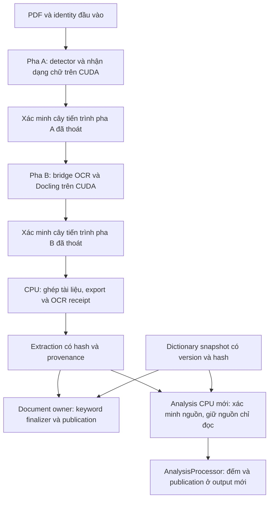
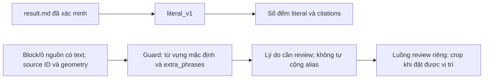

# Kiến trúc đếm từ khóa hai tầng và quy trình tự động hóa

Ngày tạo và hiệu chỉnh: 06/11/2026, Asia/Bangkok.

Phạm vi: đếm từ khóa trên extraction đã xác minh, giám sát dấu tiếng Việt, truy vết và đề xuất lưu quyết định review. **V2 là phiên bản tài liệu; version, revision và hash của bộ từ khóa được quản lý riêng.** Tài liệu phân biệt chức năng hiện có với phần thiết kế chưa triển khai.

Quyết định vận hành chuẩn theo [AGENTS.md](../AGENTS.md), [ARCHITECTURE.md](../ARCHITECTURE.md) và [README](../README.md). Hợp đồng Alias Map dưới đây là đề xuất để triển khai và kiểm chứng, chưa thay đổi policy sản phẩm. Khi chấp nhận thay đổi hợp đồng sản phẩm, phải cập nhật quyết định tương ứng trong ARCHITECTURE.

## 1. Tách extraction và phân tích từ khóa

OCR mới dùng GPU để nhận dạng đủ mọi trang. Khi chỉ thay danh sách từ khóa, có thể tạo analysis mới trên CPU từ extraction có receipt, hash và provenance hợp lệ; không cần huấn luyện lại model hoặc nhận dạng lại ảnh cho thao tác này. Nếu extraction thiếu, bị thay đổi hoặc không có bằng chứng nguồn hợp lệ, analysis phải báo lỗi. Thay dictionary không khôi phục được chữ OCR đã bỏ sót hoặc đọc sai.



Một pipeline sản phẩm gọi `ocr_pipeline.cli.main`, dùng [config/profiles.yaml](../config/profiles.yaml), profile `unified_gpu_full_ocr`. Launcher `run_batch.py` gọi cùng điểm vào này. File cấu hình theo phiên bản là alias, không tạo backend khác. OCR mới thiếu CUDA phải báo lỗi; không chọn native-first hoặc CPU OCR bằng CLI.

Supervisor/app dùng `.venv/Scripts/python.exe` với Python 3.11. Hai worker dùng runtime và lock riêng trong `.venv-v62/text` và `.venv-v62/docling`. Worker không import keyword hoặc reporting; đếm, Excel, SQLite và analysis thuộc CPU/document owner.

`batch_state.sqlite` là ledger trạng thái và publication, có thể thay đổi khi batch chạy hoặc phục hồi. Dữ liệu extraction đã công bố được bảo vệ bằng inventory, receipt và hash; không xem toàn bộ thư mục output, kể cả ledger, là một khối bất biến tự chứng thực.

## 2. Hai tầng keyword: hiện trạng và giới hạn

### 2.1. Tầng đếm hiện có: `literal_v1`

[KeywordCounter](../src/ocr_keywords/counter.py) chuẩn hóa văn bản và từ khóa bằng Unicode NFC rồi `casefold()`, escape từng cụm bằng `re.escape()` và dùng `re.finditer()` để đếm chuỗi con không chồng lấn trong từng từ khóa. Mỗi cụm duy nhất được đếm độc lập; các mục trùng sau chuẩn hóa dùng chung số đếm canonical, còn thứ tự và vị trí hiển thị được lưu trong snapshot.

Nguồn đếm là **toàn bộ `result.md`**, bao gồm markup và đường dẫn ảnh. Policy này không bỏ dấu, fuzzy match, gộp khoảng trắng, tự nối dòng hoặc đồng nhất cách đặt dấu như `hóa` và `hoá`. Ví dụ:

- `aaaa` có hai match không chồng lấn của `aa`.
- `đối mới` không được đếm thành `đổi mới`.
- `trí` và `tuệ nhân tạo` bị ngắt bằng xuống dòng không khớp nguyên cụm `trí tuệ nhân tạo`.
- Từ khóa xuất hiện trong alt text và đường dẫn ảnh Markdown có thể được đếm ở cả hai vị trí; số đếm đó chưa chứng minh có hai vị trí chữ tương ứng trên ảnh PDF.

Giữ các semantics này khi bảo trì `literal_v1`. Nếu cần đếm riêng nội dung nhìn thấy, alias hoặc cụm qua ngắt dòng, phải thiết kế policy/version riêng và kiểm fixture tương thích. So sánh baseline chỉ có ý nghĩa khi giữ đúng byte nguồn, dictionary snapshot, policy và code nhận dạng lượt chạy. Tính tất định không chứng minh OCR chính xác hoặc bảo đảm pháp lý cho báo cáo.

### 2.2. Tầng cảnh báo hiện có: diacritic guard và review

[diacritic_suspicions()](../src/ocr_text/vietnamese_diacritics.py) trả danh sách lý do nghi vấn, dùng `_PHRASES` mặc định và có thể nhận `extra_phrases` từ caller. `diacritic_suspicion_occurrences()` trả thêm span NFC; các hàm không tự nạp `config/keywords.txt` hoặc xuất bbox/crop. CPU review truyền danh sách keyword đã khóa vào guard; worker extraction vẫn giữ import boundary riêng.



Ví dụ `đối mới` có thể được gợi ý đối chiếu với `đổi mới`. Tuy nhiên, “Treo hai câu đối mới.” và “Đội mới vừa thành lập.” có thể là câu đúng nhưng vẫn cùng khung bỏ dấu. Cảnh báo là ứng viên cần xem nguồn, không phải kết luận OCR sai. Từ khóa mới ngoài `_PHRASES`, chẳng hạn `chuyển đổi xanh`, được review CPU xét khi caller truyền dictionary; chỉ sửa file trên đĩa không thay vocabulary của worker đang chạy.

Guard được dùng trong một số bước kiểm chất lượng/nhận dạng và trong [review_packet](../src/ocr_pipeline/review_packet.py). Retry bằng model trong extraction là luồng riêng có provenance và numeric guard. [AnalysisProcessor](../src/ocr_pipeline/analysis_run.py) đếm literal/citations và tạo companion ứng viên diacritic đa từ theo dictionary mới bằng `find_alias_candidates()`. Candidate span trên Markdown chưa phải bbox vật lý; việc ánh xạ từng match tới crop vẫn có các giới hạn ở mục 2.3.

### 2.3. Mức truy vết đang có và mức cần bổ sung

[KeywordCitation](../src/ocr_contracts/keyword.py) hiện lưu keyword, trang hoặc tập trang, trạng thái định vị trang, offset và ngữ cảnh trích dẫn. [build_citations()](../src/ocr_keywords/citations.py) bảo toàn các match literal; có thể trả `UNRESOLVED_PAGE` hoặc tập trang của bảng logic. Citation hiện chưa có hợp đồng bbox/crop cho từng match.

Luồng `--review-from` lấy nguồn đã kiểm, xuất hàng đợi và gói crop có giới hạn. Vùng không đặt được ảnh giữ `UNAVAILABLE` kèm lý do. Review packet không bảo đảm có crop cho mọi match trong ma trận keyword.

Thiết kế mở rộng phải ánh xạ occurrence tới PDF hash, trang vật lý, source ID/locator, `text_raw`, bbox, đơn vị và hệ tọa độ, phép biến đổi, nguồn geometry và hash ảnh crop. Offset phải ghi rõ thuộc raw, NFC hay NFC+casefold và có ánh xạ ngược khi chuẩn hóa làm đổi độ dài. Thiếu vị trí giữ trạng thái chưa xác định; không tạo bbox suy đoán hoặc thay bằng tọa độ 0.

## 3. Alias Map và lưu quyết định review — triển khai module ocr_keywords.alias_map

Đã triển khai module [`src/ocr_keywords/alias_map.py`](../src/ocr_keywords/alias_map.py) và tích hợp companion artifact `keyword_two_tier.json` trong `AnalysisProcessor` ([src/ocr_pipeline/analysis_run.py](../src/ocr_pipeline/analysis_run.py)), cùng cờ `--alias-decisions` trong CLI `run_batch.py` và `scripts/run_count_only.py`.

### 3.1. Tách số đếm literal khỏi quyết định nghiệp vụ

Hợp đồng phân định ba đại lượng riêng:

- `literal_count`: số đếm theo `literal_v1`, giữ nguyên nguồn, không chồng lấn và semantics hiện có.
- `alias_candidate_count`: số ứng viên do phonetic folding tìm thấy; chưa được coi là occurrence đã xác nhận.
- `reviewed_alias_count`: số occurrence có quyết định xác nhận gắn với bằng chứng cụ thể và còn hiệu lực.

Hợp đồng hai tầng được lưu riêng tại artifact `keyword_two_tier.json` (schema `keyword-two-tier-v2`). `keyword_counts.json`, `keyword_receipt.json` và workbook `count_keywords.xlsx` tiếp tục giữ nguyên 100% hợp đồng `literal_v1` nguyên bản. Khi chưa chạy review (`decisions is None`), `tier2_review_status` giữ `NOT_EVALUATED` và `tier2_reviewed_counts` là `null`; tuyệt đối không ghi 0 để biểu thị “không có lỗi” (tuân thủ nguyên tắc bảo toàn dữ liệu trong AGENTS.md).

Không cộng trùng cùng keyword và cùng occurrence khi có nhiều rule khớp hoặc vị trí đã có trong `literal_count`. Khác keyword vẫn tuân theo semantics độc lập của policy tương ứng. Không dùng alias để sửa số, mã, đơn vị hoặc `text_raw`; kiểm tài chính tiếp tục chỉ cảnh báo.

Mỗi keyword/occurrence được đếm tối đa một lần. Sự kiện mới nhất theo timestamp có timezone quyết định ACCEPTED/REJECTED/REVOKED; thứ tự trong bundle không quyết định kết quả. Trùng decision ID khác nội dung hoặc trạng thái đối nghịch cùng thời điểm bị từ chối. Companion được đọc kiểm lại từ nguồn và snapshot quyết định trước SQLite prepare và khi resume; literal JSON/Excel không cộng số alias.

### 3.2. Phạm vi và identity của quyết định

Mỗi quyết định review (`AliasDecision`, schema `alias-decision-v2`) có phạm vi **một occurrence**: `document_id`, `pdf_sha256`, `result_md_sha256`, `dictionary_snapshot_hash`, `counting_policy`, `offset_space="nfc"`, `keyword_id`, `keyword`, `match_start`, `match_end`, `observed_text`, `status` ("ACCEPTED", "REJECTED", "REVOKED"), `reviewer`, `decided_at_utc`, `reason`. Các hash PDF/Markdown/dictionary và người duyệt là bắt buộc; engine chỉ áp dụng quyết định đúng document ID, hash nguồn, snapshot, policy, observed text và span ứng viên. Xác nhận `đối mới` là lỗi OCR ở một vị trí cụ thể không tự động biến mọi `đối mới` ở tài liệu khác thành `đổi mới`.

Quyết định review được lưu nguyên tử trong bundle v2 (`save_alias_decisions`, `load_alias_decisions`) với checksum SHA-256 để kiểm tính nhất quán; checksum tự khai không chứng thực người duyệt. Analysis đóng băng toàn bộ quyết định và hash byte file trong `batch_config.json.alias_decisions`, gắn vào identity và companion. Đổi bundle phải dùng output mới; mất/đổi file giữa lượt chặn publication. File thiếu báo lỗi, không biến thành review rỗng. Bundle v1 thiếu identity không tự nâng cấp hoặc gắn thêm hash: phải đối chiếu lại nguồn và xuất v2, giữ nguyên publication cũ.

```mermaid
sequenceDiagram
    actor Operator as Người review
    participant Engine as Analysis và review (alias_map.py)
    participant Store as Bundle quyết định (alias-decisions-bundle-v2)
    Engine->>Engine: Giữ literal_count; trích xuất AliasCandidate có char span
    Engine->>Operator: Hiển thị raw, nguồn, vị trí và crop/trạng thái thiếu
    Operator->>Engine: Chấp nhận hoặc từ chối occurrence cụ thể
    Engine->>Store: Lưu quyết định kèm checksum và identity nguồn
    Engine->>Engine: Đối soát tầng 2 (keyword_two_tier.json); giữ nguyên literal_v1
    Note over Engine,Store: Nguồn khác hoặc identity đổi phải đánh giá lại phạm vi
```

## 4. Thêm hoặc đổi từ khóa trên extraction đã xác minh

### 4.1. Nhận dạng đúng dictionary

Tại mốc đối chiếu 06/11/2026, [dictionary_snapshot()](../src/ocr_keywords/contract.py) dùng mặc định `v1`. [config/keywords.txt](../config/keywords.txt) là danh sách đã chốt 86 dòng/86 cụm duy nhất; revision được nhận dạng bằng nội dung/hash và metadata tương ứng. Bản lịch sử 88 dòng/87 cụm được giữ tại [keywords-v1-original.txt](../config/keywords-v1-original.txt). Nhãn `v1` đơn lẻ không đủ phân biệt hai danh sách; cần snapshot hash, revision nếu có và source hash.

Khi dùng danh sách mới, tạo file riêng và truyền version riêng như `custom-20261106`. Không thêm dòng vào bộ mặc định đã khóa rồi tiếp tục dùng identity cũ. Điều kiện phiên bản được kiểm trong `dictionary_snapshot()`; dictionary tùy chỉnh thiếu version riêng có thể bị từ chối.

Ví dụ tạo `config/my_new_keywords.txt`, UTF-8, mỗi dòng một cụm:

```text
Chuyển đổi số
Đổi mới
Trí tuệ nhân tạo
Chuyển đổi xanh
Bán dẫn
ESG
```

### 4.2. Tạo analysis CPU mới

Chạy từ gốc repository bằng Python supervisor. Các thư mục output bên dưới là tên cho lượt mới, phải tách khỏi nguồn; chọn tên khác nếu đã có lượt dùng tên đó. File `config/my_new_keywords.txt` cần được tạo trước theo ví dụ trên.

```powershell
.venv/Scripts/python.exe run_batch.py --analysis-from output/run_full_moi --keywords-file config/my_new_keywords.txt --keyword-set-version custom-20261106 --output output/analysis_new_keywords_20261106
```

Launcher tương thích cho cùng trường hợp:

```powershell
.venv/Scripts/python.exe scripts/run_count_only.py output/run_full_moi --keywords-file config/my_new_keywords.txt --keyword-set-version custom-20261106 --output output/analysis_new_keywords_alt_20261106
```

Đây là hai cách gọi thay thế; một yêu cầu analysis chỉ cần dùng một cách. Luồng xác minh nguồn chỉ đọc, tạo snapshot dictionary, sao chép byte `result.md` vào output mới, đếm hoặc tái dùng report hợp lệ rồi thực hiện publication. Analysis nối tiếp vẫn kiểm lại extraction gốc qua `source.json`; phải giữ nguồn gốc để kiểm chứng về sau.

Nguồn thiếu hoặc bị hỏng giữ hàng `FAILED_DOCUMENT`, counts `null` và ô đếm trống. Số 0 chỉ có nghĩa keyword không xuất hiện trong tài liệu đã đếm thành công. Thêm keyword không tự mở rộng `_PHRASES` hay tạo Alias Map.

`--recount` tại chỗ phục vụ dictionary đã khóa của batch; không dùng để đổi từ khóa. Resume phải khớp identity đã khóa. Đổi dictionary/code/config/rule không được sửa batch cũ để ép resume; dùng output mới theo hợp đồng tương ứng.

## 5. Vận hành OCR, publication và audit

### 5.1. PDF mới

```powershell
.venv/Scripts/python.exe run_batch.py --profile unified_gpu_full_ocr --input inputs --output output/run_full_moi
```

CLI quét PDF ở cấp thư mục đầu vào theo [README](../README.md). OCR mới dùng CUDA và đủ trang, giữ raw/source ID/bbox/numeric guard/placement/provenance. Fallback Docling giữ chữ pha A và yêu cầu review; không gắn nhãn model cho bảng heuristic.

Sau khi hai pha worker đã thoát cây tiến trình: ghép/export → OCR receipt → một keyword finalizer thuộc document owner → xuất và đọc kiểm Excel riêng → SQLite prepare → ghi nguyên tử và đọc kiểm ma trận → acknowledge revision → PDF tiếp theo. Luồng analysis dùng cùng các gate publication phù hợp với loại nguồn, không chạy worker OCR. Lỗi identity/publication chặn batch; không công bố số đếm cũ cho tài liệu lỗi.

### 5.2. Đầu ra cần giữ

Ở cấp batch có `batch_input_manifest.json`, `batch_config.json`, `keyword_dictionary.snapshot.json`, `batch_state.sqlite`, `batch_report.json` và `MA_TRAN_DEM_TU_KHOA_<N>_FILES.xlsx`. Không dùng tên `keyword_counts_matrix.xlsx` để tìm ma trận của pipeline hiện tại.

Tài liệu extraction có `result.md`, các JSON/page artifacts giữ chữ và geometry, `manifest.json`, `ocr_receipt.json` và các nhóm artifact đã công bố. Tài liệu analysis mới có bản sao `result.md`, `source.json`, nhóm keyword và completion; không mặc định sao chép toàn bộ extraction sang analysis.

Nhóm keyword gồm `keyword_counts.json`, `keyword_receipt.json`, `keyword_validation.json` và `count_keywords.xlsx`; completion ở `COMPLETED.json`. Workbook từng tài liệu hiện xuất hai sheet `Tong_hop` và `Trich_dan_chi_tiet`; ma trận batch là đầu ra riêng. Tên sheet/schema, citations và cách đọc kiểm theo [ocr_reporting](../src/ocr_reporting/README.md), không tự đếm lại trong exporter.

`result.txt` là phép chiếu từ Markdown cuối để đọc/xuất văn bản, không phải nguồn đếm thay thế của `literal_v1`. Giữ snapshot, receipt và extraction nguồn nếu còn cần truy vết; chỉ giữ Excel không đủ để xác minh nguồn analysis.

### 5.3. Audit extraction và kiểm analysis

Lệnh sau audit **batch extraction gốc**, ghi report bên ngoài batch:

```powershell
.venv/Scripts/python.exe scripts/audit_batch_outputs.py --output output/run_full_moi --report scratch/audit_extraction_20261106.json --validate
```

[audit_batch_outputs.py](../scripts/audit_batch_outputs.py) hiện yêu cầu `manifest.json` và bằng chứng GPU tại thư mục tài liệu được audit. Không dùng lệnh này trỏ thẳng vào output analysis như một phép nghiệm thu analysis: analysis dùng `source.json` để tham chiếu extraction gốc. Script có thể ghi `audit_error` rồi vẫn trả exit 0; cần đọc từng record và trạng thái kiểm, không suy PASS chỉ từ exit code.

Analysis thực hiện xác minh nguồn, keyword report, Excel, ledger và ma trận trong luồng publication. Khi nghiệm thu bổ sung cần đối chiếu `source.json` với nguồn gốc, hash `result.md`, dictionary/policy, report/receipt, workbook và revision đã acknowledge bằng validator đúng loại artifact. Chưa có một lệnh audit analysis riêng được đặc tả là hoàn chỉnh trong tài liệu này. PASS artifact hoặc `SUCCEEDED` chỉ xác nhận phần hợp đồng đã kiểm, không chứng minh accuracy.

### 5.4. Gói review bằng CPU

```powershell
.venv/Scripts/python.exe run_batch.py --review-from output/run_full_moi --keywords-file config/my_new_keywords.txt --keyword-set-version custom-20261106 --output output/review_keywords_20261106 --review-limit 100 --review-offset 0
```

Gói hiện có `review.md`, `queue.jsonl`, `review.json`, `packet.json`, ảnh khi đặt được vị trí và phiếu annotation. Tăng offset và dùng output mới để lấy gói kế tiếp. Annotation vận hành chưa được production tự nhập thành Alias Map. Gói có prediction phục vụ review; không coi nó là GT độc lập hoặc là bằng chứng mọi keyword đã có crop.

## 6. Thuật toán và nguồn mã

### 6.1. Chuẩn hóa và so khớp

Unicode NFC làm các biểu diễn tổ hợp/dựng sẵn tương đương chuẩn tắc khớp nhau; `casefold()` hỗ trợ so không phân biệt hoa thường. Đây là semantics của [counter.py](../src/ocr_keywords/counter.py), dựa trên [Unicode UAX #15](https://www.unicode.org/reports/tr15/) và API Python. Khi tái lập phép đo cần lưu phiên bản Python và Unicode database của runtime.

API [re.finditer()](https://docs.python.org/3.11/library/re.html#re.finditer) trả match không chồng lấn. Counter quét từng cụm độc lập trên chuỗi đã chuẩn hóa. Chi phí phụ thuộc kích thước văn bản, số/độ dài từ khóa và số match; xác minh hash, dựng citations, đọc JSON, ghi/đọc lại XLSX và SQLite cũng có chi phí. Không suy thời gian toàn pipeline từ một phép quét regex.

Không gán tên Boyer–Moore–Horspool cho cơ chế hiện tại: tối ưu prefix của [CPython 3.11](https://github.com/python/cpython/blob/3.11/Modules/_sre/sre_lib.h) dùng bảng overlap và là chi tiết triển khai. Aho–Corasick là hướng đa mẫu để tham khảo khi cần tối ưu, chưa được triển khai trong counter. Mọi thay thế thuật toán cần giữ hoặc version hóa semantics substring, non-overlap theo từng keyword, Unicode và mapping canonical/display, rồi đo trên input đã nhận dạng.

### 6.2. Bỏ dấu và kiểm âm tiết

`_fold()` casefold, phân rã NFD, bỏ ký tự có `unicodedata.combining(c)` khác 0 rồi chuyển `đ` thành `d`. Điều kiện khung bỏ dấu giống nhau nhưng chuỗi có dấu khác nhau sinh nghi vấn. Đây là phép chiếu tạo ứng viên, không phải khoảng cách Levenshtein và không xác định duy nhất nghĩa hay chữ in trên ảnh.

Kiểm chồng dấu đếm các dấu thanh trong NFD, sau đó dùng `_SYLLABLE.fullmatch(_fold(word))` và các điều kiện giới hạn khác. Nó không phải bộ kiểm chính tả đầy đủ. Chi phí chuẩn hóa/so sánh phụ thuộc độ dài chuỗi; không mô tả là O(1) cho chuỗi dài tùy ý. Dương tính giả và bỏ sót vẫn có thể xảy ra.

Các module [column_continuity](../src/ocr_document/column_continuity.py) và [region_tree](../src/ocr_document/region_tree.py) xử lý bố cục/luồng đọc ở upstream export theo điều kiện riêng. Counter không tự nối cụm qua cột hoặc dòng; chỉ đếm chuỗi nội dung sau bước chuẩn hóa của policy. Không suy mọi cụm bị ngắt đã được khôi phục từ việc có các module này.

## 7. Điều kiện kiểm chứng và nghiệm thu

### 7.1. Hợp đồng phần mềm

Kiểm các ca NFC/NFD, hoa thường, ký tự regex, keyword lặp, chuỗi con, non-overlap, markup/đường dẫn, ngắt dòng, thiếu nguồn và citations chưa định vị. Analysis phải giữ nguồn chỉ đọc, không gọi OCR, từ chối receipt/hash sai và không tái dùng report khi identity không khớp.

Khi triển khai Alias Map/guard mở rộng, bổ sung ca cụm đúng cùng khung bỏ dấu, keyword ngoài từ vựng guard, rule xung đột, scope khác tài liệu, thu hồi quyết định, thiếu ảnh/placement, offset đổi khi casefold, chống đếm trùng và giữ nguyên raw/số/mã. Kiểm workbook riêng và ma trận đọc lại khớp report, failed/pending để trống, revision chỉ được acknowledge sau gate publication.

Các ca này kiểm tính đúng của hợp đồng phần mềm, không tự chứng minh precision/recall trên PDF thật. Test double không phải bằng chứng inference GPU hoặc GT nhận dạng.

### 7.2. Chất lượng và hiệu năng

Chất lượng nhận dạng, keyword và hiệu quả guard/alias giữ **`NOT_EVALUATED`** khi chưa có GT độc lập cùng input/config/code/model/runtime và giao thức đo có thể kiểm lại. Không suy OCR accuracy từ confidence, PASS artifact, `SUCCEEDED` hoặc số test đạt. Cờ nghi vấn không phải lỗi đã được xác nhận.

Thời gian analysis toàn lượt và peak RAM giữ **`NOT_MEASURED`** khi chưa đo. Tài liệu không cam kết 2–10 giây, RAM dưới 500 MB hay thời gian cố định cho 938/1.000 trang. Khi đo phải ghi manifest/hash nguồn, số tài liệu/trang, dung lượng Markdown/JSON, số từ khóa, dictionary/policy, code/runtime, cấu hình máy, cache, thời gian kiểm nguồn/đếm/citations/publication và peak RAM. Phân biệt chỉ đo kernel đếm với đo analysis hoàn chỉnh.

Lỗi dấu có thể đến từ ảnh, mô hình, văn bản in, font map hoặc xử lý upstream. Cần đối chiếu nguồn để kết luận nguyên nhân. Thiết kế hai tầng hỗ trợ phát hiện và review, không bảo đảm xử lý triệt để mọi lỗi.

## 8. Thành phần và tài liệu tham khảo

### 8.1. Thành phần theo runtime và artifact

- `unicodedata`, `re`, `sqlite3`: API thư viện chuẩn Python. CPython dùng PSF License; SQLite có nguồn public domain. Keyword engine dùng chuẩn hóa và literal matching, không gọi LLM để suy nghĩa hoặc viết lại nội dung.
- Detector hiện hành theo [runtime-models.json](../models/v62/runtime-models.json): adapter `onnx-db-map-v1`, artifact `ch_PP-OCRv4_det_infer.onnx`; layout theo artifact Docling được ghim trong registry. Quyền sử dụng weights phải đối chiếu đúng model revision và tài liệu giấy phép nguồn; chưa có bằng chứng thì chưa kết luận.
- VietOCR `0.3.13`: nhận dạng dòng chữ, profile hiện dùng `vgg_seq2seq`. File LICENSE trong package đang cài và [LICENSE upstream](https://github.com/pbcquoc/vietocr/blob/master/LICENSE) ghi Apache-2.0. Không kết luận MIT chỉ từ classifier metadata; lưu giấy phép cùng artifact/version được dùng.
- Docling: runtime riêng dùng các package được khóa, gồm `docling-slim`, phục vụ cấu trúc/bảng/công thức theo profile. [Docling Technical Report](https://arxiv.org/abs/2408.09869) mô tả dự án mã nguồn mở MIT; model weights/dependency cần theo artifact tương ứng.
- PyMuPDF: đọc/render PDF, font/glyph và geometry; theo [giấy phép của dự án](https://pymupdf.readthedocs.io/en/latest/about.html#license-and-copyright), có lựa chọn AGPL hoặc commercial. Native text không trở thành nguồn đếm thay OCR của profile chuẩn.
- openpyxl: xuất và đọc kiểm workbook. Dependency chính xác theo [requirements/v62](../requirements/v62), `pyproject.toml` và môi trường supervisor.

### 8.2. Nguồn kỹ thuật

1. Unicode Consortium, [Unicode Standard Annex #15: Unicode Normalization Forms](https://www.unicode.org/reports/tr15/). Nguồn về NFC/NFD; phiên bản dữ liệu thực dùng do runtime quyết định.
2. Python Software Foundation, [Python 3.11: re](https://docs.python.org/3.11/library/re.html) và [CPython 3.11 `_sre`](https://github.com/python/cpython/blob/3.11/Modules/_sre/sre_lib.h). Nguồn về API matching và chi tiết prefix của phiên bản này.
3. Aho, A. V., và Corasick, M. J. (1975), *Efficient string matching: an aid to bibliographic search*, Communications of the ACM 18(6), 333–340, [DOI](https://doi.org/10.1145/360825.360855). Tham khảo hướng đa mẫu, không là bằng chứng đã triển khai hoặc đạt thời gian cụ thể trong dự án.
4. Auer, C., et al. (2024), *Docling Technical Report*, [arXiv:2408.09869v5](https://arxiv.org/abs/2408.09869v5). Tham chiếu metadata chính thức thay cho danh sách tác giả chưa kiểm.
5. pbcquoc, [VietOCR repository](https://github.com/pbcquoc/vietocr) và [LICENSE](https://github.com/pbcquoc/vietocr/blob/master/LICENSE). Đối chiếu package/model thực dùng trước khi kết luận về toàn bộ bản phân phối.

Các nguồn trên hỗ trợ mô tả kỹ thuật và provenance thư viện. Nghiệm thu dự án vẫn cần bằng chứng đúng input, code, config, model, runtime và giao thức; trích dẫn tài liệu không thay thế kết quả kiểm chứng.
