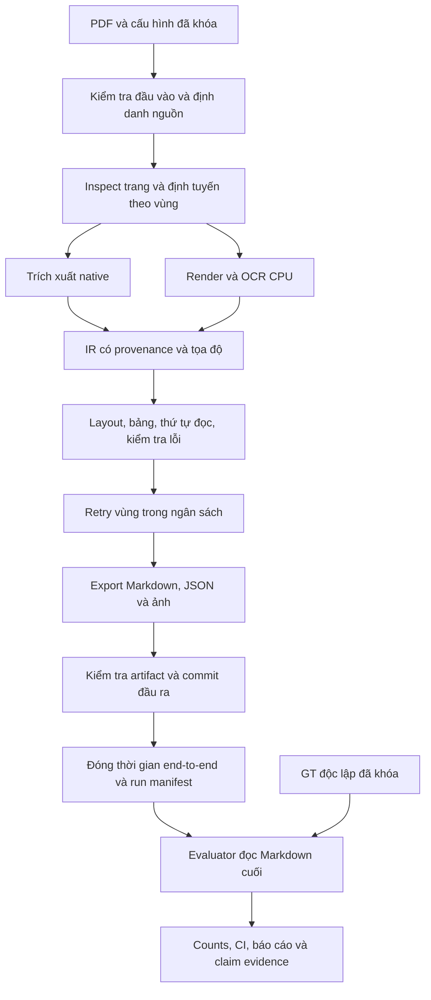

# Báo cáo đặc tả và thiết kế dự án OCR pdf V5

**Phiên bản báo cáo:** 1.0 — **Ngày:** 11/10/2026  
**Đề tài:** trích xuất PDF đa dạng sang Markdown với đánh giá độ chính xác có ground truth độc lập và hiệu năng CPU.  
**Đối tượng sử dụng:** người nghiên cứu, người hướng dẫn và Antigravity triển khai dự án.  
**Thành phần hợp nhất:** đặc tả phiên bản 1.0 ngày 10/10/2026 và thiết kế chi tiết phiên bản 1.0 ngày 11/10/2026.

Báo cáo này xác định sản phẩm cần đáp ứng yêu cầu gì và thiết kế hệ thống thực hiện các yêu cầu đó như thế nào. Phần I giữ nội dung đặc tả, phần II bổ sung thiết kế triển khai, phần III nối yêu cầu với thiết kế và hồ sơ kiểm chứng. Mục lục Word liên kết đến các phần và chương, có số trang được cập nhật khi xuất.

Đây là hồ sơ yêu cầu và thiết kế, chưa phải biên bản nghiệm thu hoặc báo cáo kết quả thực nghiệm. Các quan sát mã nguồn trong phần đặc tả giữ mốc 10/10/2026; thiết kế mục tiêu ngày 11/10/2026 có các interface và contract đề xuất chưa được coi là đã triển khai. Báo cáo không thêm số accuracy, tốc độ hay tuyên bố đã đạt chất lượng nghiên cứu.

Giữ nguyên ba trần thời gian CPU đã xác nhận: native ≤ 0,15; mixed ≤ 1,8; scan ≤ 2,5 giây/trang. Accuracy target tuyệt đối chưa được chốt được ghi NOT_SPECIFIED. Anti cần nộp bằng chứng theo yêu cầu, không thay mục tiêu để phù hợp kết quả.

[[TOC]]

## Phần I Đặc tả dự án

Quy ước PHẢI/NÊN/CÓ THỂ của đặc tả được giữ nguyên. Nhãn OBSERVED_IN_CODE chỉ xác nhận quan sát module, không chứng minh yêu cầu đã được nghiệm thu. Các thông tin hiện trạng bên dưới là đối chiếu lịch sử tại ngày 10/10/2026.

### 1. Mục đích, cách sử dụng và căn cứ

Tài liệu quy định sản phẩm cần tạo, phương pháp chứng minh chất lượng và các điều kiện để sử dụng kết quả trong bài nghiên cứu. Anti phải triển khai theo yêu cầu có mã định danh, nộp bằng chứng và để người nghiên cứu đối chiếu. Việc có module, chạy được chương trình hoặc vượt qua unit test không đồng nghĩa với đạt độ chính xác hay tốc độ trên PDF thực tế.

Thứ tự xử lý khi có khác biệt: yêu cầu đã được người dùng xác nhận; đặc tả này về toàn dự án; [RESEARCH_PROTOCOL_V5.md](RESEARCH_PROTOCOL_V5.md) về công thức và quy trình đánh giá; [ANTIGRAVITY_ACCURACY_IMPLEMENTATION.md](ANTIGRAVITY_ACCURACY_IMPLEMENTATION.md) về ca A01–A20 và triển khai evaluator. Không thay công thức hoặc mục tiêu để khớp kết quả. Thay đổi phương pháp phải có phiên bản mới, lý do và phạm vi kết quả cần chạy lại.

Các vấn đề kỹ thuật ban đầu được ghi trong [PROPOSAL_FIX_ACCURACY_RELIABILITY_PERFORMANCE.md](PROPOSAL_FIX_ACCURACY_RELIABILITY_PERFORMANCE.md). Đây là lịch sử phát hiện lỗi, không mặc định là danh sách lỗi còn tồn tại. Danh mục nguồn và BibTeX ở [ACCURACY_SOURCES.md](references/ACCURACY_SOURCES.md) và [accuracy_metrics.bib](references/accuracy_metrics.bib).

Tệp đi kèm:

- [PROJECT_REQUIREMENTS_TRACEABILITY.csv](PROJECT_REQUIREMENTS_TRACEABILITY.csv): nối yêu cầu với module, cách kiểm chứng và bằng chứng phải nộp.
- [research_acceptance.template.json](specifications/research_acceptance.template.json): mẫu cấu hình điều kiện nghiệm thu; chưa được CLI hiện tại tự động đọc, không chứa kết quả đo.

Quy ước: **PHẢI** là điều kiện bắt buộc trong phạm vi nghiệm thu; **NÊN** là lựa chọn được ưu tiên; **CÓ THỂ** là mở rộng. `OBSERVED_IN_CODE` chỉ có nghĩa đã thấy thành phần trong mã; `NOT_ACCEPTED` là chưa có hồ sơ đủ để nghiệm thu yêu cầu. Không dùng hai trạng thái này như điểm chất lượng.

### 2. Hiện trạng được đối chiếu và giới hạn của đối chiếu

Đối chiếu mã ngày 10/10/2026, không chạy lại toàn pipeline hay benchmark khi soạn tài liệu. Working tree có thay đổi chưa commit; chỉ HEAD Git không đại diện toàn bộ mã đang chạy. Mọi run sau này phải lưu hash cây nguồn thực tế.

| Thành phần | Quan sát trong mã hiện tại | Điều kiện chưa được suy ra từ quan sát |
|---|---|---|
| Phiên bản | `manifest_exporter.py` khai báo `5.0.0`; README còn tiêu đề V4.3 | Không xác nhận bản nâng cấp đã đạt nghiên cứu |
| Điều phối | `ConvertDocumentUseCase`, `ProcessPageUseCase`, routing native/OCR, profile fast/balanced/accuracy | Routing đúng và ổn định trên corpus đa dạng phải đo |
| OCR/layout | RapidOCR, VietOCR, lớp `HeuristicLayoutClassifier`, đường khởi tạo ONNX tùy model | Không gọi heuristic là model đã được huấn luyện; phải chứng minh model/provider thực tế |
| Xuất dữ liệu | `result.md`, JSON, ảnh, manifest, validation; có per-page artifacts | Đầu ra đầy đủ và đúng nội dung cần GT và kiểm tra end-to-end |
| Cache | Khóa hiện dựa trên hash PDF rút gọn, trang, profile và DPI | Chưa đáp ứng tự động khóa đầy đủ code/config/model theo đặc tả |
| Thời gian | Điều phối có tổng thời gian được tính trước bước export; manifest có làm tròn | Không lấy riêng số này làm thời gian end-to-end đạt ngưỡng |
| Accuracy | Có domain accuracy model và scientific evaluator/test files | Default CER=0 hoặc accuracy=1 trong model không được xem là kết quả khi chưa đo |
| Hồ sơ nghiên cứu | Có dataset manifest, claim registry và báo cáo triển khai | Nhãn `MEASURED`/`VERIFIED` phải có raw artifacts, hash thật, lệnh chạy và GT tương ứng |

Ví dụ cần kiểm toán: `claim_evidence.csv` đang có giá trị như `synthetic_gt_hash`, `pred_hash`, `git_head_v5`; đây không phải hash kiểm tra được. Báo cáo triển khai có chỗ gọi DER_VN_v1 là chuẩn ICDAR trong khi protocol định nghĩa đây là metric riêng của dự án. Phải làm rõ trước khi dùng trong bản thảo; tài liệu này không tiếp nhận các tuyên bố đó như bằng chứng.

### 3. Bài toán và phạm vi

#### 3.1. Đầu vào và đầu ra

Đầu vào chính là PDF tiếng Việt, có thể chứa tiếng Anh, ký hiệu, số và bảng. Đơn vị nguồn là tài liệu PDF; đơn vị xử lý là trang vật lý; đơn vị nội dung là block/region/cell. Người dùng có thể chọn trang, profile, thư mục đầu ra và xử lý nhiều tệp.

Đầu ra chính là **Markdown cuối cùng** có thứ tự đọc, đề mục, đoạn, danh sách, bảng và liên kết ảnh. JSON lưu cấu trúc cùng nguồn gốc; báo cáo chất lượng hỗ trợ kiểm tra; báo cáo khoa học lưu phép đo có GT. Markdown phải truy ngược được đến PDF/trang/vùng, và evaluator phải chấm chính Markdown người dùng nhận.

#### 3.2. Ma trận PDF cần nghiên cứu

| Trục | Nhóm cần lấy mẫu | Thách thức cần kiểm chứng |
|---|---|---|
| Cách tạo PDF | Native có lớp chữ tốt; scan; mixed; lớp OCR cũ lỗi font/Unicode | Chọn native/OCR theo vùng, phát hiện lớp chữ hỏng |
| Thể loại | Hành chính; biểu mẫu/hóa đơn; báo cáo; bài báo nhiều cột; sách/tài liệu kỹ thuật | Không giới hạn đề tài ở báo cáo tài chính |
| Bố cục | Một/nhiều cột; landscape; two-up; chữ xen ảnh; bảng nhiều trang | Thứ tự đọc, tọa độ, gộp/tách trang và bảng |
| Chất lượng ảnh | Scan sạch/mờ/nghiêng/xoay; nền nhiễu; độ phân giải khác nhau | OCR tiếng Việt, lỗi dấu, retry và thời gian |
| Thành phần | Chữ, bảng, số, caption, ảnh, công thức, sơ đồ | Nội dung được trích xuất hay chỉ được bảo toàn ảnh phải tách rõ |

Không bắt buộc có mọi tổ hợp trong tích Descartes. Phải công bố nhóm có/không có dữ liệu, số tài liệu/trang và phạm vi kết luận. Nhóm chưa có mẫu là `NOT_EVALUATED`, không được gán điểm mặc định hoặc suy rộng từ nhóm khác.

Chữ viết tay, tài liệu đa ngôn ngữ ngoài vi/en và PDF không mở được là các trường hợp cần ghi nhận giới hạn. Nhận dạng công thức LaTeX và đồ thị ngữ nghĩa chỉ được tuyên bố khi có GT chuyên biệt; trước đó yêu cầu tối thiểu là bảo toàn ảnh nguồn và trạng thái chưa trích xuất ngữ nghĩa.

#### 3.3. Ranh giới sản phẩm

Phiên bản nghiên cứu tập trung chuyển đổi và đánh giá, không tự tóm tắt hay viết lại nội dung PDF. Sửa chính tả suy đoán phải là chế độ riêng có provenance; số liệu chính dùng bản trích xuất đã khóa chính sách. Agent không được tự điền chữ thiếu, dựng quan hệ sơ đồ hoặc thay số bằng giá trị hợp lý rồi coi đó là thông tin nguồn.

### 4. Câu hỏi nghiên cứu và đóng góp cần chứng minh

| Mã | Câu hỏi | Bằng chứng cần thu thập |
|---|---|---|
| RQ1 | Pipeline hybrid bảo toàn nội dung Markdown tốt đến mức nào ở từng nhóm PDF? | CER/WER, dấu, số, bảng, thứ tự và coverage theo nhóm, CI và lỗi điển hình |
| RQ2 | Routing theo trang/vùng có giảm thời gian CPU mà vẫn giữ chất lượng so với V4.3 và OCR toàn trang không? | Runs ghép cặp cùng dữ liệu, accuracy delta và thời gian end-to-end |
| RQ3 | Retry có giới hạn, lọc noise và xử lý header/footer đóng góp gì? | Ablation chạy thật từng thành phần, chất lượng–thời gian–review workload |
| RQ4 | Confidence và cờ review có nhận diện được các lỗi thực tế không? | GT lỗi theo vùng, precision/recall cảnh báo và chi phí kiểm tra |
| RQ5 | Bộ đánh giá có tái lập và tránh báo đạt khi thiếu bằng chứng không? | Parity evaluator độc lập, kiểm thử phản ví dụ, run manifests và tái tạo báo cáo |

Giả thuyết làm việc: hybrid có thể giảm OCR không cần thiết; retry vùng có thể giảm lỗi với chi phí ít hơn retry toàn trang; đánh giá nhiều thành phần có thể phát hiện lỗi mà confidence hoặc CER đơn lẻ bỏ sót. Đây là giả thuyết, không phải kết quả.

Đóng góp dự kiến phải gắn với thiết kế thuật toán, dữ liệu/annotation tiếng Việt hoặc giao thức đánh giá cụ thể. Tích hợp nhiều thư viện và tăng số unit test chưa đủ tự chứng minh tính mới. Bài nghiên cứu phải so với công trình liên quan, mô tả adaptation và báo cả kết quả bất lợi.

### 5. Kiến trúc mục tiêu và phân chia trách nhiệm



| Lớp | Trách nhiệm | Module hiện có liên quan |
|---|---|---|
| Domain | Document/page/block/region/table/quality, trạng thái và hợp đồng tọa độ | `src/ocr/domain/models/`, `domain/routing/` |
| Application | Điều phối, route, xử lý trang, retry và export | `src/ocr/application/` |
| Infrastructure | PDF reader/render, OCR, layout, bảng, cache, export | `src/ocr/infrastructure/` |
| CLI/batch | Kiểm tra tham số, progress, isolation từng run, kết quả toàn batch | `src/ocr/cli/` |
| Research | Adapter GT, matching, metrics, tổng hợp, CI, baseline và provenance | `benchmark/scientific_evaluation/`, `scripts/run_scientific_benchmark.py`, `scripts/run_regression.py` |

Evaluator chạy sau extraction, không cung cấp GT cho routing hoặc sửa prediction. Cấu hình phải được giải quyết thành effective config rồi lưu; fallback do thiếu model phải hiện trong manifest, không âm thầm đổi phương pháp.

#### 5.1. Profile hiện có và chính sách điều chỉnh

Bảng này phản ánh `config/profiles.yaml` tại thời điểm đối chiếu; tên profile hoặc ngưỡng confidence không bảo đảm mức accuracy:

| Profile | Render / engine khai báo | Retry khai báo | Ngưỡng native reliable/review | Timeout |
|---|---|---|---|---:|
| fast | 150 DPI / rapidocr | Fallback tắt | 0,90 / 0,70 | 120 s |
| balanced | 180 DPI / vietocr | `fallback_only_on_review=true`, tối đa ratio 0,15 và 5 vùng; upscale 250 DPI | 0,90 / 0,70 | 120 s |
| accuracy | 180 DPI / vietocr | Fallback, adaptive second pass và regional retry; ratio 0,25 và 30 vùng; upscale 300 DPI | 0,92 / 0,75 | 180 s |

Effective engine phải được đối chiếu với model thật loaded, không chỉ đọc tên trong YAML. Ratio và cap cần có công thức rounding nhất quán, điều kiện ưu tiên và quy tắc dừng khi hết deadline. Không tự tắt kiểm tra số để làm nhanh; không tự tăng retry toàn trang để cải thiện CER mà bỏ mục tiêu CPU. Tune trên dev rồi khóa config trước final test. `requirements.txt` hiện dùng nhiều khoảng phiên bản, chưa thay thế environment lock chính xác của từng run.

#### 5.2. Giao diện xử lý mục tiêu

API điều phối hiện có là `ConvertDocumentUseCase.execute(file_path, profile_name, pages, output_dir, resume, benchmark, accuracy_report, ground_truth_dir)` trả `ExtractedDocument`. Giữ adapter tương thích nếu sửa API; hợp đồng mục tiêu phải thêm khả năng truyền effective config/run context và trả output paths, trạng thái, errors, review count, actual engine/provider cùng provenance. Không chỉ trả object có `quality_score` rồi suy kết quả thành công.

Extraction có thể chạy không GT. Evaluation là thao tác riêng nhận final output manifest và GT manifest; kiểm tra hash/schema/scope trước khi tính metric. Flag `accuracy_report` chỉ được gọi là đánh giá khi có dữ liệu đủ điều kiện; trường hợp thiếu GT phải hiển thị `NO_GROUND_TRUTH`, không in mean accuracy mặc định.

CLI mục tiêu phải phân biệt thành công, invalid input, partial/failure bằng exit code và JSON status có tài liệu; mapping exit code phải được khóa khi triển khai. Progress cho biết trang/nhóm hiện tại và lỗi, không tự hiển thị “độ chính xác 99%” từ confidence. Batch report phải có mọi input, số trang yêu cầu/hoàn tất/lỗi, thời gian, cache regime, trạng thái evaluation và link review.

### 6. Yêu cầu chức năng

Các mã FR là hợp đồng mục tiêu, không phải xác nhận đã triển khai. Cột kiểm chứng là loại bằng chứng bắt buộc; vị trí code và ca kiểm tra chi tiết ở ma trận truy vết.

| Mã | Yêu cầu PHẢI | Kiểm chứng |
|---|---|---|
| FR-01 | Mở đúng PDF chỉ định; kiểm tra định dạng, quyền mở, trang và tham số. Tên trùng ở đường dẫn khác không được âm thầm chọn nhầm tệp | PDF hash/path đúng; lỗi có mã; input xấu không tạo thành công |
| FR-02 | Chọn trang 1-based, loại trùng, giữ thứ tự ổn định. Chuỗi sai, khoảng đảo và trang ngoài tài liệu phải báo lỗi rõ | Ca CLI `1,3-5`, `abc`, `5-2`, trang 0/out-of-range; không âm thầm chạy toàn tài liệu |
| FR-03 | Inspect lớp chữ, ảnh, rotation, kích thước và chất lượng Unicode theo trang; route theo vùng có lý do | Annotated routing subset; confusion matrix và trace quyết định |
| FR-04 | Native extraction giữ Unicode, dấu câu, số và bbox; lớp chữ lỗi không được xem là chắc chắn đúng | PDF native sạch/lỗi font; GT chữ cuối Markdown |
| FR-05 | OCR scan/mixed dùng đúng model/provider được ghi nhận; lưu raw text, confidence và tọa độ | Model hash, provider log, ảnh đầu vào và output trace |
| FR-06 | Transform rotation/crop/two-up ánh xạ về trang vật lý; giữ số trang nguồn, không tính hai nửa thành hai trang PDF | Test khứ hồi tọa độ; GT orientation/reading order |
| FR-07 | Layout phân biệt nhãn đã khóa; nêu rõ heuristic hay model inference, không dựng bbox để điền evaluator | Class mapping version, provenance và layout GT |
| FR-08 | Tái tạo thứ tự đọc nhiều cột, caption, bảng xen đoạn; không loại đoạn chỉ vì trùng tiền tố | GT block/pair order; duplicate/missing/spurious counts |
| FR-09 | Bảng giữ ô trống, hàng/cột, merge và chữ/số. GFM dùng cho bảng đơn; bảng merge dùng HTML hoặc biểu diễn bảo toàn tương đương | Parse Markdown cuối, TEDS-S/TEDS và detection P/R/F1 |
| FR-10 | Bảng tiếp nối nhiều trang chỉ gộp khi có bằng chứng; từng cell giữ nguồn trang/bbox | Fixture bảng tiếp nối và bảng giống nhưng độc lập |
| FR-11 | Số giữ dấu âm, ngoặc, dấu phân cách, số 0 đầu, đơn vị và vị trí cell/block. Xung đột OCR số phải vào review | NumericExact, ca A12/A13 và nhật ký các ứng viên |
| FR-12 | Ảnh/công thức/sơ đồ chưa trích được phải có asset nguồn và trạng thái; bảo toàn ảnh không được gọi là trích xuất ngữ nghĩa đúng | Kiểm tra file/hash/link, GT modality nếu có tuyên bố semantic |
| FR-13 | Noise/hallucination/header/footer chỉ loại bằng rule có dấu vết; nội dung thân bài lặp lại phải được giữ | Tập GT âm/dương, deletion/insertion và rule audit |
| FR-14 | Retry ưu tiên vùng có vấn đề, có ngân sách số vùng/thời gian; lưu bản trước/sau và lý do chọn | Ablation retry, numeric conflict và số OCR calls |
| FR-15 | Review queue bao phủ block/region/page lỗi, low confidence, số bất đồng, bảng/asset chưa giải quyết; mỗi item định vị được nguồn | Đối chiếu predicate bằng ID; queue rỗng khi vẫn có cờ lỗi là thất bại |
| FR-16 | Deadline trang là giới hạn thời gian thực, bao gồm inspect/render/OCR/retry; tiến trình treo phải được dừng hoặc cô lập | Inject worker treo; batch tiếp tục; không chỉ timeout chờ future |
| FR-17 | Cache/resume kiểm tra PDF, trang, effective config, code/model và schema; dữ liệu lỗi hoặc khác phiên bản phải bị vô hiệu | Cache hit/miss có lý do; sửa config/model không dùng cache cũ |
| FR-18 | Export nhất quán Markdown/JSON/assets; có mapping page/block vào byte spans của Markdown cuối | Round-trip parse, coverage, artifact validation |
| FR-19 | Batch ghi kết quả mọi tệp đã yêu cầu, không đè tên trùng và không bỏ tệp thất bại khỏi thống kê | Input ledger đối chiếu output; completion/failure counts |
| FR-20 | Ghi output vào vùng staging riêng, chỉ công bố hoàn tất sau validation; run mới không ghi đè lịch sử nghiên cứu | Inject lỗi export; output cũ nguyên vẹn; manifest PARTIAL/FAILED |
| FR-21 | Quality/confidence là chẩn đoán; accuracy cần GT. Không có GT hoặc mẫu số hợp lệ phải trả null cùng trạng thái | Không có default perfect score; test thiếu/empty GT |
| FR-22 | Evaluator đọc `result.md` có hash; không thay bằng per-page Markdown khi thiếu marker/mapping | Xóa/đổi Markdown cuối: metric đổi hoặc ALIGNMENT_FAILED |
| FR-23 | Mỗi run đóng dấu code/data/model/config/evaluator/output và môi trường thực tế; kiểm tra snapshot trước/sau | Run manifest và hash verification độc lập |
| FR-24 | JSON/CSV/Markdown/LaTeX biểu diễn đúng null, đơn vị, trạng thái và counts; chỉ tạo bảng ablation từ actual runs | So raw JSON với báo cáo; không dùng hệ số nhân/synthetic rows |

#### 6.1. Hành vi quan trọng

- **PDF lỗi/khóa:** báo `FAILED_INPUT`; không lưu mật khẩu trong log hay manifest. PDF đọc được một phần phải chỉ rõ trang không mở được.
- **Mixed:** giữ native đúng, OCR đúng vùng ảnh có chữ, chống nhân đôi giữa hai nguồn. Không bỏ nội dung chỉ vì confidence thấp; bảo toàn bằng chứng và đưa vào review.
- **Header/footer:** phải kết hợp vị trí và lặp trên các trang khác nhau; quy tắc tần suất không đủ để loại câu lặp trong thân bài. Mọi phần bị loại vẫn có dấu vết trong JSON.
- **Bảng không giải được:** asset bảng cùng `PRESERVED_IMAGE`, không phát sinh bảng giả. Detection có thể đúng nhưng cấu trúc chưa được trích; không tính ảnh như bảng HTML đúng hoàn toàn.
- **Ảnh scan:** bảo toàn cả ảnh trang không tự thỏa mãn yêu cầu text extraction. Thiếu text prediction trên vùng có GT phải được tính lỗi bỏ sót.
- **Human review:** bản tự động và bản sau người sửa là hai track, có hash và thời gian lao động riêng; không dùng bản đã sửa để báo accuracy của hệ thống tự động.

### 7. Hợp đồng dữ liệu và đầu ra

#### 7.1. Cấu trúc đầu ra mục tiêu

Giữ tương thích tên file hiện có khi khả thi, bổ sung version trong hợp đồng. Cây dưới đây là thiết kế cần triển khai, không phải khẳng định mọi file đang được tạo:

```text
output/runs/<run_id>/<document_id>/
  result.md                 # đầu ra chính, UTF-8
  result.json               # IR và cấu trúc nội dung
  quality.json              # chẩn đoán, không là accuracy
  manifest.json             # extraction provenance
  validation.json           # tính nhất quán artifact
  alignment.json            # spans trang/block trên result.md
  review_queue.json         # item cần kiểm tra
  pages/page-0001.json
  pages/page-0001.md
  images/<asset_id>.png
benchmark/runs/<run_id>/
  run_manifest.json         # scope, snapshot, hardware, timing
  metrics.json              # metric records, counts, coverage
  per_page.csv
  per_document.csv
  failures.jsonl
  report.md
  claims.csv
```

Output sản phẩm và output đánh giá nối bằng `run_id`, PDF hash và hash `result.md`. Không hash một manifest chứa chính hash của nó; dùng ledger artifacts bên ngoài hoặc quy tắc loại trường self-hash được định nghĩa trước.

#### 7.2. Định danh và tọa độ

| Thực thể | Trường bắt buộc trong hợp đồng mục tiêu |
|---|---|
| Document | `schema_version`, `document_id`, `pdf_sha256` đủ 64 hex, path nguồn, `total_pages`, `selected_pages`, `run_id`, trạng thái |
| Page | `page_num` 1-based, kích thước PDF, rotation, route và lý do, processing status, errors, elapsed, regions/blocks/tables |
| Block/region | ID duy nhất trong document, `page_num`, bbox, coordinate space, content type, source, raw/final text nếu có, rule history, review reasons |
| Table/cell | Table ID, hàng/cột/span, text nguyên gốc, cell ID, page/bbox nguồn; header semantics nếu có |
| Asset | Asset ID, relative path, hash, kích thước, page/bbox nguồn, loại nội dung và extraction status |
| Alignment | `markdown_sha256`, UTF-8 byte offset `[start,end)`, page/block ID, loại nội dung; version parser và mapping |
| Review item | Item ID, doc/page/region/block, loại lỗi, mức ưu tiên, lý do, source crop/link, trạng thái và lịch sử người sửa |

Bbox IR là `[x0,y0,x1,y1]` trong PDF points, gốc trên trái của trang đã chuẩn hóa; phải lưu transform từ ảnh render/crop/rotation. Adapter COCO chuyển sang `[x,y,w,h]`. Không trộn pixel/point hay đổi `image_id` giữa trang. Giá trị bbox phải hữu hạn, hợp lệ và nằm trong phạm vi sau clipping có ghi nhận.

`source` tối thiểu phân biệt native, primary OCR, fallback OCR, human edit và preserved image. Confidence có thể null; không có confidence native không được gán 1.0 rồi diễn giải là xác suất đúng. Thay thế text phải lưu bản trước và provenance.

#### 7.3. Markdown và mapping cuối

Markdown dùng UTF-8 và Unicode NFC cho track đánh giá đã định nghĩa; lưu hash trước/sau nếu có normalization. Có thể chèn marker dạng comment mang ID trang; phải escape và phân biệt marker sinh bởi hệ thống với nội dung giống marker trong PDF. `alignment.json` là nguồn mapping có hash tương ứng, không suy trang chỉ từ đề mục `# Trang N` có thể trùng chữ nguồn.

Parser phải bảo toàn nội dung chữ trong heading/list/table và các ký tự có nghĩa như `%`, `-`, dấu ngoặc, dấu `|` đã escape. Metadata chương trình không phải nội dung PDF; chỉ loại metadata do exporter tạo và có mapping. Không dùng regex xóa toàn bộ dòng heading, số hay punctuation để làm giảm CER.

#### 7.4. Run manifest

Manifest phải có: thời gian UTC có timezone; CLI/lệnh thực tế; full effective config/hash; HEAD và dirty tree source hash; environment/dependency versions; model filename/hash và providers; CPU model/core/thread, RAM, OS; dataset/split/GT version/hash; page selection; cache regime/hits; seed; protocol/parser/evaluator version/hash; input/output artifact hashes; stage và end-to-end timings; requested/complete/partial/failed pages; notes về fallback hoặc khác thiết kế.

Hash phải có thể tái tính từ file, không dùng chuỗi minh họa như `pred_hash`. Snapshot đổi trong khi chạy làm run không đủ điều kiện so sánh cho đến khi giải thích hoặc chạy lại. Alias model không đủ thay file weights hash.

### 8. Trạng thái, lỗi và tính tin cậy vận hành

Trạng thái xử lý mục tiêu: `PENDING → RUNNING → COMPLETED | PARTIAL | FAILED_INPUT | FAILED_PROCESSING | TIMEOUT`. Cache là thuộc tính nguồn thực thi, không tự biến artifact chưa valid thành `COMPLETED`. Review là trạng thái độc lập: trang xử lý xong vẫn có thể `NEEDS_REVIEW`.

`COMPLETED` chỉ xác nhận đã xử lý tất cả trang yêu cầu và artifact đạt contract, không xác nhận nội dung đúng. `PARTIAL` phải có danh sách phần chưa giải được. Trang trắng có thể hoàn tất nếu xác nhận input trắng; không coi lỗi OCR trả rỗng như trang trắng hợp lệ.

Error record chứa `code`, stage, document/page/region, message, retryable, exception type và artifact liên quan. Dùng các mã như `PDF_OPEN_FAILED`, `INVALID_PAGE_SELECTION`, `MODEL_UNAVAILABLE`, `PAGE_TIMEOUT`, `ASSET_EXPORT_FAILED`, `ARTIFACT_INVALID`, `ALIGNMENT_FAILED`, `GT_SCHEMA_INVALID`, `SNAPSHOT_CHANGED`. Lỗi không được nuốt thành thành công; lỗi ở một PDF không được làm mất ledger của PDF khác.

| Mã | Yêu cầu phi chức năng | Cách kiểm chứng |
|---|---|---|
| NF-01 | Kết quả và thứ tự ổn định với snapshot/config/seed đã khóa; phần nondeterministic phải được mô tả | Chạy lặp, so semantic artifacts và hash sau loại metadata thời gian theo quy tắc |
| NF-02 | Chạy CPU có provider explicit; không tự chọn CUDA trong run mang nhãn CPU | Provider trace và kiểm tra thực tế của cả OCR/layout |
| NF-03 | Bộ nhớ và số worker có giới hạn cấu hình; không giữ toàn bộ ảnh DPI cao của mọi trang; báo peak RSS | Corpus dài, đo bộ nhớ và inject lỗi thiếu tài nguyên |
| NF-04 | Dữ liệu nguồn, output cũ, GT và baseline bất biến đối với test; mỗi run/test có thư mục riêng | Ca A20, diff filesystem và kiểm tra lịch sử |
| NF-05 | Cài đặt nghiên cứu khóa version dependencies/model/evaluator; có quy trình tái lập Windows và nêu phạm vi OS đã thử | Environment lock, installation log và fresh-environment rerun |
| NF-06 | Nội dung PDF là dữ liệu: không thực thi link/embedded script, không gửi dữ liệu ra dịch vụ ngoài mặc định; xuất HTML/ảnh an toàn | Test malicious text/link; cấu hình network và export escaping |

Peak RAM, số worker và timeout là tham số kỹ thuật phải công bố, chưa có ngưỡng nghiệm thu do người dùng chốt. Timeout 120/180 giây trong profile hiện tại là giới hạn vận hành, không thay mục tiêu 0,15/1,8/2,5 giây/trang.

### 9. Dữ liệu nghiên cứu và ground truth

#### 9.1. Thiết kế tập dữ liệu

| Mã | Yêu cầu khoa học | Bằng chứng |
|---|---|---|
| SCI-01 | Corpus đa thể loại theo mục 3, có quyền sử dụng, hash, nguồn, category và lý do chọn/exclude | Dataset manifest thực và báo cáo phân bố |
| SCI-02 | GT độc lập với prediction được đánh giá; phân biệt chưa gán nhãn với đã xác nhận rỗng; ghi coverage từng modality | Annotation files, hướng dẫn, reviewer/provenance và adjudication log |
| SCI-03 | Split theo tài liệu và nhóm gần trùng/template/nguồn khi phù hợp; dev dùng tune, test khóa trước final run | Split manifest, duplicate audit và lịch sử freeze |
| SCI-04 | Evaluator đúng định nghĩa, parity với tham chiếu độc lập; custom metrics đặt tên và version riêng | A01–A20, parity raw outputs, evaluator hashes |
| SCI-05 | So sánh V4.3/V5/baseline và ablation bằng actual runs có scope tương thích | Run matrix, comparability gate và raw results |
| SCI-06 | Tổng hợp đúng counts, CI theo cụm tài liệu và phân tích từng nhóm; không bỏ trang lỗi | Per-page/doc records, bootstrap config và kết quả tái lập |
| SCI-07 | Đo end-to-end CPU đúng biên thời gian, cache regime và mục tiêu đã chốt | Timing traces và CPU provider evidence |
| SCI-08 | Mọi claim trong báo cáo/bài viết nối được với bằng chứng; thiếu evidence không được ghi đạt | Claim registry, kiểm tra hash/path và review bản thảo |

Không đưa toàn bộ corpus vào test để vừa tune vừa công bố. Trang trong cùng tài liệu không phân tán vào dev và test. Nếu các bản PDF cùng mẫu hoặc cùng nguồn rất gần nhau, phải đánh giá leakage và công bố cách group split. Dữ liệu public dùng để huấn luyện model phải được kiểm tra overlap với test nếu có thông tin; unknown training overlap phải ghi giới hạn.

Pilot dùng để xác định chi phí gán nhãn, mức biến thiên và lỗi evaluator. Kích thước tập final dựa trên độ rộng CI mong muốn và khả năng thu thập tài liệu độc lập; không lấy số trang lớn của vài tài liệu làm bằng chứng đại diện. Ghi trước quy tắc sampling, loại trừ, primary metrics, strata, split, cấu hình và phân tích dự kiến trong hồ sơ freeze.

#### 9.2. Quy trình gán nhãn

1. Khóa PDF/hash/trang, tạo ảnh tham chiếu và guideline, không cho annotator xem prediction của phiên bản sẽ đánh giá.
2. Gán text, layout, tables, numeric entities và reading order theo scope; AI/OCR có thể hỗ trợ bản nháp nhưng phải giữ nhãn `AI_CANDIDATE` đến khi người kiểm tra thực sự xác nhận.
3. Người thứ hai kiểm tra độc lập; ghi phần double-annotated và mức bất đồng trước hòa giải. Mục tiêu GT final là hai vòng kiểm tra; nếu pilot chỉ có một người, công bố tier và không gọi đã đạt target GT final.
4. Hòa giải bằng ảnh nguồn, lưu phiên bản, reviewer thực và lý do; agent không được tự ký tên người đã kiểm tra.
5. Kiểm tra schema, tọa độ, category mapping, Unicode, coverage và quyền sử dụng; freeze GT và split trước final run.

Annotation trạng thái: `not_annotated`, `annotated_empty`, `annotated_nonempty`, cùng `adjudication_status`. Không có annotation không đồng nghĩa không có thực thể. Inter-annotator agreement phải dùng thước đo phù hợp từng loại (text edit disagreement, bbox/category agreement, cell/order agreement), ghi thuật toán matching và không gom thành một tỷ lệ tùy ý.

Partial GT chỉ cho phép kết luận trên phần đã gán nhãn. Phải báo số tài liệu/trang/vùng/GT characters được đánh giá và phần chưa đánh giá. Nếu prediction thiếu trên một vùng có GT, vẫn tính deletion/missing entity; nếu mapping Markdown hỏng, ghi lỗi đánh giá thay vì né sang page file.

### 10. Hệ chỉ số độ chính xác

Chi tiết công thức, empty-reference policy, matching và đối chiếu tham chiếu theo [protocol](RESEARCH_PROTOCOL_V5.md). Bảng dưới khóa vai trò của chỉ số trong đề tài:

| Thành phần | Chỉ số cần báo | Điều kiện/diễn giải |
|---|---|---|
| Text Markdown cuối | Micro CER = tổng(S+D+I)/tổng ký tự GT; WER_ws tương tự với token khoảng trắng; macro document riêng | NFC và policy đã khóa; lưu counts; không clamp 100% hoặc cắt prediction |
| Dấu tiếng Việt | DER_VN_v1 | Metric custom theo slots shape/tone/stroke; `đ` có quy tắc riêng; không gọi là chuẩn ICDAR |
| Bảng | TEDS/TEDS-S; TEDS_GT; detection P/R/F1, missing/spurious | TEDS nguồn PubTabNet, matching độc lập chất lượng; bảng dư phải hiện trong detection |
| Layout | COCO AP50 và AP@[.50:.95] | Official COCOeval, class/page/box mapping đã pin; layout không thay accuracy text |
| Thứ tự đọc | Matched-block coverage, precedence accuracy; Spearman khi hợp lệ | Ghép 1-1; partial order GT nếu nhiều thứ tự hợp lý; thiếu block không bị che bởi điểm order cao |
| Số | NumericExact P/R/F1, CellExactMatch khi có GT cell | So raw format/value/unit/location theo policy; bag recall chỉ diagnostic |
| Độ đủ nội dung | Missing/spurious blocks/pages, GT/output coverage theo modality | Trang thiếu phải tính vào mẫu; preserved asset và semantic extraction tách riêng |
| Vận hành | Completion/failure/timeout rate; queue size; cảnh báo lỗi P/R khi có error GT | Không diễn giải queue rỗng là 100% đúng |
| Ảnh/công thức/sơ đồ | Asset integrity; metric semantic chuyên biệt chỉ khi có GT/definition | Asset link tồn tại không chứng minh graph/formula đúng |

Text đánh giá có ít nhất track `visible_strict_v1` và track chuẩn hóa trình bày riêng nếu cần. Không gộp WER_ws với WER có word segmentation tiếng Việt. Nội dung bảng phải được tính trong text track đã công bố hoặc tách cell-text track với coverage rõ ràng; không loại bảng khó rồi gọi CER toàn tài liệu.

Không có GT → `NO_GROUND_TRUTH`, value null. GT rỗng đã xác nhận → báo insertions/spurious và zero-denominator status; không tạo tỷ lệ hoàn hảo giả. Modality không áp dụng → `NOT_APPLICABLE`. Giữ `ALIGNMENT_FAILED`, `INVALID_INPUT`, `UNSUPPORTED` riêng, không bỏ khỏi số trang lỗi.

Metric record mục tiêu chứa `name`, `definition_version`, `track`, `scope`, `status`, `value`, `counts`, `denominator`, `coverage`, `gt_manifest_sha256`, `markdown_sha256`, `evaluator_sha256`, `run_id` và `confidence_interval` nếu đủ điều kiện. Các hash còn thiếu phải là null với lý do, không dùng chuỗi minh họa như hash thật. Mẫu dưới chỉ mô tả trạng thái chưa đo:

```json
{
  "name": "micro_cer",
  "definition_version": "CER_NFC_v1",
  "track": "visible_strict_v1",
  "scope": "requested_pages",
  "status": "NO_GROUND_TRUTH",
  "value": null,
  "counts": null,
  "denominator": null,
  "confidence_interval": null,
  "coverage": {"evaluated_pages": 0, "requested_pages": null},
  "gt_manifest_sha256": null,
  "markdown_sha256": null,
  "evaluator_sha256": null,
  "run_id": null
}
```

Chưa có ngưỡng accuracy tuyệt đối được người dùng xác nhận: `accuracy_targets_status=NOT_SPECIFIED`, `accuracy_requirement_met=null`. Anti được báo số đo và delta, không được tự đặt CER≤1%, accuracy≥99% hoặc TEDS≥0,95 rồi tuyên bố đạt.

### 11. Đo hiệu năng CPU

#### 11.1. Mục tiêu đã được xác nhận

| Nhóm PDF | Dải thời gian mục tiêu | Trần mean end-to-end |
|---|---:|---:|
| Native có lớp chữ dùng được | 0,05–0,15 giây/trang | ≤ 0,15 giây/trang |
| Mixed | 0,8–1,8 giây/trang | ≤ 1,8 giây/trang |
| Scan | 1,5–2,5 giây/trang | ≤ 2,5 giây/trang |

Nhanh hơn đầu dưới là đạt về thời gian nếu nội dung vẫn đáp ứng phạm vi. Không thay các trần bằng số phù hợp với kết quả hiện tại.

#### 11.2. Biên thời gian và cách phân nhóm

End-to-end bắt đầu trước mở PDF và khởi tạo thành phần cần thiết của chế độ chạy; kết thúc sau khi Markdown, JSON, ảnh, validation và artifact ledger bắt buộc đã ghi xong. Dùng monotonic high-resolution clock, lưu số chưa làm tròn. Tách thời gian evaluation GT/báo cáo khoa học khỏi thời gian extraction; vẫn báo riêng để thấy tổng chi phí nghiên cứu.

Nhóm tốc độ phải lấy từ thuộc tính nguồn đã gán nhãn, không từ route prediction để tránh chuyển trang khó sang nhóm khác. Lưu cả page-level source type, doc composition và route thực tế. Nếu tài liệu gồm cả trang native/scan hoặc nội dung xen chữ/ảnh cần OCR, đánh giá whole-document mixed đúng scope đã khóa. Không chia tổng thời gian tài liệu mixed cho riêng số trang native rồi gọi tốc độ native.

Mean theo nhóm = tổng thời gian các run hoàn chỉnh của nhóm / tổng số trang yêu cầu tương ứng. Không dùng trung bình các tỷ lệ theo file khi số trang khác nhau. Các run thất bại có ledger/thời gian, không làm đẹp tốc độ bằng bỏ chúng; nếu chưa hoàn tất toàn bộ tập nghiệm thu thì không có PASS hiệu năng cho toàn tập. Có thể báo latency completed subset như chẩn đoán, kèm failure rate.

Với phân tích stage theo trang, overhead mở PDF/export chung phải hiện riêng; không dùng tổng stage làm thay thế wall clock, đặc biệt khi chạy song song. Thời gian pytest không phải thời gian PDF extraction.

#### 11.3. Chế độ và điều kiện so sánh

- Báo riêng cold process/model initialization, warm model với artifact cache tắt, và resume/artifact cache hit. Chọn chế độ nghiệm thu chính trước final run; mẫu đi kèm để `primary_timing_regime=null` cho đến khi hồ sơ thí nghiệm khóa lựa chọn, không âm thầm chọn chế độ nhanh nhất sau khi đo.
- Khóa profile chính (đề xuất `balanced`), CPU/thread/worker, model và provider, RAM/OS, DPI và fallback budgets. Các profile khác là các điểm chất lượng–thời gian riêng.
- Chạy lặp và ghi warm-up, số lượt, thứ tự ngẫu nhiên/cân bằng giữa hệ thống. Pilot xác định số lượt cần thiết; ít nhất ba lượt là đề xuất kỹ thuật ban đầu, không bảo đảm CI ổn định.
- Báo mean theo trang, median, p95, max, throughput và peak memory. Ngưỡng hiện chốt là mean; p95 vẫn bắt buộc mô tả, chưa tự đặt thêm trần p95.
- So trần trên số chưa làm tròn: mixed 1,8004 giây/trang vượt 1,8 dù màn hình hiển thị 1,80. Không dùng GPU cho bảng mang nhãn CPU.

Chỉ ghi performance đạt cho nhóm đã có actual runs hợp lệ; nhóm thiếu mẫu là `NOT_EVALUATED`. Đạt tốc độ nhưng bỏ chữ/bảng hoặc để nhiều phần chưa trích không tự chứng minh đạt yêu cầu toàn dự án.

### 12. Thiết kế thực nghiệm, thống kê và tái lập

#### 12.1. Ma trận chạy

| Track | Hệ thống/cấu hình | Mục đích và điều kiện |
|---|---|---|
| T0 | V4.3 snapshot thật | Baseline trước nâng cấp; ghi commit/dirty patch, dependencies và outputs thật |
| T1 | V5 profile chính đã khóa | So sánh chính trên đúng test corpus và thiết bị |
| T2 | Native-only | Baseline thành phần; scan không hỗ trợ vẫn ghi unsupported/missing, không xem là score hoàn hảo |
| T3 | OCR toàn trang với engine đã pin | Kiểm tra lợi ích routing, cùng ngân sách tài nguyên và cấu hình công bố |
| T4 | V5 bỏ retry; bỏ routing; bỏ rule noise/header; thay layout/table theo từng ablation | Chạy thật mỗi cấu hình, nêu thay đổi một yếu tố hoặc tương tác |
| T5 | Hệ thống PDF parsing công khai có thể chạy trên máy | Chọn sau pilot, pin version/license; không chép điểm leaderboard máy khác |

Nếu không tái tạo được V4.3, ghi `BASELINE_UNAVAILABLE`; không dựng số cũ hoặc gọi HEAD hiện tại là V4.3 khi đang dùng working tree V5. Ablation thay cả nhiều tham số phải công bố, không quy mọi delta về một thành phần.

Runs chỉ comparable khi corpus/split/trang/GT, metric policy, scope đầu ra, môi trường và cache regime tương thích. Nếu thay evaluator, đánh giá lại outputs cả hai hệ thống bằng cùng evaluator. Baseline file cố định; history không tự cập nhật baseline sau mỗi run.

#### 12.2. Tổng hợp và bất định

Tính micro từ counts, macro theo tài liệu/trang ở cột riêng, và per-stratum results. CI95% bootstrap theo **cụm tài liệu**; so hệ thống dùng paired resampling cùng document IDs. Lưu seed, số replicate, estimator và độ ổn định; mặc định kỹ thuật 2.000 replicate theo protocol. Một tài liệu không đủ để suy CI giữa các tài liệu: ghi `INSUFFICIENT_DOCUMENTS`.

Báo effect size, CI delta và hướng cải tiến (CER giảm, TEDS tăng, thời gian giảm). Phân biệt ý nghĩa thống kê với ý nghĩa thực tế; nếu muốn kiểm định không suy giảm accuracy phải khóa biên không suy giảm trước final run. Chưa có biên thì chỉ báo delta/CI, không tự tuyên bố non-inferiority. Nhiều phép so sánh exploratory phải được ghi rõ hoặc có kế hoạch xử lý multiple comparisons.

Hiệu năng có hai nguồn biến thiên: khác tài liệu và các lần chạy cùng tài liệu. Không coi các lần lặp trên cùng PDF là các tài liệu độc lập. Ghi cả time repeats và document cluster; không bơm sample size bằng nhân số lượt.

#### 12.3. Phân tích lỗi và độ tin cậy cảnh báo

Phân loại lỗi chữ/dấu/số, mất bảng/spans, đảo cột, text ảo, thiếu trang/asset, routing và timeout. Chọn ví dụ theo quy tắc đã ghi, có ví dụ tốt/xấu và tỷ lệ theo corpus. Đánh giá cảnh báo trên GT lỗi độc lập; ngưỡng confidence chỉ tune trên dev. Nếu gọi confidence là xác suất đúng, phải có calibration analysis; trước đó giữ nhãn diagnostic score.

Hồ sơ tái lập phải cho phép một người khác từ snapshot và dataset được phép sử dụng tạo lại outputs/metrics/report. Sai khác floating point có tolerance đã công bố; counts edit distance phải đối chiếu chính xác khi policy giống nhau.

### 13. Nguồn nghiên cứu và cách áp dụng

Thiết kế đa thể loại và đánh giá end-to-end/thành phần tham khảo [OmniDocBench, CVPR 2025](https://arxiv.org/abs/2412.07626). Bộ tiếng Việt của dự án là một adaptation riêng; không tự gọi là điểm chính thức trên OmniDocBench.

Thiết kế layout annotations đa nguồn và kiểm tra đồng thuận tham khảo [DocLayNet, công trình được chấp nhận SIGKDD 2022](https://arxiv.org/abs/2206.01062). Không sao chép số mAP của công trình để mô tả OCR_pdf.

TEDS cho cấu trúc/nội dung bảng dựa trên [Zhong và cộng sự, ECCV 2020](https://www.ecva.net/papers/eccv_2020/papers_ECCV/html/3802_ECCV_2020_paper.php), triển khai tham chiếu qua PubTabNet. CER/WER đối chiếu JiWER; AP dùng COCOeval chính thức theo registry. Chỉ ghi adapter tương thích sau khi có parity thực, version/commit và phạm vi normalization.

Bootstrap so hệ thống tham khảo [Koehn, EMNLP 2004](https://aclanthology.org/W04-3250/); cluster theo tài liệu cho OCR là lựa chọn thích nghi trong dự án. DER_VN_v1, NumericExact và precedence metric riêng phải công bố công thức, không gán cho IEEE/ICDAR hoặc nguồn không định nghĩa chúng.

Citation tăng khả năng kiểm tra phương pháp, không thay GT, thực nghiệm hoặc chứng minh tính mới. License public dataset/model/evaluator phải kiểm tra theo bản thực sự sử dụng; pin version range như `>=2.0.7` chưa khóa một bản duy nhất.

### 14. Cổng nghiệm thu và bằng chứng

| Cổng | Điều kiện PHẢI | Khi thiếu điều kiện |
|---|---|---|
| G0 — nguồn và phạm vi | Snapshot thực, requirements và experiment plan được khóa; không có hash minh họa trong run thật | NOT_ACCEPTED |
| G1 — sản phẩm | FR-01–FR-20 và NF áp dụng có evidence; mọi trang có trạng thái, artifacts hợp lệ, không nuốt lỗi/đè lịch sử | FAIL hoặc PARTIAL |
| G2 — evaluator | FR-21–FR-24, SCI-04, A01–A20 và parity độc lập đạt trên cùng snapshot | INVALID_EVALUATION |
| G3 — dữ liệu | SCI-01–SCI-03, GT và split có provenance, coverage đạt phạm vi claim | NO_GROUND_TRUTH hoặc PARTIAL_GT |
| G4 — thực nghiệm | SCI-05–SCI-07: actual baseline/ablation, counts/CI, timing hợp lệ và missing pages được tính | INCOMPARABLE hoặc NOT_EVALUATED |
| G5 — accuracy/tốc độ | Accuracy so với ngưỡng đã chốt nếu có; CPU so trần theo nhóm và regime đã khóa | Accuracy chưa chốt → NOT_SPECIFIED; tốc độ thiếu run → NOT_EVALUATED |
| G6 — tuyên bố khoa học | SCI-08: mỗi claim nối evidence và giới hạn; reproducibility review bởi người thực; tính mới được lập luận bằng related work | CLAIM_UNSUPPORTED |

Không gom thành một cờ `research_ready=true` từ số test pass. Báo tách:

- `artifact_valid`: đầu ra đúng contract.
- `evaluation_valid`: phép đo có dữ liệu/phương pháp/provenance hợp lệ.
- `accuracy_requirement_met`: true/false/null; null nếu chưa chốt ngưỡng hoặc chưa đo.
- `performance_requirement_met`: theo từng nhóm, null nếu thiếu chế độ/mẫu/evidence.
- `research_claim_supported`: theo từng claim, không suy từ hai cờ trên.

Nghiên cứu vẫn có thể báo kết quả chưa đạt mục tiêu nếu phép đo đáng tin và kết luận đúng phạm vi. Nghiệm thu “đã đạt mọi yêu cầu người dùng” chưa thể hoàn tất khi accuracy target chưa xác định. Hồ sơ đạt các cổng phương pháp không tự bảo đảm bài được hội nghị/tạp chí chấp nhận.

Claim record cần: claim ID, câu/giá trị/đơn vị, scope/stratum, vị trí trong bản thảo, trạng thái, actual run IDs, raw metrics path/hash, PDF/dataset/GT/output/code/model/config/evaluator hashes, CI, comparability và reviewer evidence. Câu thiếu run thật ghi `TARGET`, `HYPOTHESIS` hoặc `UNVERIFIED`; fixture ghi `IMPLEMENTATION_TEST_ONLY`.

### 15. Ca nghiệm thu toàn dự án bổ sung

Các ca sau bổ sung cho A01–A20, không thay test suite cũ. Đây là kịch bản yêu cầu, chưa phải test đã chạy:

| Ca | Input/tác động | Kết quả cần có |
|---|---|---|
| S01 | Hai PDF cùng stem ở hai đường dẫn, hash khác | Hai identity/output riêng, không dùng nhầm cache |
| S02 | `--pages abc`, `5-2`, `0`, vượt total_pages | INVALID_PAGE_SELECTION, không tự chạy tất cả trang |
| S03 | Scan xoay, landscape và two-up có GT | Text/bbox về đúng trang nguồn, đúng số trang và thứ tự |
| S04 | Native lớp chữ lỗi font và mixed chữ native + ảnh có chữ | Route trace; native/OCR không mất hoặc nhân đôi |
| S05 | Câu lặp trong thân bài giống running header; ảnh có chữ ngắn thật | Giữ nội dung thật; rule removal truy vết và GT đo được |
| S06 | Bảng ô gộp, bảng tiếp nối và hai bảng giống độc lập | Giữ spans/source; không gộp sai, missing/spurious có counts |
| S07 | OCR worker treo và lỗi export asset | Deadline thực; PARTIAL/TIMEOUT/FAILED; batch không treo và không báo hoàn tất giả |
| S08 | Sửa DPI/config/model/code rồi resume | Cache miss/invalidate đúng lý do; không giữ artifact khác snapshot |
| S09 | Xóa trang hoặc sửa nội dung `result.md` sau export | Hash/mapping sai bị chặn; không fallback page file để giữ score đẹp |
| S10 | Queue không chứa một region còn cờ unresolved/numeric conflict | Validation FAIL, có ID item thiếu |
| S11 | Tập không GT; GT rỗng; GT một phần; trang có GT nhưng thiếu prediction | null/status đúng; partial coverage; deletion/spurious đúng, không perfect default |
| S12 | Run CPU nhưng layout chọn CUDA; thời gian chỉ tính trước export | Chặn nhãn CPU/không đủ evidence, timing biên sai không được nghiệm thu |
| S13 | Run cũ khác dataset/machine/policy hoặc source đổi giữa run | Không kết luận cải tiến; comparability/snapshot gate ghi lý do |
| S14 | Test tạo workbook/báo cáo synthetic | Chỉ ghi temp dir; không sửa outputs/claims/baseline thật |
| S15 | CSV/LaTeX có null hoặc ablation thiếu actual run | N/A đúng, không synthetic row hoặc claim đạt |
| S16 | Chạy lại từ clean environment có dataset/model hash đã khóa | Tái lập counts/report trong tolerance công bố; sai khác được giải thích |
| S17 | Text giống HTML/script, link ngoài hoặc path traversal trong nội dung PDF | Giữ như dữ liệu, escape xuất phù hợp, không thực thi/truy cập ngoài và không ghi file ra ngoài output root |

Không sửa expected để khớp output sai. Khi đổi normalization/contract có chủ ý, cập nhật spec version và đánh giá lại các kết quả bị ảnh hưởng.

### 16. Kế hoạch thực hiện cho Antigravity

| Giai đoạn | Công việc | Sản phẩm bàn giao và điểm dừng |
|---|---|---|
| P0 — kiểm toán bằng chứng | Đối chiếu paper/readiness/implementation report và claim registry với file thật; tách target/fixture/actual | Claim audit, danh sách thiếu evidence; không nhận “research ready” vô căn cứ |
| P1 — contract và vận hành | Sửa input/page validation, IDs, status, timeout, cache keys, export/mapping và review queue | FR/NF evidence, S01–S10/S12/S14; output contract có version |
| P2 — evaluator | Triển khai protocol, loại default perfect scores, parity và report status, khóa references | A01–A20 và S09/S11/S15, raw parity report; không benchmark lớn khi evaluator sai |
| P3 — dữ liệu | Xác minh paths/hash/rights, sampling, annotation, dev/test và scope | Dataset/GT manifests thật, annotation review, freeze ledger; agent không tự xác nhận human review |
| P4 — pilot rồi final runs | Chốt regime, config, sample size và analysis; chạy baseline/ablation/repeats thật | Runs raw, failures, timing, CI và lỗi; chỉ final test sau khi thiết kế khóa |
| P5 — bài nghiên cứu | Viết phương pháp/kết quả/giới hạn theo evidence; tái lập và review claim | Report, figures/tables từ raw data, reproducibility bundle và claim map |

Mỗi giai đoạn nộp: file/module thay đổi, hash snapshot, lệnh đã chạy, kết quả đúng phạm vi, failures/skips, requirements đã có evidence và chưa đủ. Không dùng tiến độ phần trăm để thay bằng chứng.

Trong task triển khai, Anti phải đọc đặc tả, protocol và tài liệu A01–A20; cập nhật ma trận truy vết bằng link artifacts thật. Không sửa yêu cầu/thresholds để đóng task. Nhóm PDF khó phải được báo và phân tích, không loại khỏi corpus sau khi thấy kết quả xấu.

#### Lệnh hiện có để tham khảo

Các ví dụ dưới dùng entry points/tham số đang có trong mã; đường dẫn cần thay bằng dữ liệu thật. Chúng không chứng minh CLI đã đáp ứng toàn bộ đặc tả và không được tự chạy như một benchmark hợp lệ khi chưa freeze snapshot/GT.

```powershell
python -m src.ocr.cli.run_ocr inputs/document.pdf --profile balanced --pages 1-5 --output output/pilot --benchmark
python -m src.ocr.cli.batch_runner --input inputs --output output/pilot_batch --profile balanced --limit 2 --excel output/pilot_batch/report.xlsx
python scripts/run_scientific_benchmark.py --prediction output/pilot/document --ground-truth benchmark/ground_truth/document --output-dir benchmark/runs/pilot_eval
```

`--benchmark` hiện có không tự bảo đảm end-to-end timing đúng biên; cần sửa/đối chiếu trước dùng để nghiệm thu. `--generate-latex` chỉ được dùng cho bảng nghiên cứu sau khi xác nhận mọi hàng lấy từ actual runs; không dùng đường tạo ablation synthetic.

### 17. Các quyết định còn cần khóa trước final benchmark

1. Ngưỡng accuracy tuyệt đối theo từng metric/nhóm, hoặc chỉ mục tiêu nghiên cứu mô tả và so sánh; hiện trạng là `NOT_SPECIFIED`.
2. CPU/môi trường chuẩn, profile và primary timing regime; ba trần thời gian đã chốt được giữ nguyên.
3. Final corpus/split, số tài liệu độc lập và coverage GT theo modality, target CI precision và sample-size rationale.
4. Baseline versions có thể tái tạo, adapter/class mappings và reference commits/packages chính xác.
5. Chính sách header/footer/table text/normalization, phạm vi semantic formula/diagram và biên non-inferiority nếu có.

Các điểm này không cản trở viết đặc tả, kiểm toán hoặc sửa contract/evaluator. Chúng phải được khóa trước khi lấy số final và tuyên bố đáp ứng toàn bộ yêu cầu nghiên cứu.


## Phần II Thiết kế hệ thống

Thiết kế sau đây cụ thể hóa yêu cầu của phần I. Interface, kiểu dữ liệu và contract mới là thiết kế đề xuất; mã đang có được nêu ở cột liên hệ để hướng dẫn triển khai. Không có GT hoặc actual runs được tạo trong bước soạn báo cáo.

### 18. Mục tiêu thiết kế và các quyết định kiến trúc

Thiết kế cụ thể hóa 38 yêu cầu FR/NF/SCI của phần đặc tả thành ranh giới module, dữ liệu trao đổi, thuật toán và hồ sơ kiểm chứng. Dùng kiến trúc domain/application/infrastructure hiện có, tách orchestration khỏi OCR adapter và tách evaluator khỏi pipeline tạo prediction. Không đưa GT vào routing, retry hoặc postprocessing của run dùng để công bố accuracy.

| Quyết định | Thiết kế chọn | Lý do và điều kiện kiểm chứng |
|---|---|---|
| D01 | IR có provenance là trung tâm; Markdown là đầu ra chính | Cho phép truy ngược lỗi; evaluator vẫn phải đọc Markdown cuối, không chỉ chấm IR |
| D02 | Định tuyến theo vùng với native-first | Hạn chế OCR không cần thiết; chứng minh bằng ablation routing trên corpus đa loại |
| D03 | Model/provider và effective config được khóa theo run | Nhãn CPU hoặc tên model phải khớp thực thi, không dựa riêng vào YAML |
| D04 | Deadline do supervisor kiểm soát ở biên process | Thread timeout không bảo đảm dừng inference; kiểm chứng bằng worker treo |
| D05 | Cache nội dung khóa toàn bộ đầu vào và phiên bản | Không dùng lại artifact khi code/config/model thay đổi |
| D06 | Export staging và xác thực trước công bố | Tránh đọc đầu ra đang viết dở hoặc ghi đè run cũ |
| D07 | Evaluator riêng và reference adapters có version | GT không ảnh hưởng extraction; có thể đánh giá lại output bằng cùng evaluator |
| D08 | Accuracy, quality, processing status và review status là các trường độc lập | Tránh cờ hoàn tất hoặc confidence cao trở thành kết luận accuracy |
| D09 | Lưu counts và metric applicability trước aggregate | Không tạo perfect score khi thiếu GT; micro/macro có thể tái tính |
| D10 | Actual run registry cho baseline và ablation | Mỗi hàng báo cáo phải có run thật, không sinh bằng hệ số |
| D11 | Report builder chỉ đọc artifacts bất biến | Tạo lại JSON/CSV/Word/LaTeX từ cùng data, không sửa prediction để khớp GT |
| D12 | Schema và adapter có migration rõ ràng | Hỗ trợ dữ liệu cũ mà không giả nó có provenance hoặc null policy mới |

Các quyết định này không khẳng định luôn tối ưu. Nếu pilot cho thấy một lựa chọn không đạt mục tiêu CPU hoặc làm tăng lỗi, thay thiết kế phải có version, evidence và chạy lại các comparison bị ảnh hưởng.

### 19. Phân rã thành phần và giao diện

#### 19.1. Các thành phần xử lý

| Thành phần mục tiêu | Input và output | Liên hệ mã hiện có |
|---|---|---|
| InputResolver | Request → PDF đã xác minh, hash đầy đủ và tập trang hợp lệ | `convert_document.py`, `run_ocr.py`; cần thống nhất resolver |
| RunCoordinator | Request + RunContext → ExtractionResult và run ledger | `ConvertDocumentUseCase`; cần bổ sung lifecycle và timing biên cuối |
| PageInspector | PDF page → PageInspection có text/ảnh/geometry/features | `pdf_inspector.py`, `native_quality.py` |
| RoutingPlanner | Inspection + config → RegionProcessingPlan có lý do | `route_page.py`, routing policy và content analyzer |
| NativeAdapter | Page/region → ContentCandidates native với bbox | `native_text_extractor.py` |
| RenderAdapter | Page/region/DPI → RenderedRegion và transform | `pdf_renderer.py`, `region_cropper.py` |
| OCRAdapter | RenderedRegion + engine context → OCRCandidates | RapidOCR, VietOCR, primary/fallback engines |
| ContentAssembler | Candidates + regions → PageIR, bảng và thứ tự | Layout, reading order và table/domain components |
| RetryPlanner | PageIR + remaining budget → các retry tasks | `reocr_region.py`, candidate scorer |
| ArtifactExporter | DocumentIR → Markdown/JSON/assets và alignment | Export use case và Markdown/JSON exporters |
| ArtifactValidator | Staging artifacts → integrity errors/review items | `artifact_validator.py`; không đo semantic accuracy |
| ScientificEvaluator | Frozen final output + independent GT → metric records | `benchmark/scientific_evaluation/`, scientific runner |

Tên thành phần trong bảng là ranh giới trách nhiệm, không yêu cầu tạo một file cho mọi tên. Có thể refactor module hiện có, miễn interface và evidence rõ ràng. Không tạo một class lớn mới chứa cả routing, OCR, export và evaluation.

#### 19.2. Giao diện mục tiêu

Chữ ký dưới đây là hợp đồng thiết kế; CLI/API hiện tại cần adapter tương thích, chưa được xem là đã tồn tại:

```text
convert(request: ConversionRequest, context: RunContext) -> ExtractionResult
inspect(page: SourcePage, context: PageContext) -> PageInspection
plan(inspection: PageInspection, config: EffectiveConfig) -> PagePlan
recognize(image: RenderedRegion, deadline: Deadline) -> OCRResult
assemble(candidates: CandidateSet, plan: PagePlan) -> PageIR
export(document: DocumentIR, staging: ArtifactRoot) -> ExportResult
validate(export: ExportResult) -> ValidationResult
evaluate(output: FrozenOutput, gt: FrozenGT, policy: EvaluationPolicy)
    -> EvaluationResult
```

`ConversionRequest` chứa PDF path, profile, selected pages, output root, cache mode và options đã kiểm tra. `RunContext` chứa run ID, source snapshot, config/model hashes, device/providers, logger, artifact store và clock. `PageContext` bổ sung deadline tuyệt đối và transform; không chứa GT.

`ExtractionResult` trả processing status, output paths/hashes, page ledger, review count và errors. `EvaluationResult` trả evaluation validity, metric records, coverage, failure reasons và claim eligibility. Ngoại lệ tầng library được chuyển thành error record có stage; không nuốt thành mảng rỗng hoặc object mặc định.

### 20. Thiết kế dữ liệu và định danh

#### 20.1. Các quan hệ dữ liệu

Một run chứa nhiều document executions. Một source document định danh bằng SHA256 đầy đủ; từng execution ghi profile/config/cache regime. Document có nhiều trang vật lý; page có regions, content blocks, tables và assets. Table chứa cells, mỗi cell có thể nối nhiều source regions nếu là bảng tiếp nối. Review item tham chiếu entity ID, không dựa vào vị trí dòng của file report.

`SourceDocumentID` nên lấy từ full PDF SHA256, còn tên file/stem là display name. `DocumentExecutionID` kết hợp run ID, source ID, page selection và effective config. ID block/cell/region phải ổn định trong cùng schema/snapshot, có parent ID; không dùng text làm ID vì có thể trùng. Hai file khác nội dung nhưng cùng stem phải có output riêng.

| Kiểu dữ liệu mục tiêu | Trường cốt lõi | Invariant |
|---|---|---|
| RunRecord | run_id, snapshot/config/model/data hashes, device, regime, timestamps, executions | Không placeholder hash; source snapshot ổn định |
| PageInspection | page_num, page size, rotation, native features, image regions, warnings | Trang 1-based và tọa độ có đơn vị |
| PagePlan | source classification, region tasks, route reasons, budgets | Source classification độc lập route prediction |
| ContentCandidate | entity/source IDs, raw text, bbox, confidence, engine, rule history | Không sửa raw text tại chỗ; confidence có thể null |
| PageIR | blocks/tables/assets, physical page, extraction status, review reasons | Mọi vùng cần xử lý có disposition |
| ExportAlignment | Markdown hash, page/entity IDs, UTF-8 spans, parser version | Spans thuộc chính file cuối được hash |
| MetricRecord | definition/track/scope/status/value/counts/denominator/coverage | Không GT hoặc không mẫu số hợp lệ không sinh tỷ lệ giả |
| ClaimRecord | claim ID/text/unit, run IDs, raw paths/hashes, CI, reviewer | Số thực nghiệm phải truy đến actual run |

Schema mục tiêu dùng `schema_version` có version semantic. Bổ sung field optional có default null là thay đổi tương thích nếu không đổi nghĩa; đổi hệ tọa độ, denominator hoặc source enum phải tăng major contract version hoặc dùng adapter explicit. Kiểu `Any` trong domain accuracy hiện tại cần thay bằng model có status và optional value, không chỉ thêm annotation mà giữ default perfect score.

#### 20.2. Transform tọa độ

Lưu phép biến đổi affine dưới dạng ma trận 3×3 cho từng bước: PDF page → rotation-normalized page → crop → render pixels → model resized image. Pipeline phải lưu transform composition và inverse; bbox prediction đổi về PDF points bằng inverse trước khi merge/match.

Trong bước không xoay, pixel scale bằng DPI/72; crop origin dịch tọa độ trước scale. Khi có rotation, phải biến đổi đủ bốn góc bbox rồi lấy enclosing rectangle. Không chỉ hoán đổi width/height hoặc nhân scale cho tọa độ đã xoay. Test dùng landmarks gần bốn góc và crop lệch tâm để phát hiện lỗi mà bbox ở giữa trang có thể che.

#### 20.3. Chính sách text và provenance

Lưu `raw_text`, `normalized_text`, `selected_text` và transformations khi có thay đổi. NFC là canonical policy; không bỏ dấu, case, số, punctuation trong strict text track. Mỗi nguồn OCR lưu engine/model hash, render parameters và candidate ID; bản human-edited dùng provenance khác.

Các enum source hiện có khác nhau giữa EvidenceBlock và Region phải đi qua adapter. Không gán chuỗi nguồn ngoài enum rồi sửa validator để chấp nhận tùy ý. Confidence native có thể không có; heuristic quality phải ghi score type, không quy thành probability hoặc accuracy.

### 21. Luồng xử lý và thuật toán theo trang

#### 21.1. Luồng điều phối tài liệu

```text
validate_request_and_resolve_source()
freeze_effective_config_and_source_snapshot()
start_clock_for_declared_timing_regime()
open_pdf_and_prepare_required_workers()
for each requested physical page in stable order:
    create_absolute_page_deadline()
    try valid cache entry, otherwise inspect and plan
    extract native candidates for reliable regions
    render and OCR only planned regions
    assemble layout, tables and reading order
    retry eligible regions within remaining budget
    persist PageIR, errors and review dispositions
export_document_to_staging()
validate_markdown_json_assets_alignment_and_queue()
commit_complete_or_explicit_partial_artifacts()
stop_extraction_clock_and_finalize_nonrecursive_run_ledger()
verify_source_snapshot_has_not_changed()
evaluate_frozen_output_separately_if_GT_is_available()
```

`freeze` lưu cấu hình đã giải quyết, không chỉ tên profile. Clock boundary và overhead thu thập provenance phải được ghi rõ; thời gian ghi run ledger cuối có timing/self-hash không được tạo vòng đệ quy. Không loại export/validation khỏi extraction để đạt trần CPU.

#### 21.2. Routing theo vùng

Inspect native layer, lỗi Unicode/font, image coverage, region geometry và khả năng có chữ. Các ngưỡng native quality dùng profile hiện có như giá trị khởi đầu, cần calibrate trên dev; không dùng GT test để chọn threshold.

| Trường hợp | Kế hoạch xử lý | Điều kiện theo dõi |
|---|---|---|
| Native chữ hợp lệ | Dùng native; phân tích bảng/vector/ảnh riêng | Native lỗi font hoặc thiếu vùng phải vào kiểm tra |
| Scan không có lớp chữ dùng được | Render vùng/trang, OCR và layout | Không coi OCR rỗng như trang trắng |
| Mixed | Native vùng chữ đúng và OCR vùng ảnh có chữ | Deduplicate bằng geometry + source correspondence; giữ ảnh nguồn cần thiết |
| Lớp OCR cũ hỏng | OCR lại vùng lỗi hoặc toàn trang theo plan | Lưu lý do bỏ native layer và chi phí |
| Ảnh trang trí không có text | Bảo toàn ảnh, có thể bỏ OCR theo rule | Rule phải được đo trên positive/negative GT, tránh mất caption/chữ ngắn |
| Không xác định | Preserved asset + unresolved/review hoặc fallback theo config | Không tự hoàn tất semantic extraction |

Deduplication không dựa vào prefix text đơn lẻ. Cần overlap/containment đúng tọa độ, source relation và text compatibility; nếu hai nguồn bất đồng số hoặc dấu, giữ candidates và review. Bản đã bị loại vẫn có disposition trong IR.

#### 21.3. Xử lý orientation và two up

Ưu tiên metadata rotation và evidence hình học; chỉ thử thêm hướng khi có dấu hiệu orientation không chắc. Mỗi lần thử ghi angle, score type, số OCR calls và thời gian. Không thử bốn hướng cho mọi vùng bất kể cần thiết.

Two-up tạo các logical subpages gắn với cùng physical page. Reading order đi qua subpage order rồi block order; denominator tốc độ và selected pages vẫn đếm trang PDF vật lý. Landmark transform tests xác nhận text/bbox của hai nửa không bị đảo hoặc nằm ngoài nguồn.

### 22. Thiết kế layout bảng và thứ tự đọc

#### 22.1. Layout và reading order

Adapter layout trả labels, bbox, confidence type và method (`heuristic` hoặc model inference). Registry ánh xạ nhãn model → ontology dự án → categories COCO, có version. Không gọi mọi nhãn nội bộ là category của DocLayNet hoặc OmniDocBench khi schema khác nhau.

Order assembler xây đồ thị precedence theo cột, tiêu đề spanning, vùng bảng/ảnh và caption. Sắp thứ tự topological theo constraint; tie-break bằng page/subpage/geometry/entity ID được khóa. Nếu có cycle hoặc nhiều thứ tự chưa quyết định, ghi lý do và review; không tùy tiện sort theo y toàn trang rồi coi đã xử lý đa cột.

GT có thể là partial order. Evaluator ghép blocks một-một bằng mapping nguồn hoặc geometry/content policy đã khóa trước khi đo order. Không chọn phép ghép nhằm tối đa order score và không ghép hai predicted blocks vào một GT block.

#### 22.2. Bảng và cells

Table assembler ưu tiên vector/text geometry với native; với scan cần detection và structure inference/heuristic được ghi phương pháp thực. Bước tạo grid trả rows, columns, cells, rowspan/colspan và source mapping. Cell rỗng vẫn là cell, không làm lệch cột khi parse.

Markdown GFM chỉ dùng cho grid biểu diễn được không mất spans. Bảng merged cells dùng HTML table đã escape nội dung; giữ header/caption và thứ tự xuất. Nếu không tái tạo được structure, xuất ảnh bảng cùng trạng thái preservation, không đo TEDS như bảng trích đúng.

Gộp bảng nhiều trang cần evidence về vị trí tiếp nối, cấu trúc cột, headers và caption; lưu group ID cùng individual source table IDs. Bảng giống nhau nhưng không liên tục không được tự gộp. Evaluator phải biết GT correspondence ở scope bảng merged hay từng trang; không so hai scope khác nhau.

#### 22.3. Số và bất đồng ứng viên

Numeric parser trả raw token, vị trí entity/cell, sign, unit và locale policy; không ép mọi token thành float. `(100)` giữ dấu âm theo policy đã khóa, `00123` giữ leading zeros, dấu phân cách/thập phân và `%` không bị xóa.

Nếu primary/fallback khác giá trị số, không chọn tự động chỉ vì confidence cao hơn. Ưu tiên evidence nguồn/candidate selection policy trên dev; unresolved conflict bắt buộc vào queue. NumericExact so khớp location và raw format/value policy tương ứng GT; bag-of-numbers recall là diagnostic riêng.

### 23. Thiết kế retry deadline và review queue

#### 23.1. Retry có giới hạn

Tập eligible regions được xác định trước khi chọn retry: low confidence, Unicode corruption, native/OCR disagreement, numeric conflict hoặc structure unresolved. Sắp ưu tiên bằng severity, likelihood of recoverable error, estimated cost và ID; công bố scoring rule, không gọi nó là accuracy.

Đề xuất ngân sách strict: `region_budget = min(max_regions, floor(ratio * eligible_base_regions))`, đồng thời chặn theo remaining deadline. `eligible_base_regions` là số vùng nội dung đủ điều kiện của trang, phải khóa định nghĩa. Với trang ít vùng, budget có thể bằng 0: giữ output/evidence và review, không tự nâng lên 1 để vượt ratio. Nếu cần minimum retry, đổi policy/config explicit và đánh giá lại.

Retry tạo candidate mới; lưu region crop/DPI/model/angle/time và lý do accept/reject. Không sửa raw prediction cũ. Rule chọn bản mới phải được kiểm chứng trên dev và trong ablation. Khi hết ngân sách, báo budget exhausted, không coi vùng đã giải quyết.

#### 23.2. Deadline process và worker lifecycle

Parent coordinator dùng deadline tuyệt đối từ monotonic clock cho toàn trang. Worker nhận thời gian còn lại cho inspect/render/OCR/assemble/retry; parent supervise timeout. Khi worker treo, parent terminate worker thuộc run của mình, ghi TIMEOUT và khởi tạo lại worker theo policy. Không dừng tiến trình ứng dụng của người dùng hoặc worker run khác.

Windows dùng process start mode được hỗ trợ và entry point guard. Worker có thể giữ model warm cho các trang trong cùng run; model init/restart costs vẫn ghi trong regime. IPC gửi job metadata/paths hoặc shared buffer theo giới hạn bộ nhớ; không sao chép toàn bộ document images cho từng task. Concurrency ban đầu nhỏ và explicit; số workers × engine threads không được tự vượt tài nguyên chuẩn.

Dừng future/thread chờ không đồng nghĩa inference đã dừng. Test S07 phải đo parent completion time, xác nhận worker không tiếp tục ghi artifacts sau timeout và batch xử lý tệp tiếp theo.

#### 23.3. Queue reconciliation

Queue builder duyệt PageIR và artifact errors, tạo key theo document/page/entity/reason. Gộp items trùng cùng lỗi nhưng không gộp mất reason độc lập. Mỗi unresolved, failed extraction, numeric conflict, missing asset và review flag bắt buộc có item hoặc waiver explicit có evidence.

Validator đối chiếu predicate-to-queue theo IDs; chỉ so tổng số item là không đủ. Item có source crop/link, text candidates, severity và trạng thái `OPEN`, `IN_REVIEW`, `RESOLVED`, `WAIVED`; resolution ghi người thật, timestamp và bản thay đổi. Agent không tự đánh dấu human-reviewed.

### 24. Thiết kế cache lưu trữ và xuất Markdown

#### 24.1. Khóa cache và invalidation

Cache key SHA256 được tính trên canonical serialized payload gồm full PDF SHA256, physical page, effective config hash, code snapshot hash, model weights hashes, runtime compatibility fingerprint, preprocessing/layout versions và IR schema version. `run_id` không nằm trong content key để cho phép reuse giữa run, nhưng mỗi cache hit có provenance run tạo và run dùng lại.

Config canonicalization phải ổn định thứ tự keys/Unicode/float representation; thuật toán có version. Cache đọc phải validate schema và artifact hashes. Sai key/schema/hash → miss có reason; không dùng silent recovery để tạo score hoàn hảo. Cache partial chỉ được reuse phần có validity rõ ràng; phần chưa xử lý vẫn tạo tasks.

Đầu ra cache và benchmark histories tách thư mục. Không dùng resume cache time như extraction mới. Khi schema legacy không có code/model hash, báo `LEGACY_CACHE_UNVERIFIED` và không dùng cho final research comparison.

#### 24.2. Artifact transaction

Mỗi run có namespace riêng; mỗi execution viết staging trên cùng filesystem với đích để có thể rename khi hoàn tất. Luồng: write → flush/close → validate paths/hashes/schema → write completion marker/ledger → publish namespace. Khi crash, staging không được đọc như final output; recovery scan chỉ nhận marker hợp lệ.

Không overwrite run cũ; lỗi trùng run ID phải báo. Paths assets là relative trong output root, kiểm tra containment trước ghi. Khi export ảnh thất bại ở mọi DPI, giữ error và review item; không phát sinh link đến file không tồn tại.

#### 24.3. Markdown và alignment

Exporter tạo buffer UTF-8 cuối, ghi boundary metadata cho từng page/entity tại thời điểm nối nội dung. Byte spans lấy trên buffer thực tế sau mọi header/footer/table rendering, trước hoặc cùng lần ghi `result.md`. Sau write, tính hash từ bytes trên disk và xác nhận mapping vẫn đúng. Mọi thao tác sửa final file invalidates alignment.

Alignment có thể có nhiều spans cho một table/cell nếu output interleave, nhưng mỗi span cần semantic type. Metadata exporter được đánh dấu riêng để evaluator bỏ đúng metadata. Text giống marker trong PDF phải escape hoặc nằm ngoài channel metadata; không suy page chỉ bằng regex đề mục.

Per-page Markdown là artifact chẩn đoán có hash riêng. Nếu final mapping hỏng, evaluator báo ALIGNMENT_FAILED, không chuyển sang page files để giữ điểm. Images preserved có source mapping nhưng không trở thành text prediction cho CER.

### 25. Thiết kế bộ đánh giá khoa học

#### 25.1. Quy trình evaluator

1. Nạp frozen run/output manifests; kiểm tra PDF/output/schema/source snapshot hashes và scope.
2. Nạp GT độc lập; xác nhận page/modality status, annotation version, rights và coverage.
3. Parse Markdown cuối thành semantic AST bằng parser/version đã khóa; lấy text/table content theo track.
4. Match prediction với GT bằng correspondence hoặc policy đã khóa; lưu missing/spurious/mapping failures.
5. Tính counts và per-scope metrics bằng reference adapters; không truncate prediction hoặc bỏ trang lỗi.
6. Aggregate micro/macro/per-stratum, uncertainty và paired deltas khi comparable.
7. Xuất metric records/status, raw counts và claim eligibility; quality/confidence không thay accuracy.

Adapter GT phải phân biệt `not_annotated`, `annotated_empty` và `annotated_nonempty`. Chưa gán nhãn không được xem như không có thực thể; annotated-empty prediction có chữ/bảng phải ghi insertions/spurious. Không có mẫu số tỷ lệ hợp lệ → null, vẫn giữ error counts phù hợp.

#### 25.2. Định nghĩa và implementation adapters

| Adapter | Phép tính mục tiêu | Kiểm chứng |
|---|---|---|
| TextEditAdapter | Căn chỉnh S/D/I/H; CER trên ký tự NFC; WER_ws trên whitespace tokens | JiWER parity cùng transformations; insertion vượt 100%; empty-GT policy riêng |
| VietnameseDiacriticAdapter | DER_VN_v1 theo alignment rồi shape/tone/stroke slots | Golden cases cho sắc/huyền, mũ/móc/trăng và đ; custom definition/version |
| TableAdapter | TEDS/TEDS-S official/adapted HTML track, TEDS_GT và detection P/R/F1 | Pin PubTabNet source; parser normalization; thiếu/dư tables |
| LayoutAdapter | pycocotools COCOeval với image/category mapping và xywh | Official reference outputs; scale/rotation, crowd/area/maxDets và absent classes |
| OrderAdapter | 1-1 correspondence, coverage và precedence trên GT pairs | Duplicate/missing blocks; partial order; Spearman N/A khi không đủ matched blocks |
| NumericAdapter | Exact TP/FP/FN theo raw format/location policy | Sai vị trí và token dư bị phạt; sign/unit/locale/leading-zero cases |
| AggregationAdapter | Pooled counts, macro document, strata và cluster bootstrap | Recompute từ raw records; paired resampling seed và insufficient-document status |

CER và WER dùng reference denominator, không normalized edit distance có mẫu số khác. DER không tự đổi thành `1-DER` rồi gọi accuracy khi insertion có thể làm error rate vượt 1. TEDS matched cao không chứng minh không có table dư; order matched cao không chứng minh content coverage đủ.

Numeric exact nếu thay token ở cùng location tạo một FP và một FN; token location/value khớp tạo TP. Nếu không có GT numeric entities đã xác nhận, tỷ lệ recall không có mẫu số: value null và spurious count vẫn có. Mẫu số của mỗi metric phải xuất cùng record.

#### 25.3. Parity và provenance

Registry lưu exact package version hoặc upstream commit/source hash, license, adapter hash, normalization policy và commands tạo golden outputs. `>=version` hoặc nhãn VERIFIED không đủ làm pin/parity evidence. So trên cùng inputs, capture reference and project outputs cùng tolerance đã khóa. Không lấy kết quả từ project implementation làm independent golden result.

Fixtures toán học và synthetic cases nằm ngoài empirical corpus. Reference failures/unsupported classes phải báo, không thay official evaluator bằng approximation mà vẫn giữ tên official score. Mọi adaptation cần track name riêng và phạm vi tương thích.

### 26. Thiết kế thực nghiệm và báo cáo có thể tái lập

Run registry khóa system/config/code/model hashes cho V4.3, V5 và mỗi ablation. Tạo matrix từ experimental plan, thực thi từng row, lưu completion/failure và raw outputs. Collector chỉ nhận rows có actual run ID và valid artifacts; biến thể không chạy ghi NOT_RUN.

Comparability service đối chiếu corpus/split/pages/GT/policy/evaluator/device/regime và output scope. Khác điều kiện quan trọng → INCOMPARABLE với lý do; không tính improvement/regression như một experiment ghép cặp. Khi evaluator thay đổi, re-evaluate outputs cả hai bên.

Bootstrap resample document clusters; cùng draw dùng cho paired system delta. Tính lại estimator từ counts của các document lấy mẫu; không bootstrap trực tiếp vài giá trị mean toàn corpus. Timing repetitions được lưu nested theo document/run; không xem repeated runs là tài liệu độc lập. CI thiếu independence phải ghi insufficient scope.

Report builder đọc metrics và claims qua immutable IDs/hashes; formatting không thay số raw. Null hiển thị N/A kèm trạng thái, phần trăm ghi rõ chuyển từ ratio ×100, timing so threshold trước rounding. LaTeX/Word tables của kết quả chỉ tạo từ actual runs; design/report templates không chứa empirical numbers tự điền.

Claim registry bao gồm claim text, unit/scope, raw artifact paths/hashes, run IDs, code/data/GT/model/config/evaluator identity, CI và giới hạn. Lint bản thảo đối chiếu mọi số kết quả với registry; claim không có raw evidence ghi UNVERIFIED/TARGET/HYPOTHESIS, không MEASURED.

### 27. Thiết kế hiệu năng CPU và giới hạn tài nguyên

Các trần 0,15 / 1,8 / 2,5 giây/trang được giữ nguyên. Chưa có benchmark hợp lệ thì không ghi đã đạt. Primary profile, timing regime và CPU chuẩn phải freeze trước final run; warm model, cold process và artifact cache hit là các kết quả riêng.

| Nguồn chi phí | Thiết kế giảm chi phí | Bằng chứng cần có |
|---|---|---|
| Native tốt bị OCR lại | Region routing và native-first; giữ kiểm tra Unicode | Routing ablation cùng accuracy scope |
| Render toàn trang nhiều lần | Render/crop theo plan, reuse buffer cùng DPI/transform | Render-call counts, stage timing và RAM |
| OCR thử nhiều hướng | Orientation evidence rồi mới thêm candidate | OCR-call count, orientation GT và lỗi chữ |
| Retry không chọn lọc | Budget/time cap và ưu tiên vùng recoverable | Retry ablation, CER/NumericExact delta và CPU cost |
| Model initialization | Worker lifecycle explicit, warm regime riêng | Init/restart timing, provider và cold/warm report |
| Xuất ảnh/JSON nhiều | Buffer và staging write hợp lý, không bỏ artifacts cần thiết | Export/validation timing và asset integrity |
| Quá nhiều threads/workers | Số thread/worker explicit theo máy chuẩn | End-to-end wall clock, peak RSS và repeat variability |

Recorder dùng monotonic clocks và giữ elapsed raw chưa rounding; UTC timestamp chỉ phục vụ provenance. Stage intervals nên nonoverlapping trong một worker; nếu nested/parallel phải lưu parent relation, không giả tổng stage bằng wall time. Page number trong timing là physical PDF page.

Memory policy xử lý tuần tự hoặc batch nhỏ, giải phóng raster/crop sau stage, chỉ giữ IR và asset paths. Nếu concurrency làm throughput tăng nhưng peak memory/timeouts hoặc tail latency xấu, phải báo tradeoff. Tăng hardware/GPU không được dùng để nhận PASS CPU.

### 28. Triển khai môi trường bảo mật và migration

#### 28.1. Môi trường chạy

Bundle nghiên cứu gồm source snapshot/patch, exact dependency lock, config snapshot, weights hashes, evaluator references và reproduction commands. Quy trình cài đặt xác nhận interpreter/packages thực dùng, provider CPU và khả năng đọc PDF; không dùng README version để thay runtime evidence.

Tách production output, benchmark run artifacts và test temp directories. Chế độ offline không tự tải model hoặc gửi PDF ngoài máy; thiếu weights phải báo model unavailable hoặc documented fallback khác method. Mọi path tương đối được giải quyết từ workspace/run context rõ ràng, không âm thầm tìm filename trùng trong nhiều thư mục.

#### 28.2. Dữ liệu nguồn và an toàn export

PDF text được coi là data; không thực thi script/link/instructions nhúng trong nội dung. Escape HTML table cells và kiểm tra path containment của asset filenames. Error logs không chứa password, toàn bộ tài liệu nhạy cảm hoặc token dịch vụ. Nếu nghiên cứu dùng dữ liệu hạn chế, publish manifest/aggregates theo quyền, không tự công khai PDF hay GT.

#### 28.3. Tương thích dữ liệu cũ

Legacy output không có source/code/model/alignment hash giữ nhãn legacy/unverified. Adapter có thể đọc phục vụ review nhưng không tự bổ sung human GT provenance hoặc đo end-to-end time từ số cũ đã rounding. Migration tạo artifact mới với migration log, không ghi đè lịch sử.

`EvidenceBlock`, `Region` và accuracy models đang có default 1.0/0.0 phải được rà lại theo từng field: diagnostic default được nêu loại; measured accuracy không có default perfect. Schema tests phải bảo đảm chưa đo serialize null/status thay vì 0 hoặc 1, và enum/provenance adapters không làm mất nguồn.

### 29. Kiểm thử thiết kế và điều kiện hoàn thành

Thiết kế dùng A01–A20 và S01–S17 của phần đặc tả như contract cases. Test toán học/adapter tách test end-to-end trên PDF có independent GT; không cộng chúng thành tỷ lệ accuracy chung. Hạn chế snapshot đổi trong khi tests chạy; ghi exact command, versions, failures/skips và source hash.

| Nhóm kiểm thử | Phạm vi | Điều kiện hoàn thành |
|---|---|---|
| Interface/schema | Input/page validation, enum/null/status và IDs | Invalid input bị chặn; serialization có semantics đúng |
| Coordinate/routing | Rotate/crop/two-up/mixed và native layer lỗi | Landmark round-trip, source pages và route evidence đúng |
| Content assembly | Duplicate text, multi-column order, tables/spans và numeric conflicts | Không mất/nhân đôi content; GT metrics và review đúng |
| Runtime fault injection | Hung worker, model failure, export lỗi và crash staging | Deadline thực, failure ledger và không publish complete giả |
| Cache/provenance | Config/model/code changes, bad hash và legacy outputs | Invalid cache không được dùng; run reproducible |
| Evaluator/reference | Empty/missing/partial GT, insertion, missing/spurious entities và official parity | Counts/status đúng; independent parity artifact tồn tại |
| Empirical experiment | Multi-type PDFs, baseline/ablation, CPU repeats và CI | Actual runs hợp lệ và claim scope đúng; thiếu evidence không PASS |

Hoàn thành thiết kế nghĩa là module contracts, invariants, workflow, status, schema/migration và test evidence plan đầy đủ để triển khai. Hoàn thành triển khai và nghiệm thu khoa học vẫn cần code, GT, actual runs và các gates G0–G6. Không dùng tài liệu thiết kế để tự đóng task benchmark.

### 30. Trình tự phát triển và các điểm cần quyết định

Triển khai thứ tự: contract/null/provenance → input/IDs/export/alignment → deadline/cache/review → evaluator parity → GT/split freeze → pilot → actual final comparison → claim/report audit. Duy trì compatibility adapter cho CLI hiện có; khi đổi default profile/output layout phải có release note và regression checks.

| Điểm quyết định | Giá trị hiện tại trong thiết kế | Thời điểm khóa |
|---|---|---|
| Accuracy thresholds và non-inferiority margins | Chưa xác định, null/NOT_SPECIFIED | Trước final acceptance hoặc final non-inferiority analysis |
| CPU chuẩn, profile và primary regime | Profile balanced là đề xuất; CPU-only, regime chưa khóa | Experiment plan freeze |
| Corpus size/split/GT scope | Pilot xác định sample-size rationale; không bịa số mẫu | Trước final test |
| Native quality/routing/retry policies | Profile thresholds là khởi đầu, policy có version | Sau dev/pilot, trước final |
| OCR/layout weights và references | Phải ghi bản/hash thực; không chỉ model alias hoặc version range | Trước tạo accepted run |
| Ontology và coordinate transforms | PDF points IR, explicit mapping; taxonomy version riêng | Trước annotation/evaluator freeze |


## Phần III Truy vết và kiểm chứng

### 31. Ma trận yêu cầu thiết kế và bằng chứng

Bảng nối đủ 38 yêu cầu của phần I với chương thiết kế tương ứng và phương pháp kiểm chứng. Đây là kế hoạch truy vết; tất cả yêu cầu vẫn có trạng thái NOT_ACCEPTED trong ma trận nguồn cho đến khi được bổ sung evidence thực. Ca A01–A20 là kiểm tra evaluator; S01–S17 là các kịch bản toàn dự án trong chương 15. Các mục DATA_AUDIT, SPLIT_AUDIT và CLAIM_AUDIT là công việc kiểm toán, không phải test đã chạy.

| Yêu cầu | Chương thiết kế | Kiểm chứng | Bằng chứng cần nộp |
|---|---|---|---|
| FR-01 | 19, 20, 21, 28 | S01, S02 | Path và full PDF SHA256; input failure records |
| FR-02 | 19, 21 | S02 | CLI invalid-page cases và selected-pages manifest |
| FR-03 | 21 | S04 | Routing trace và confusion matrix trên GT subset |
| FR-04 | 20, 21 | S04, S11 | Final-Markdown text metrics và PDF native/lỗi font GT |
| FR-05 | 19, 21, 27 | S03, S12 | Weights hash; providers; OCR input/output trace |
| FR-06 | 20, 21 | S03 | Coordinate round-trip và physical-page/order GT |
| FR-07 | 22, 25 | A11, S12 | Category mapping; actual heuristic/model trace; layout metrics |
| FR-08 | 22, 25 | A14, S03, S04 | One-to-one matching; block coverage; precedence counts |
| FR-09 | 22, 25 | A08, A09, A10, S06 | Final-Markdown table HTML; TEDS parity; table detection counts |
| FR-10 | 22 | S06 | Cell/page provenance; merged and independent-table cases |
| FR-11 | 22, 23, 25 | A12, A13, S10 | NumericExact counts; candidates; cell/block locations |
| FR-12 | 22, 24 | S07 | Asset ledger/hash/link checks; semantic GT nếu có claim |
| FR-13 | 21, 22 | S05 | Rule audit; positive/negative GT; insertion/deletion analysis |
| FR-14 | 23, 27 | S04, S10 | Before/after candidates; OCR calls; actual retry ablation |
| FR-15 | 23 | S10 | ID-level predicate-to-queue reconciliation |
| FR-16 | 23 | S07 | Injected hung worker; elapsed; worker termination; batch continuation |
| FR-17 | 24 | S01, S08 | Code/config/model change invalidation; hit/miss reasons |
| FR-18 | 20, 24 | A04, A05, S09 | Alignment UTF-8 spans; output hashes; artifact validation |
| FR-19 | 19, 21, 24 | S01, S07 | Input ledger; completed/partial/failed records |
| FR-20 | 24 | S07, S14 | Export-failure isolation; immutable previous-run artifacts |
| FR-21 | 20, 25, 28 | A01, A02, A03, A07, A10, S11 | No-GT/empty-GT records; no default perfect score |
| FR-22 | 24, 25 | A04, A05, A17, S09 | Final Markdown tamper cases; hash/mapping enforcement |
| FR-23 | 20, 24, 26 | S13, S16 | Run manifest; hash verification; snapshot-before/after |
| FR-24 | 26 | A18, S15 | JSON/CSV/Markdown/LaTeX parity; actual-run ablation rows |
| NF-01 | 20, 26, 29 | S16 | Repeated semantic artifacts; seeds; nondeterminism notes |
| NF-02 | 19, 27, 28 | S12 | Runtime providers của OCR/layout và device trace |
| NF-03 | 23, 27 | S07 | Long-document peak RSS; resource-limit failure evidence |
| NF-04 | 24, 28, 29 | A20, S14 | Temp-dir isolation; real-output/claim/baseline hash invariance |
| NF-05 | 26, 28 | S16 | Dependency lock; model/evaluator hashes; fresh-environment log |
| NF-06 | 24, 28 | S17 | Malicious link/text escaping; no automatic external transfer |
| SCI-01 | 26, 30 | DATA_AUDIT | Actual PDF hashes; source/rights; strata distribution |
| SCI-02 | 25, 26 | A02, A03, A05, S11 | Annotation files; reviewer/adjudication logs; modality coverage |
| SCI-03 | 26, 30 | SPLIT_AUDIT | Document/group split; duplicate audit; freeze history |
| SCI-04 | 25, 29 | A01-A20 | Official-reference raw outputs; exact versions/hashes; parity scope |
| SCI-05 | 26 | A16, S13, S15 | Real run matrix; fixed baseline; comparability reasons |
| SCI-06 | 25, 26 | A15, A17, S11, S16 | Per-page/doc counts; cluster bootstrap seed; CI and failure scope |
| SCI-07 | 21, 27 | A19, S12 | Raw monotonic timing; regimes; source categories; CPU evidence |
| SCI-08 | 26, 29, 30 | CLAIM_AUDIT, S15, S16 | Claim-to-run/raw-artifact hash map; manuscript review |


### 32. Hồ sơ bàn giao và cách sử dụng báo cáo

Anti triển khai theo chương 16 và 30, cập nhật từng yêu cầu bằng evidence path/hash và snapshot thực. File thiết kế không phải evidence rằng đã có implementation. Không đánh dấu hoàn thành accuracy/performance nếu chưa có GT, regime đã khóa, actual runs và kết quả đáp ứng phạm vi.

| Hồ sơ | Nội dung phải có | Cổng nghiệm thu |
|---|---|---|
| Source và môi trường | Source snapshot, dirty patch nếu có, exact versions, model/provider/config hashes | G0 G1 |
| Sản phẩm | Markdown/JSON/assets/alignment, status/errors và queue reconciliation | G1 |
| Evaluator | Golden reference outputs, parity scope, A01–A20 và adapter versions | G2 |
| Dữ liệu | Dataset/split/GT manifests, rights, coverage và human review evidence | G3 |
| Thực nghiệm | Actual baseline/ablation runs, CPU timings, counts/CI và failure records | G4 G5 |
| Bài nghiên cứu | Claim registry, raw evidence links, related work, giới hạn và reproducibility review | G6 |

Khi mã, config, weights, dataset, GT hoặc metric policy thay đổi, phải xác định phần artifact/comparison bị invalidated rồi chạy lại phạm vi cần thiết. Không tự cập nhật baseline, chép outputs cũ hoặc đổi threshold để đóng task.

Mục lục trong Word là trường có thể cập nhật. Sau khi người dùng chỉnh nội dung hoặc phân trang, chọn mục lục và cập nhật toàn bộ để đồng bộ số trang. Các headings dùng style Word để điều hướng và tái tạo mục lục; số trang trong bản xuất này được tính từ chính file Word cuối.

### 33. Nguồn tài liệu và lịch sử hợp nhất

Nguồn nội dung chính là [đặc tả V5](PROJECT_SPECIFICATION_RESEARCH_V5.md), [thiết kế chi tiết V5](PROJECT_DETAILED_DESIGN_RESEARCH_V5.md) và [ma trận yêu cầu](PROJECT_REQUIREMENTS_TRACEABILITY.csv). Phương pháp metric chi tiết và công trình liên quan theo [protocol](RESEARCH_PROTOCOL_V5.md), [nguồn tham chiếu](references/ACCURACY_SOURCES.md), [BibTeX](references/accuracy_metrics.bib) và [kế hoạch evaluator A01–A20](ANTIGRAVITY_ACCURACY_IMPLEMENTATION.md).

| Phiên bản | Ngày | Thay đổi |
|---|---|---|
| Đặc tả 1.0 | 10/10/2026 | Yêu cầu toàn dự án, dữ liệu/metrics/CPU và gates G0–G6 |
| Thiết kế 1.0 | 11/10/2026 | Kiến trúc, interface, dữ liệu, thuật toán, runtime/cache/export và evaluator |
| Báo cáo hợp nhất 1.0 | 11/10/2026 | Ghép đủ hai phần, bổ sung truy vết và mục lục Word có số trang |

Các nguồn nghiên cứu được liên kết tại chương 13. Citation hỗ trợ kiểm tra phương pháp; không chứng nhận accuracy hoặc thay thực nghiệm. Báo cáo này không đổi số liệu mục tiêu thành kết quả đã đo.
