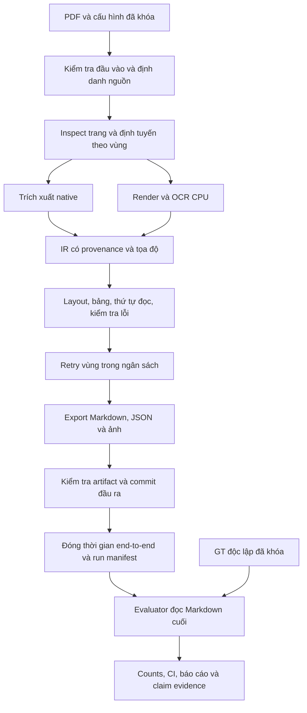

# ĐẶC TẢ DỰ ÁN OCR_pdf V5 PHỤC VỤ NGHIÊN CỨU KHOA HỌC

**Phiên bản đặc tả:** 1.0 — **Ngày:** 10/10/2026  
**Đối tượng thực hiện:** Antigravity và người phát triển OCR_pdf.  
**Trạng thái:** đặc tả yêu cầu và thiết kế; chưa phải biên bản nghiệm thu, kết quả thực nghiệm hoặc chứng nhận khoa học.  
**Đề tài:** trích xuất PDF đa dạng sang Markdown, bảo toàn nội dung, đo độ chính xác bằng dữ liệu đối chứng độc lập và đo thời gian xử lý trên CPU.

## 1. Mục đích, cách sử dụng và căn cứ

Tài liệu quy định sản phẩm cần tạo, phương pháp chứng minh chất lượng và các điều kiện để sử dụng kết quả trong bài nghiên cứu. Anti phải triển khai theo yêu cầu có mã định danh, nộp bằng chứng và để người nghiên cứu đối chiếu. Việc có module, chạy được chương trình hoặc vượt qua unit test không đồng nghĩa với đạt độ chính xác hay tốc độ trên PDF thực tế.

Thứ tự xử lý khi có khác biệt: yêu cầu đã được người dùng xác nhận; đặc tả này về toàn dự án; [RESEARCH_PROTOCOL_V5.md](RESEARCH_PROTOCOL_V5.md) về công thức và quy trình đánh giá; [ANTIGRAVITY_ACCURACY_IMPLEMENTATION.md](ANTIGRAVITY_ACCURACY_IMPLEMENTATION.md) về ca A01–A20 và triển khai evaluator. Không thay công thức hoặc mục tiêu để khớp kết quả. Thay đổi phương pháp phải có phiên bản mới, lý do và phạm vi kết quả cần chạy lại.

Các vấn đề kỹ thuật ban đầu được ghi trong [PROPOSAL_FIX_ACCURACY_RELIABILITY_PERFORMANCE.md](PROPOSAL_FIX_ACCURACY_RELIABILITY_PERFORMANCE.md). Đây là lịch sử phát hiện lỗi, không mặc định là danh sách lỗi còn tồn tại. Danh mục nguồn và BibTeX ở [ACCURACY_SOURCES.md](references/ACCURACY_SOURCES.md) và [accuracy_metrics.bib](references/accuracy_metrics.bib).

Tệp đi kèm:

- [PROJECT_REQUIREMENTS_TRACEABILITY.csv](PROJECT_REQUIREMENTS_TRACEABILITY.csv): nối yêu cầu với module, cách kiểm chứng và bằng chứng phải nộp.
- [research_acceptance.template.json](specifications/research_acceptance.template.json): mẫu cấu hình điều kiện nghiệm thu; chưa được CLI hiện tại tự động đọc, không chứa kết quả đo.

Quy ước: **PHẢI** là điều kiện bắt buộc trong phạm vi nghiệm thu; **NÊN** là lựa chọn được ưu tiên; **CÓ THỂ** là mở rộng. `OBSERVED_IN_CODE` chỉ có nghĩa đã thấy thành phần trong mã; `NOT_ACCEPTED` là chưa có hồ sơ đủ để nghiệm thu yêu cầu. Không dùng hai trạng thái này như điểm chất lượng.

## 2. Hiện trạng được đối chiếu và giới hạn của đối chiếu

Đối chiếu mã ngày 10/10/2026, không chạy lại toàn pipeline hay benchmark khi soạn tài liệu. Working tree có thay đổi chưa commit; chỉ HEAD Git không đại diện toàn bộ mã đang chạy. Mọi run sau này phải lưu hash cây nguồn thực tế.

| Thành phần | Quan sát trong mã hiện tại | Điều kiện chưa được suy ra từ quan sát |
|---|---|---|
| Phiên bản | `manifest_exporter.py` khai báo `5.0.0`; README còn tiêu đề V4.3 | Không xác nhận bản nâng cấp đã đạt nghiên cứu |
| Điều phối | `ConvertDocumentUseCase`, `ProcessPageUseCase`, routing native/OCR, profile fast/balanced/accuracy | Routing đúng và ổn định trên corpus đa dạng phải đo |
| OCR/layout | RapidOCR, VietOCR, lớp `HeuristicLayoutClassifier`, đường khởi tạo ONNX tùy model | Không gọi heuristic là model đã được huấn luyện; phải chứng minh model/provider thực tế |
| Xuất dữ liệu | `result.md`, JSON, ảnh, manifest, validation; có per-page artifacts | Đầu ra đầy đủ và đúng nội dung cần GT và kiểm tra end-to-end |
| Cache | Khóa hiện dựa trên hash PDF rút gọn, trang, profile và DPI | Chưa đáp ứng tự động khóa đầy đủ code/config/model theo đặc tả |
| Thời gian | Điều phối có tổng thời gian được tính trước bước export; manifest có làm tròn | Không lấy riêng số này làm thời gian end-to-end đạt ngưỡng |
| Accuracy | Có domain accuracy model và scientific evaluator/test files | Default CER=0 hoặc accuracy=1 trong model không được xem là kết quả khi chưa đo |
| Hồ sơ nghiên cứu | Có dataset manifest, claim registry và báo cáo triển khai | Nhãn `MEASURED`/`VERIFIED` phải có raw artifacts, hash thật, lệnh chạy và GT tương ứng |

Ví dụ cần kiểm toán: `claim_evidence.csv` đang có giá trị như `synthetic_gt_hash`, `pred_hash`, `git_head_v5`; đây không phải hash kiểm tra được. Báo cáo triển khai có chỗ gọi DER_VN_v1 là chuẩn ICDAR trong khi protocol định nghĩa đây là metric riêng của dự án. Phải làm rõ trước khi dùng trong bản thảo; tài liệu này không tiếp nhận các tuyên bố đó như bằng chứng.

## 3. Bài toán và phạm vi

### 3.1. Đầu vào và đầu ra

Đầu vào chính là PDF tiếng Việt, có thể chứa tiếng Anh, ký hiệu, số và bảng. Đơn vị nguồn là tài liệu PDF; đơn vị xử lý là trang vật lý; đơn vị nội dung là block/region/cell. Người dùng có thể chọn trang, profile, thư mục đầu ra và xử lý nhiều tệp.

Đầu ra chính là **Markdown cuối cùng** có thứ tự đọc, đề mục, đoạn, danh sách, bảng và liên kết ảnh. JSON lưu cấu trúc cùng nguồn gốc; báo cáo chất lượng hỗ trợ kiểm tra; báo cáo khoa học lưu phép đo có GT. Markdown phải truy ngược được đến PDF/trang/vùng, và evaluator phải chấm chính Markdown người dùng nhận.

### 3.2. Ma trận PDF cần nghiên cứu

| Trục | Nhóm cần lấy mẫu | Thách thức cần kiểm chứng |
|---|---|---|
| Cách tạo PDF | Native có lớp chữ tốt; scan; mixed; lớp OCR cũ lỗi font/Unicode | Chọn native/OCR theo vùng, phát hiện lớp chữ hỏng |
| Thể loại | Hành chính; biểu mẫu/hóa đơn; báo cáo; bài báo nhiều cột; sách/tài liệu kỹ thuật | Không giới hạn đề tài ở báo cáo tài chính |
| Bố cục | Một/nhiều cột; landscape; two-up; chữ xen ảnh; bảng nhiều trang | Thứ tự đọc, tọa độ, gộp/tách trang và bảng |
| Chất lượng ảnh | Scan sạch/mờ/nghiêng/xoay; nền nhiễu; độ phân giải khác nhau | OCR tiếng Việt, lỗi dấu, retry và thời gian |
| Thành phần | Chữ, bảng, số, caption, ảnh, công thức, sơ đồ | Nội dung được trích xuất hay chỉ được bảo toàn ảnh phải tách rõ |

Không bắt buộc có mọi tổ hợp trong tích Descartes. Phải công bố nhóm có/không có dữ liệu, số tài liệu/trang và phạm vi kết luận. Nhóm chưa có mẫu là `NOT_EVALUATED`, không được gán điểm mặc định hoặc suy rộng từ nhóm khác.

Chữ viết tay, tài liệu đa ngôn ngữ ngoài vi/en và PDF không mở được là các trường hợp cần ghi nhận giới hạn. Nhận dạng công thức LaTeX và đồ thị ngữ nghĩa chỉ được tuyên bố khi có GT chuyên biệt; trước đó yêu cầu tối thiểu là bảo toàn ảnh nguồn và trạng thái chưa trích xuất ngữ nghĩa.

### 3.3. Ranh giới sản phẩm

Phiên bản nghiên cứu tập trung chuyển đổi và đánh giá, không tự tóm tắt hay viết lại nội dung PDF. Sửa chính tả suy đoán phải là chế độ riêng có provenance; số liệu chính dùng bản trích xuất đã khóa chính sách. Agent không được tự điền chữ thiếu, dựng quan hệ sơ đồ hoặc thay số bằng giá trị hợp lý rồi coi đó là thông tin nguồn.

## 4. Câu hỏi nghiên cứu và đóng góp cần chứng minh

| Mã | Câu hỏi | Bằng chứng cần thu thập |
|---|---|---|
| RQ1 | Pipeline hybrid bảo toàn nội dung Markdown tốt đến mức nào ở từng nhóm PDF? | CER/WER, dấu, số, bảng, thứ tự và coverage theo nhóm, CI và lỗi điển hình |
| RQ2 | Routing theo trang/vùng có giảm thời gian CPU mà vẫn giữ chất lượng so với V4.3 và OCR toàn trang không? | Runs ghép cặp cùng dữ liệu, accuracy delta và thời gian end-to-end |
| RQ3 | Retry có giới hạn, lọc noise và xử lý header/footer đóng góp gì? | Ablation chạy thật từng thành phần, chất lượng–thời gian–review workload |
| RQ4 | Confidence và cờ review có nhận diện được các lỗi thực tế không? | GT lỗi theo vùng, precision/recall cảnh báo và chi phí kiểm tra |
| RQ5 | Bộ đánh giá có tái lập và tránh báo đạt khi thiếu bằng chứng không? | Parity evaluator độc lập, kiểm thử phản ví dụ, run manifests và tái tạo báo cáo |

Giả thuyết làm việc: hybrid có thể giảm OCR không cần thiết; retry vùng có thể giảm lỗi với chi phí ít hơn retry toàn trang; đánh giá nhiều thành phần có thể phát hiện lỗi mà confidence hoặc CER đơn lẻ bỏ sót. Đây là giả thuyết, không phải kết quả.

Đóng góp dự kiến phải gắn với thiết kế thuật toán, dữ liệu/annotation tiếng Việt hoặc giao thức đánh giá cụ thể. Tích hợp nhiều thư viện và tăng số unit test chưa đủ tự chứng minh tính mới. Bài nghiên cứu phải so với công trình liên quan, mô tả adaptation và báo cả kết quả bất lợi.

## 5. Kiến trúc mục tiêu và phân chia trách nhiệm



| Lớp | Trách nhiệm | Module hiện có liên quan |
|---|---|---|
| Domain | Document/page/block/region/table/quality, trạng thái và hợp đồng tọa độ | `src/ocr/domain/models/`, `domain/routing/` |
| Application | Điều phối, route, xử lý trang, retry và export | `src/ocr/application/` |
| Infrastructure | PDF reader/render, OCR, layout, bảng, cache, export | `src/ocr/infrastructure/` |
| CLI/batch | Kiểm tra tham số, progress, isolation từng run, kết quả toàn batch | `src/ocr/cli/` |
| Research | Adapter GT, matching, metrics, tổng hợp, CI, baseline và provenance | `benchmark/scientific_evaluation/`, `scripts/run_scientific_benchmark.py`, `scripts/run_regression.py` |

Evaluator chạy sau extraction, không cung cấp GT cho routing hoặc sửa prediction. Cấu hình phải được giải quyết thành effective config rồi lưu; fallback do thiếu model phải hiện trong manifest, không âm thầm đổi phương pháp.

### 5.1. Profile hiện có và chính sách điều chỉnh

Bảng này phản ánh `config/profiles.yaml` tại thời điểm đối chiếu; tên profile hoặc ngưỡng confidence không bảo đảm mức accuracy:

| Profile | Render / engine khai báo | Retry khai báo | Ngưỡng native reliable/review | Timeout |
|---|---|---|---|---:|
| fast | 150 DPI / rapidocr | Fallback tắt | 0,90 / 0,70 | 120 s |
| balanced | 180 DPI / vietocr | `fallback_only_on_review=true`, tối đa ratio 0,15 và 5 vùng; upscale 250 DPI | 0,90 / 0,70 | 120 s |
| accuracy | 180 DPI / vietocr | Fallback, adaptive second pass và regional retry; ratio 0,25 và 30 vùng; upscale 300 DPI | 0,92 / 0,75 | 180 s |

Effective engine phải được đối chiếu với model thật loaded, không chỉ đọc tên trong YAML. Ratio và cap cần có công thức rounding nhất quán, điều kiện ưu tiên và quy tắc dừng khi hết deadline. Không tự tắt kiểm tra số để làm nhanh; không tự tăng retry toàn trang để cải thiện CER mà bỏ mục tiêu CPU. Tune trên dev rồi khóa config trước final test. `requirements.txt` hiện dùng nhiều khoảng phiên bản, chưa thay thế environment lock chính xác của từng run.

### 5.2. Giao diện xử lý mục tiêu

API điều phối hiện có là `ConvertDocumentUseCase.execute(file_path, profile_name, pages, output_dir, resume, benchmark, accuracy_report, ground_truth_dir)` trả `ExtractedDocument`. Giữ adapter tương thích nếu sửa API; hợp đồng mục tiêu phải thêm khả năng truyền effective config/run context và trả output paths, trạng thái, errors, review count, actual engine/provider cùng provenance. Không chỉ trả object có `quality_score` rồi suy kết quả thành công.

Extraction có thể chạy không GT. Evaluation là thao tác riêng nhận final output manifest và GT manifest; kiểm tra hash/schema/scope trước khi tính metric. Flag `accuracy_report` chỉ được gọi là đánh giá khi có dữ liệu đủ điều kiện; trường hợp thiếu GT phải hiển thị `NO_GROUND_TRUTH`, không in mean accuracy mặc định.

CLI mục tiêu phải phân biệt thành công, invalid input, partial/failure bằng exit code và JSON status có tài liệu; mapping exit code phải được khóa khi triển khai. Progress cho biết trang/nhóm hiện tại và lỗi, không tự hiển thị “độ chính xác 99%” từ confidence. Batch report phải có mọi input, số trang yêu cầu/hoàn tất/lỗi, thời gian, cache regime, trạng thái evaluation và link review.

## 6. Yêu cầu chức năng

Các mã FR là hợp đồng mục tiêu, không phải xác nhận đã triển khai. Cột kiểm chứng là loại bằng chứng bắt buộc; vị trí code và ca kiểm tra chi tiết ở ma trận truy vết.

| Mã | Yêu cầu PHẢI | Kiểm chứng |
|---|---|---|
| FR-01 | Mở đúng PDF chỉ định; kiểm tra định dạng, quyền mở, trang và tham số. Tên trùng ở đường dẫn khác không được âm thầm chọn nhầm tệp | PDF hash/path đúng; lỗi có mã; input xấu không tạo thành công |
| FR-02 | Chọn trang 1-based, loại trùng, giữ thứ tự ổn định. Chuỗi sai, khoảng đảo và trang ngoài tài liệu phải báo lỗi rõ | Ca CLI `1,3-5`, `abc`, `5-2`, trang 0/out-of-range; không âm thầm chạy toàn tài liệu |
| FR-03 | Inspect lớp chữ, ảnh, rotation, kích thước và chất lượng Unicode theo trang; route theo vùng có lý do | Annotated routing subset; confusion matrix và trace quyết định |
| FR-04 | Native extraction giữ Unicode, dấu câu, số và bbox; lớp chữ lỗi không được xem là chắc chắn đúng | PDF native sạch/lỗi font; GT chữ cuối Markdown |
| FR-05 | OCR scan/mixed dùng đúng model/provider được ghi nhận; lưu raw text, confidence và tọa độ | Model hash, provider log, ảnh đầu vào và output trace |
| FR-06 | Transform rotation/crop/two-up ánh xạ về trang vật lý; giữ số trang nguồn, không tính hai nửa thành hai trang PDF | Test khứ hồi tọa độ; GT orientation/reading order |
| FR-07 | Layout phân biệt nhãn đã khóa; nêu rõ heuristic hay model inference, không dựng bbox để điền evaluator | Class mapping version, provenance và layout GT |
| FR-08 | Tái tạo thứ tự đọc nhiều cột, caption, bảng xen đoạn; không loại đoạn chỉ vì trùng tiền tố | GT block/pair order; duplicate/missing/spurious counts |
| FR-09 | Bảng giữ ô trống, hàng/cột, merge và chữ/số. GFM dùng cho bảng đơn; bảng merge dùng HTML hoặc biểu diễn bảo toàn tương đương | Parse Markdown cuối, TEDS-S/TEDS và detection P/R/F1 |
| FR-10 | Bảng tiếp nối nhiều trang chỉ gộp khi có bằng chứng; từng cell giữ nguồn trang/bbox | Fixture bảng tiếp nối và bảng giống nhưng độc lập |
| FR-11 | Số giữ dấu âm, ngoặc, dấu phân cách, số 0 đầu, đơn vị và vị trí cell/block. Xung đột OCR số phải vào review | NumericExact, ca A12/A13 và nhật ký các ứng viên |
| FR-12 | Ảnh/công thức/sơ đồ chưa trích được phải có asset nguồn và trạng thái; bảo toàn ảnh không được gọi là trích xuất ngữ nghĩa đúng | Kiểm tra file/hash/link, GT modality nếu có tuyên bố semantic |
| FR-13 | Noise/hallucination/header/footer chỉ loại bằng rule có dấu vết; nội dung thân bài lặp lại phải được giữ | Tập GT âm/dương, deletion/insertion và rule audit |
| FR-14 | Retry ưu tiên vùng có vấn đề, có ngân sách số vùng/thời gian; lưu bản trước/sau và lý do chọn | Ablation retry, numeric conflict và số OCR calls |
| FR-15 | Review queue bao phủ block/region/page lỗi, low confidence, số bất đồng, bảng/asset chưa giải quyết; mỗi item định vị được nguồn | Đối chiếu predicate bằng ID; queue rỗng khi vẫn có cờ lỗi là thất bại |
| FR-16 | Deadline trang là giới hạn thời gian thực, bao gồm inspect/render/OCR/retry; tiến trình treo phải được dừng hoặc cô lập | Inject worker treo; batch tiếp tục; không chỉ timeout chờ future |
| FR-17 | Cache/resume kiểm tra PDF, trang, effective config, code/model và schema; dữ liệu lỗi hoặc khác phiên bản phải bị vô hiệu | Cache hit/miss có lý do; sửa config/model không dùng cache cũ |
| FR-18 | Export nhất quán Markdown/JSON/assets; có mapping page/block vào byte spans của Markdown cuối | Round-trip parse, coverage, artifact validation |
| FR-19 | Batch ghi kết quả mọi tệp đã yêu cầu, không đè tên trùng và không bỏ tệp thất bại khỏi thống kê | Input ledger đối chiếu output; completion/failure counts |
| FR-20 | Ghi output vào vùng staging riêng, chỉ công bố hoàn tất sau validation; run mới không ghi đè lịch sử nghiên cứu | Inject lỗi export; output cũ nguyên vẹn; manifest PARTIAL/FAILED |
| FR-21 | Quality/confidence là chẩn đoán; accuracy cần GT. Không có GT hoặc mẫu số hợp lệ phải trả null cùng trạng thái | Không có default perfect score; test thiếu/empty GT |
| FR-22 | Evaluator đọc `result.md` có hash; không thay bằng per-page Markdown khi thiếu marker/mapping | Xóa/đổi Markdown cuối: metric đổi hoặc ALIGNMENT_FAILED |
| FR-23 | Mỗi run đóng dấu code/data/model/config/evaluator/output và môi trường thực tế; kiểm tra snapshot trước/sau | Run manifest và hash verification độc lập |
| FR-24 | JSON/CSV/Markdown/LaTeX biểu diễn đúng null, đơn vị, trạng thái và counts; chỉ tạo bảng ablation từ actual runs | So raw JSON với báo cáo; không dùng hệ số nhân/synthetic rows |

### 6.1. Hành vi quan trọng

- **PDF lỗi/khóa:** báo `FAILED_INPUT`; không lưu mật khẩu trong log hay manifest. PDF đọc được một phần phải chỉ rõ trang không mở được.
- **Mixed:** giữ native đúng, OCR đúng vùng ảnh có chữ, chống nhân đôi giữa hai nguồn. Không bỏ nội dung chỉ vì confidence thấp; bảo toàn bằng chứng và đưa vào review.
- **Header/footer:** phải kết hợp vị trí và lặp trên các trang khác nhau; quy tắc tần suất không đủ để loại câu lặp trong thân bài. Mọi phần bị loại vẫn có dấu vết trong JSON.
- **Bảng không giải được:** asset bảng cùng `PRESERVED_IMAGE`, không phát sinh bảng giả. Detection có thể đúng nhưng cấu trúc chưa được trích; không tính ảnh như bảng HTML đúng hoàn toàn.
- **Ảnh scan:** bảo toàn cả ảnh trang không tự thỏa mãn yêu cầu text extraction. Thiếu text prediction trên vùng có GT phải được tính lỗi bỏ sót.
- **Human review:** bản tự động và bản sau người sửa là hai track, có hash và thời gian lao động riêng; không dùng bản đã sửa để báo accuracy của hệ thống tự động.

## 7. Hợp đồng dữ liệu và đầu ra

### 7.1. Cấu trúc đầu ra mục tiêu

Giữ tương thích tên file hiện có khi khả thi, bổ sung version trong hợp đồng. Cây dưới đây là thiết kế cần triển khai, không phải khẳng định mọi file đang được tạo:

```text
output/runs/<run_id>/<document_id>/
  result.md                 # đầu ra chính, UTF-8
  result.json               # IR và cấu trúc nội dung
  quality.json              # chẩn đoán, không là accuracy
  manifest.json             # extraction provenance
  validation.json           # tính nhất quán artifact
  alignment.json            # spans trang/block trên result.md
  review_queue.json         # item cần kiểm tra
  pages/page-0001.json
  pages/page-0001.md
  images/<asset_id>.png
benchmark/runs/<run_id>/
  run_manifest.json         # scope, snapshot, hardware, timing
  metrics.json              # metric records, counts, coverage
  per_page.csv
  per_document.csv
  failures.jsonl
  report.md
  claims.csv
```

Output sản phẩm và output đánh giá nối bằng `run_id`, PDF hash và hash `result.md`. Không hash một manifest chứa chính hash của nó; dùng ledger artifacts bên ngoài hoặc quy tắc loại trường self-hash được định nghĩa trước.

### 7.2. Định danh và tọa độ

| Thực thể | Trường bắt buộc trong hợp đồng mục tiêu |
|---|---|
| Document | `schema_version`, `document_id`, `pdf_sha256` đủ 64 hex, path nguồn, `total_pages`, `selected_pages`, `run_id`, trạng thái |
| Page | `page_num` 1-based, kích thước PDF, rotation, route và lý do, processing status, errors, elapsed, regions/blocks/tables |
| Block/region | ID duy nhất trong document, `page_num`, bbox, coordinate space, content type, source, raw/final text nếu có, rule history, review reasons |
| Table/cell | Table ID, hàng/cột/span, text nguyên gốc, cell ID, page/bbox nguồn; header semantics nếu có |
| Asset | Asset ID, relative path, hash, kích thước, page/bbox nguồn, loại nội dung và extraction status |
| Alignment | `markdown_sha256`, UTF-8 byte offset `[start,end)`, page/block ID, loại nội dung; version parser và mapping |
| Review item | Item ID, doc/page/region/block, loại lỗi, mức ưu tiên, lý do, source crop/link, trạng thái và lịch sử người sửa |

Bbox IR là `[x0,y0,x1,y1]` trong PDF points, gốc trên trái của trang đã chuẩn hóa; phải lưu transform từ ảnh render/crop/rotation. Adapter COCO chuyển sang `[x,y,w,h]`. Không trộn pixel/point hay đổi `image_id` giữa trang. Giá trị bbox phải hữu hạn, hợp lệ và nằm trong phạm vi sau clipping có ghi nhận.

`source` tối thiểu phân biệt native, primary OCR, fallback OCR, human edit và preserved image. Confidence có thể null; không có confidence native không được gán 1.0 rồi diễn giải là xác suất đúng. Thay thế text phải lưu bản trước và provenance.

### 7.3. Markdown và mapping cuối

Markdown dùng UTF-8 và Unicode NFC cho track đánh giá đã định nghĩa; lưu hash trước/sau nếu có normalization. Có thể chèn marker dạng comment mang ID trang; phải escape và phân biệt marker sinh bởi hệ thống với nội dung giống marker trong PDF. `alignment.json` là nguồn mapping có hash tương ứng, không suy trang chỉ từ đề mục `# Trang N` có thể trùng chữ nguồn.

Parser phải bảo toàn nội dung chữ trong heading/list/table và các ký tự có nghĩa như `%`, `-`, dấu ngoặc, dấu `|` đã escape. Metadata chương trình không phải nội dung PDF; chỉ loại metadata do exporter tạo và có mapping. Không dùng regex xóa toàn bộ dòng heading, số hay punctuation để làm giảm CER.

### 7.4. Run manifest

Manifest phải có: thời gian UTC có timezone; CLI/lệnh thực tế; full effective config/hash; HEAD và dirty tree source hash; environment/dependency versions; model filename/hash và providers; CPU model/core/thread, RAM, OS; dataset/split/GT version/hash; page selection; cache regime/hits; seed; protocol/parser/evaluator version/hash; input/output artifact hashes; stage và end-to-end timings; requested/complete/partial/failed pages; notes về fallback hoặc khác thiết kế.

Hash phải có thể tái tính từ file, không dùng chuỗi minh họa như `pred_hash`. Snapshot đổi trong khi chạy làm run không đủ điều kiện so sánh cho đến khi giải thích hoặc chạy lại. Alias model không đủ thay file weights hash.

## 8. Trạng thái, lỗi và tính tin cậy vận hành

Trạng thái xử lý mục tiêu: `PENDING → RUNNING → COMPLETED | PARTIAL | FAILED_INPUT | FAILED_PROCESSING | TIMEOUT`. Cache là thuộc tính nguồn thực thi, không tự biến artifact chưa valid thành `COMPLETED`. Review là trạng thái độc lập: trang xử lý xong vẫn có thể `NEEDS_REVIEW`.

`COMPLETED` chỉ xác nhận đã xử lý tất cả trang yêu cầu và artifact đạt contract, không xác nhận nội dung đúng. `PARTIAL` phải có danh sách phần chưa giải được. Trang trắng có thể hoàn tất nếu xác nhận input trắng; không coi lỗi OCR trả rỗng như trang trắng hợp lệ.

Error record chứa `code`, stage, document/page/region, message, retryable, exception type và artifact liên quan. Dùng các mã như `PDF_OPEN_FAILED`, `INVALID_PAGE_SELECTION`, `MODEL_UNAVAILABLE`, `PAGE_TIMEOUT`, `ASSET_EXPORT_FAILED`, `ARTIFACT_INVALID`, `ALIGNMENT_FAILED`, `GT_SCHEMA_INVALID`, `SNAPSHOT_CHANGED`. Lỗi không được nuốt thành thành công; lỗi ở một PDF không được làm mất ledger của PDF khác.

| Mã | Yêu cầu phi chức năng | Cách kiểm chứng |
|---|---|---|
| NF-01 | Kết quả và thứ tự ổn định với snapshot/config/seed đã khóa; phần nondeterministic phải được mô tả | Chạy lặp, so semantic artifacts và hash sau loại metadata thời gian theo quy tắc |
| NF-02 | Chạy CPU có provider explicit; không tự chọn CUDA trong run mang nhãn CPU | Provider trace và kiểm tra thực tế của cả OCR/layout |
| NF-03 | Bộ nhớ và số worker có giới hạn cấu hình; không giữ toàn bộ ảnh DPI cao của mọi trang; báo peak RSS | Corpus dài, đo bộ nhớ và inject lỗi thiếu tài nguyên |
| NF-04 | Dữ liệu nguồn, output cũ, GT và baseline bất biến đối với test; mỗi run/test có thư mục riêng | Ca A20, diff filesystem và kiểm tra lịch sử |
| NF-05 | Cài đặt nghiên cứu khóa version dependencies/model/evaluator; có quy trình tái lập Windows và nêu phạm vi OS đã thử | Environment lock, installation log và fresh-environment rerun |
| NF-06 | Nội dung PDF là dữ liệu: không thực thi link/embedded script, không gửi dữ liệu ra dịch vụ ngoài mặc định; xuất HTML/ảnh an toàn | Test malicious text/link; cấu hình network và export escaping |

Peak RAM, số worker và timeout là tham số kỹ thuật phải công bố, chưa có ngưỡng nghiệm thu do người dùng chốt. Timeout 120/180 giây trong profile hiện tại là giới hạn vận hành, không thay mục tiêu 0,15/1,8/2,5 giây/trang.

## 9. Dữ liệu nghiên cứu và ground truth

### 9.1. Thiết kế tập dữ liệu

| Mã | Yêu cầu khoa học | Bằng chứng |
|---|---|---|
| SCI-01 | Corpus đa thể loại theo mục 3, có quyền sử dụng, hash, nguồn, category và lý do chọn/exclude | Dataset manifest thực và báo cáo phân bố |
| SCI-02 | GT độc lập với prediction được đánh giá; phân biệt chưa gán nhãn với đã xác nhận rỗng; ghi coverage từng modality | Annotation files, hướng dẫn, reviewer/provenance và adjudication log |
| SCI-03 | Split theo tài liệu và nhóm gần trùng/template/nguồn khi phù hợp; dev dùng tune, test khóa trước final run | Split manifest, duplicate audit và lịch sử freeze |
| SCI-04 | Evaluator đúng định nghĩa, parity với tham chiếu độc lập; custom metrics đặt tên và version riêng | A01–A20, parity raw outputs, evaluator hashes |
| SCI-05 | So sánh V4.3/V5/baseline và ablation bằng actual runs có scope tương thích | Run matrix, comparability gate và raw results |
| SCI-06 | Tổng hợp đúng counts, CI theo cụm tài liệu và phân tích từng nhóm; không bỏ trang lỗi | Per-page/doc records, bootstrap config và kết quả tái lập |
| SCI-07 | Đo end-to-end CPU đúng biên thời gian, cache regime và mục tiêu đã chốt | Timing traces và CPU provider evidence |
| SCI-08 | Mọi claim trong báo cáo/bài viết nối được với bằng chứng; thiếu evidence không được ghi đạt | Claim registry, kiểm tra hash/path và review bản thảo |

Không đưa toàn bộ corpus vào test để vừa tune vừa công bố. Trang trong cùng tài liệu không phân tán vào dev và test. Nếu các bản PDF cùng mẫu hoặc cùng nguồn rất gần nhau, phải đánh giá leakage và công bố cách group split. Dữ liệu public dùng để huấn luyện model phải được kiểm tra overlap với test nếu có thông tin; unknown training overlap phải ghi giới hạn.

Pilot dùng để xác định chi phí gán nhãn, mức biến thiên và lỗi evaluator. Kích thước tập final dựa trên độ rộng CI mong muốn và khả năng thu thập tài liệu độc lập; không lấy số trang lớn của vài tài liệu làm bằng chứng đại diện. Ghi trước quy tắc sampling, loại trừ, primary metrics, strata, split, cấu hình và phân tích dự kiến trong hồ sơ freeze.

### 9.2. Quy trình gán nhãn

1. Khóa PDF/hash/trang, tạo ảnh tham chiếu và guideline, không cho annotator xem prediction của phiên bản sẽ đánh giá.
2. Gán text, layout, tables, numeric entities và reading order theo scope; AI/OCR có thể hỗ trợ bản nháp nhưng phải giữ nhãn `AI_CANDIDATE` đến khi người kiểm tra thực sự xác nhận.
3. Người thứ hai kiểm tra độc lập; ghi phần double-annotated và mức bất đồng trước hòa giải. Mục tiêu GT final là hai vòng kiểm tra; nếu pilot chỉ có một người, công bố tier và không gọi đã đạt target GT final.
4. Hòa giải bằng ảnh nguồn, lưu phiên bản, reviewer thực và lý do; agent không được tự ký tên người đã kiểm tra.
5. Kiểm tra schema, tọa độ, category mapping, Unicode, coverage và quyền sử dụng; freeze GT và split trước final run.

Annotation trạng thái: `not_annotated`, `annotated_empty`, `annotated_nonempty`, cùng `adjudication_status`. Không có annotation không đồng nghĩa không có thực thể. Inter-annotator agreement phải dùng thước đo phù hợp từng loại (text edit disagreement, bbox/category agreement, cell/order agreement), ghi thuật toán matching và không gom thành một tỷ lệ tùy ý.

Partial GT chỉ cho phép kết luận trên phần đã gán nhãn. Phải báo số tài liệu/trang/vùng/GT characters được đánh giá và phần chưa đánh giá. Nếu prediction thiếu trên một vùng có GT, vẫn tính deletion/missing entity; nếu mapping Markdown hỏng, ghi lỗi đánh giá thay vì né sang page file.

## 10. Hệ chỉ số độ chính xác

Chi tiết công thức, empty-reference policy, matching và đối chiếu tham chiếu theo [protocol](RESEARCH_PROTOCOL_V5.md). Bảng dưới khóa vai trò của chỉ số trong đề tài:

| Thành phần | Chỉ số cần báo | Điều kiện/diễn giải |
|---|---|---|
| Text Markdown cuối | Micro CER = tổng(S+D+I)/tổng ký tự GT; WER_ws tương tự với token khoảng trắng; macro document riêng | NFC và policy đã khóa; lưu counts; không clamp 100% hoặc cắt prediction |
| Dấu tiếng Việt | DER_VN_v1 | Metric custom theo slots shape/tone/stroke; `đ` có quy tắc riêng; không gọi là chuẩn ICDAR |
| Bảng | TEDS/TEDS-S; TEDS_GT; detection P/R/F1, missing/spurious | TEDS nguồn PubTabNet, matching độc lập chất lượng; bảng dư phải hiện trong detection |
| Layout | COCO AP50 và AP@[.50:.95] | Official COCOeval, class/page/box mapping đã pin; layout không thay accuracy text |
| Thứ tự đọc | Matched-block coverage, precedence accuracy; Spearman khi hợp lệ | Ghép 1-1; partial order GT nếu nhiều thứ tự hợp lý; thiếu block không bị che bởi điểm order cao |
| Số | NumericExact P/R/F1, CellExactMatch khi có GT cell | So raw format/value/unit/location theo policy; bag recall chỉ diagnostic |
| Độ đủ nội dung | Missing/spurious blocks/pages, GT/output coverage theo modality | Trang thiếu phải tính vào mẫu; preserved asset và semantic extraction tách riêng |
| Vận hành | Completion/failure/timeout rate; queue size; cảnh báo lỗi P/R khi có error GT | Không diễn giải queue rỗng là 100% đúng |
| Ảnh/công thức/sơ đồ | Asset integrity; metric semantic chuyên biệt chỉ khi có GT/definition | Asset link tồn tại không chứng minh graph/formula đúng |

Text đánh giá có ít nhất track `visible_strict_v1` và track chuẩn hóa trình bày riêng nếu cần. Không gộp WER_ws với WER có word segmentation tiếng Việt. Nội dung bảng phải được tính trong text track đã công bố hoặc tách cell-text track với coverage rõ ràng; không loại bảng khó rồi gọi CER toàn tài liệu.

Không có GT → `NO_GROUND_TRUTH`, value null. GT rỗng đã xác nhận → báo insertions/spurious và zero-denominator status; không tạo tỷ lệ hoàn hảo giả. Modality không áp dụng → `NOT_APPLICABLE`. Giữ `ALIGNMENT_FAILED`, `INVALID_INPUT`, `UNSUPPORTED` riêng, không bỏ khỏi số trang lỗi.

Metric record mục tiêu chứa `name`, `definition_version`, `track`, `scope`, `status`, `value`, `counts`, `denominator`, `coverage`, `gt_manifest_sha256`, `markdown_sha256`, `evaluator_sha256`, `run_id` và `confidence_interval` nếu đủ điều kiện. Các hash còn thiếu phải là null với lý do, không dùng chuỗi minh họa như hash thật. Mẫu dưới chỉ mô tả trạng thái chưa đo:

```json
{
  "name": "micro_cer",
  "definition_version": "CER_NFC_v1",
  "track": "visible_strict_v1",
  "scope": "requested_pages",
  "status": "NO_GROUND_TRUTH",
  "value": null,
  "counts": null,
  "denominator": null,
  "confidence_interval": null,
  "coverage": {"evaluated_pages": 0, "requested_pages": null},
  "gt_manifest_sha256": null,
  "markdown_sha256": null,
  "evaluator_sha256": null,
  "run_id": null
}
```

Chưa có ngưỡng accuracy tuyệt đối được người dùng xác nhận: `accuracy_targets_status=NOT_SPECIFIED`, `accuracy_requirement_met=null`. Anti được báo số đo và delta, không được tự đặt CER≤1%, accuracy≥99% hoặc TEDS≥0,95 rồi tuyên bố đạt.

## 11. Đo hiệu năng CPU

### 11.1. Mục tiêu đã được xác nhận

| Nhóm PDF | Dải thời gian mục tiêu | Trần mean end-to-end |
|---|---:|---:|
| Native có lớp chữ dùng được | 0,05–0,15 giây/trang | ≤ 0,15 giây/trang |
| Mixed | 0,8–1,8 giây/trang | ≤ 1,8 giây/trang |
| Scan | 1,5–2,5 giây/trang | ≤ 2,5 giây/trang |

Nhanh hơn đầu dưới là đạt về thời gian nếu nội dung vẫn đáp ứng phạm vi. Không thay các trần bằng số phù hợp với kết quả hiện tại.

### 11.2. Biên thời gian và cách phân nhóm

End-to-end bắt đầu trước mở PDF và khởi tạo thành phần cần thiết của chế độ chạy; kết thúc sau khi Markdown, JSON, ảnh, validation và artifact ledger bắt buộc đã ghi xong. Dùng monotonic high-resolution clock, lưu số chưa làm tròn. Tách thời gian evaluation GT/báo cáo khoa học khỏi thời gian extraction; vẫn báo riêng để thấy tổng chi phí nghiên cứu.

Nhóm tốc độ phải lấy từ thuộc tính nguồn đã gán nhãn, không từ route prediction để tránh chuyển trang khó sang nhóm khác. Lưu cả page-level source type, doc composition và route thực tế. Nếu tài liệu gồm cả trang native/scan hoặc nội dung xen chữ/ảnh cần OCR, đánh giá whole-document mixed đúng scope đã khóa. Không chia tổng thời gian tài liệu mixed cho riêng số trang native rồi gọi tốc độ native.

Mean theo nhóm = tổng thời gian các run hoàn chỉnh của nhóm / tổng số trang yêu cầu tương ứng. Không dùng trung bình các tỷ lệ theo file khi số trang khác nhau. Các run thất bại có ledger/thời gian, không làm đẹp tốc độ bằng bỏ chúng; nếu chưa hoàn tất toàn bộ tập nghiệm thu thì không có PASS hiệu năng cho toàn tập. Có thể báo latency completed subset như chẩn đoán, kèm failure rate.

Với phân tích stage theo trang, overhead mở PDF/export chung phải hiện riêng; không dùng tổng stage làm thay thế wall clock, đặc biệt khi chạy song song. Thời gian pytest không phải thời gian PDF extraction.

### 11.3. Chế độ và điều kiện so sánh

- Báo riêng cold process/model initialization, warm model với artifact cache tắt, và resume/artifact cache hit. Chọn chế độ nghiệm thu chính trước final run; mẫu đi kèm để `primary_timing_regime=null` cho đến khi hồ sơ thí nghiệm khóa lựa chọn, không âm thầm chọn chế độ nhanh nhất sau khi đo.
- Khóa profile chính (đề xuất `balanced`), CPU/thread/worker, model và provider, RAM/OS, DPI và fallback budgets. Các profile khác là các điểm chất lượng–thời gian riêng.
- Chạy lặp và ghi warm-up, số lượt, thứ tự ngẫu nhiên/cân bằng giữa hệ thống. Pilot xác định số lượt cần thiết; ít nhất ba lượt là đề xuất kỹ thuật ban đầu, không bảo đảm CI ổn định.
- Báo mean theo trang, median, p95, max, throughput và peak memory. Ngưỡng hiện chốt là mean; p95 vẫn bắt buộc mô tả, chưa tự đặt thêm trần p95.
- So trần trên số chưa làm tròn: mixed 1,8004 giây/trang vượt 1,8 dù màn hình hiển thị 1,80. Không dùng GPU cho bảng mang nhãn CPU.

Chỉ ghi performance đạt cho nhóm đã có actual runs hợp lệ; nhóm thiếu mẫu là `NOT_EVALUATED`. Đạt tốc độ nhưng bỏ chữ/bảng hoặc để nhiều phần chưa trích không tự chứng minh đạt yêu cầu toàn dự án.

## 12. Thiết kế thực nghiệm, thống kê và tái lập

### 12.1. Ma trận chạy

| Track | Hệ thống/cấu hình | Mục đích và điều kiện |
|---|---|---|
| T0 | V4.3 snapshot thật | Baseline trước nâng cấp; ghi commit/dirty patch, dependencies và outputs thật |
| T1 | V5 profile chính đã khóa | So sánh chính trên đúng test corpus và thiết bị |
| T2 | Native-only | Baseline thành phần; scan không hỗ trợ vẫn ghi unsupported/missing, không xem là score hoàn hảo |
| T3 | OCR toàn trang với engine đã pin | Kiểm tra lợi ích routing, cùng ngân sách tài nguyên và cấu hình công bố |
| T4 | V5 bỏ retry; bỏ routing; bỏ rule noise/header; thay layout/table theo từng ablation | Chạy thật mỗi cấu hình, nêu thay đổi một yếu tố hoặc tương tác |
| T5 | Hệ thống PDF parsing công khai có thể chạy trên máy | Chọn sau pilot, pin version/license; không chép điểm leaderboard máy khác |

Nếu không tái tạo được V4.3, ghi `BASELINE_UNAVAILABLE`; không dựng số cũ hoặc gọi HEAD hiện tại là V4.3 khi đang dùng working tree V5. Ablation thay cả nhiều tham số phải công bố, không quy mọi delta về một thành phần.

Runs chỉ comparable khi corpus/split/trang/GT, metric policy, scope đầu ra, môi trường và cache regime tương thích. Nếu thay evaluator, đánh giá lại outputs cả hai hệ thống bằng cùng evaluator. Baseline file cố định; history không tự cập nhật baseline sau mỗi run.

### 12.2. Tổng hợp và bất định

Tính micro từ counts, macro theo tài liệu/trang ở cột riêng, và per-stratum results. CI95% bootstrap theo **cụm tài liệu**; so hệ thống dùng paired resampling cùng document IDs. Lưu seed, số replicate, estimator và độ ổn định; mặc định kỹ thuật 2.000 replicate theo protocol. Một tài liệu không đủ để suy CI giữa các tài liệu: ghi `INSUFFICIENT_DOCUMENTS`.

Báo effect size, CI delta và hướng cải tiến (CER giảm, TEDS tăng, thời gian giảm). Phân biệt ý nghĩa thống kê với ý nghĩa thực tế; nếu muốn kiểm định không suy giảm accuracy phải khóa biên không suy giảm trước final run. Chưa có biên thì chỉ báo delta/CI, không tự tuyên bố non-inferiority. Nhiều phép so sánh exploratory phải được ghi rõ hoặc có kế hoạch xử lý multiple comparisons.

Hiệu năng có hai nguồn biến thiên: khác tài liệu và các lần chạy cùng tài liệu. Không coi các lần lặp trên cùng PDF là các tài liệu độc lập. Ghi cả time repeats và document cluster; không bơm sample size bằng nhân số lượt.

### 12.3. Phân tích lỗi và độ tin cậy cảnh báo

Phân loại lỗi chữ/dấu/số, mất bảng/spans, đảo cột, text ảo, thiếu trang/asset, routing và timeout. Chọn ví dụ theo quy tắc đã ghi, có ví dụ tốt/xấu và tỷ lệ theo corpus. Đánh giá cảnh báo trên GT lỗi độc lập; ngưỡng confidence chỉ tune trên dev. Nếu gọi confidence là xác suất đúng, phải có calibration analysis; trước đó giữ nhãn diagnostic score.

Hồ sơ tái lập phải cho phép một người khác từ snapshot và dataset được phép sử dụng tạo lại outputs/metrics/report. Sai khác floating point có tolerance đã công bố; counts edit distance phải đối chiếu chính xác khi policy giống nhau.

## 13. Nguồn nghiên cứu và cách áp dụng

Thiết kế đa thể loại và đánh giá end-to-end/thành phần tham khảo [OmniDocBench, CVPR 2025](https://arxiv.org/abs/2412.07626). Bộ tiếng Việt của dự án là một adaptation riêng; không tự gọi là điểm chính thức trên OmniDocBench.

Thiết kế layout annotations đa nguồn và kiểm tra đồng thuận tham khảo [DocLayNet, công trình được chấp nhận SIGKDD 2022](https://arxiv.org/abs/2206.01062). Không sao chép số mAP của công trình để mô tả OCR_pdf.

TEDS cho cấu trúc/nội dung bảng dựa trên [Zhong và cộng sự, ECCV 2020](https://www.ecva.net/papers/eccv_2020/papers_ECCV/html/3802_ECCV_2020_paper.php), triển khai tham chiếu qua PubTabNet. CER/WER đối chiếu JiWER; AP dùng COCOeval chính thức theo registry. Chỉ ghi adapter tương thích sau khi có parity thực, version/commit và phạm vi normalization.

Bootstrap so hệ thống tham khảo [Koehn, EMNLP 2004](https://aclanthology.org/W04-3250/); cluster theo tài liệu cho OCR là lựa chọn thích nghi trong dự án. DER_VN_v1, NumericExact và precedence metric riêng phải công bố công thức, không gán cho IEEE/ICDAR hoặc nguồn không định nghĩa chúng.

Citation tăng khả năng kiểm tra phương pháp, không thay GT, thực nghiệm hoặc chứng minh tính mới. License public dataset/model/evaluator phải kiểm tra theo bản thực sự sử dụng; pin version range như `>=2.0.7` chưa khóa một bản duy nhất.

## 14. Cổng nghiệm thu và bằng chứng

| Cổng | Điều kiện PHẢI | Khi thiếu điều kiện |
|---|---|---|
| G0 — nguồn và phạm vi | Snapshot thực, requirements và experiment plan được khóa; không có hash minh họa trong run thật | NOT_ACCEPTED |
| G1 — sản phẩm | FR-01–FR-20 và NF áp dụng có evidence; mọi trang có trạng thái, artifacts hợp lệ, không nuốt lỗi/đè lịch sử | FAIL hoặc PARTIAL |
| G2 — evaluator | FR-21–FR-24, SCI-04, A01–A20 và parity độc lập đạt trên cùng snapshot | INVALID_EVALUATION |
| G3 — dữ liệu | SCI-01–SCI-03, GT và split có provenance, coverage đạt phạm vi claim | NO_GROUND_TRUTH hoặc PARTIAL_GT |
| G4 — thực nghiệm | SCI-05–SCI-07: actual baseline/ablation, counts/CI, timing hợp lệ và missing pages được tính | INCOMPARABLE hoặc NOT_EVALUATED |
| G5 — accuracy/tốc độ | Accuracy so với ngưỡng đã chốt nếu có; CPU so trần theo nhóm và regime đã khóa | Accuracy chưa chốt → NOT_SPECIFIED; tốc độ thiếu run → NOT_EVALUATED |
| G6 — tuyên bố khoa học | SCI-08: mỗi claim nối evidence và giới hạn; reproducibility review bởi người thực; tính mới được lập luận bằng related work | CLAIM_UNSUPPORTED |

Không gom thành một cờ `research_ready=true` từ số test pass. Báo tách:

- `artifact_valid`: đầu ra đúng contract.
- `evaluation_valid`: phép đo có dữ liệu/phương pháp/provenance hợp lệ.
- `accuracy_requirement_met`: true/false/null; null nếu chưa chốt ngưỡng hoặc chưa đo.
- `performance_requirement_met`: theo từng nhóm, null nếu thiếu chế độ/mẫu/evidence.
- `research_claim_supported`: theo từng claim, không suy từ hai cờ trên.

Nghiên cứu vẫn có thể báo kết quả chưa đạt mục tiêu nếu phép đo đáng tin và kết luận đúng phạm vi. Nghiệm thu “đã đạt mọi yêu cầu người dùng” chưa thể hoàn tất khi accuracy target chưa xác định. Hồ sơ đạt các cổng phương pháp không tự bảo đảm bài được hội nghị/tạp chí chấp nhận.

Claim record cần: claim ID, câu/giá trị/đơn vị, scope/stratum, vị trí trong bản thảo, trạng thái, actual run IDs, raw metrics path/hash, PDF/dataset/GT/output/code/model/config/evaluator hashes, CI, comparability và reviewer evidence. Câu thiếu run thật ghi `TARGET`, `HYPOTHESIS` hoặc `UNVERIFIED`; fixture ghi `IMPLEMENTATION_TEST_ONLY`.

## 15. Ca nghiệm thu toàn dự án bổ sung

Các ca sau bổ sung cho A01–A20, không thay test suite cũ. Đây là kịch bản yêu cầu, chưa phải test đã chạy:

| Ca | Input/tác động | Kết quả cần có |
|---|---|---|
| S01 | Hai PDF cùng stem ở hai đường dẫn, hash khác | Hai identity/output riêng, không dùng nhầm cache |
| S02 | `--pages abc`, `5-2`, `0`, vượt total_pages | INVALID_PAGE_SELECTION, không tự chạy tất cả trang |
| S03 | Scan xoay, landscape và two-up có GT | Text/bbox về đúng trang nguồn, đúng số trang và thứ tự |
| S04 | Native lớp chữ lỗi font và mixed chữ native + ảnh có chữ | Route trace; native/OCR không mất hoặc nhân đôi |
| S05 | Câu lặp trong thân bài giống running header; ảnh có chữ ngắn thật | Giữ nội dung thật; rule removal truy vết và GT đo được |
| S06 | Bảng ô gộp, bảng tiếp nối và hai bảng giống độc lập | Giữ spans/source; không gộp sai, missing/spurious có counts |
| S07 | OCR worker treo và lỗi export asset | Deadline thực; PARTIAL/TIMEOUT/FAILED; batch không treo và không báo hoàn tất giả |
| S08 | Sửa DPI/config/model/code rồi resume | Cache miss/invalidate đúng lý do; không giữ artifact khác snapshot |
| S09 | Xóa trang hoặc sửa nội dung `result.md` sau export | Hash/mapping sai bị chặn; không fallback page file để giữ score đẹp |
| S10 | Queue không chứa một region còn cờ unresolved/numeric conflict | Validation FAIL, có ID item thiếu |
| S11 | Tập không GT; GT rỗng; GT một phần; trang có GT nhưng thiếu prediction | null/status đúng; partial coverage; deletion/spurious đúng, không perfect default |
| S12 | Run CPU nhưng layout chọn CUDA; thời gian chỉ tính trước export | Chặn nhãn CPU/không đủ evidence, timing biên sai không được nghiệm thu |
| S13 | Run cũ khác dataset/machine/policy hoặc source đổi giữa run | Không kết luận cải tiến; comparability/snapshot gate ghi lý do |
| S14 | Test tạo workbook/báo cáo synthetic | Chỉ ghi temp dir; không sửa outputs/claims/baseline thật |
| S15 | CSV/LaTeX có null hoặc ablation thiếu actual run | N/A đúng, không synthetic row hoặc claim đạt |
| S16 | Chạy lại từ clean environment có dataset/model hash đã khóa | Tái lập counts/report trong tolerance công bố; sai khác được giải thích |
| S17 | Text giống HTML/script, link ngoài hoặc path traversal trong nội dung PDF | Giữ như dữ liệu, escape xuất phù hợp, không thực thi/truy cập ngoài và không ghi file ra ngoài output root |

Không sửa expected để khớp output sai. Khi đổi normalization/contract có chủ ý, cập nhật spec version và đánh giá lại các kết quả bị ảnh hưởng.

## 16. Kế hoạch thực hiện cho Antigravity

| Giai đoạn | Công việc | Sản phẩm bàn giao và điểm dừng |
|---|---|---|
| P0 — kiểm toán bằng chứng | Đối chiếu paper/readiness/implementation report và claim registry với file thật; tách target/fixture/actual | Claim audit, danh sách thiếu evidence; không nhận “research ready” vô căn cứ |
| P1 — contract và vận hành | Sửa input/page validation, IDs, status, timeout, cache keys, export/mapping và review queue | FR/NF evidence, S01–S10/S12/S14; output contract có version |
| P2 — evaluator | Triển khai protocol, loại default perfect scores, parity và report status, khóa references | A01–A20 và S09/S11/S15, raw parity report; không benchmark lớn khi evaluator sai |
| P3 — dữ liệu | Xác minh paths/hash/rights, sampling, annotation, dev/test và scope | Dataset/GT manifests thật, annotation review, freeze ledger; agent không tự xác nhận human review |
| P4 — pilot rồi final runs | Chốt regime, config, sample size và analysis; chạy baseline/ablation/repeats thật | Runs raw, failures, timing, CI và lỗi; chỉ final test sau khi thiết kế khóa |
| P5 — bài nghiên cứu | Viết phương pháp/kết quả/giới hạn theo evidence; tái lập và review claim | Report, figures/tables từ raw data, reproducibility bundle và claim map |

Mỗi giai đoạn nộp: file/module thay đổi, hash snapshot, lệnh đã chạy, kết quả đúng phạm vi, failures/skips, requirements đã có evidence và chưa đủ. Không dùng tiến độ phần trăm để thay bằng chứng.

Trong task triển khai, Anti phải đọc đặc tả, protocol và tài liệu A01–A20; cập nhật ma trận truy vết bằng link artifacts thật. Không sửa yêu cầu/thresholds để đóng task. Nhóm PDF khó phải được báo và phân tích, không loại khỏi corpus sau khi thấy kết quả xấu.

### Lệnh hiện có để tham khảo

Các ví dụ dưới dùng entry points/tham số đang có trong mã; đường dẫn cần thay bằng dữ liệu thật. Chúng không chứng minh CLI đã đáp ứng toàn bộ đặc tả và không được tự chạy như một benchmark hợp lệ khi chưa freeze snapshot/GT.

```powershell
python -m src.ocr.cli.run_ocr inputs/document.pdf --profile balanced --pages 1-5 --output output/pilot --benchmark
python -m src.ocr.cli.batch_runner --input inputs --output output/pilot_batch --profile balanced --limit 2 --excel output/pilot_batch/report.xlsx
python scripts/run_scientific_benchmark.py --prediction output/pilot/document --ground-truth benchmark/ground_truth/document --output-dir benchmark/runs/pilot_eval
```

`--benchmark` hiện có không tự bảo đảm end-to-end timing đúng biên; cần sửa/đối chiếu trước dùng để nghiệm thu. `--generate-latex` chỉ được dùng cho bảng nghiên cứu sau khi xác nhận mọi hàng lấy từ actual runs; không dùng đường tạo ablation synthetic.

## 17. Các quyết định còn cần khóa trước final benchmark

1. Ngưỡng accuracy tuyệt đối theo từng metric/nhóm, hoặc chỉ mục tiêu nghiên cứu mô tả và so sánh; hiện trạng là `NOT_SPECIFIED`.
2. CPU/môi trường chuẩn, profile và primary timing regime; ba trần thời gian đã chốt được giữ nguyên.
3. Final corpus/split, số tài liệu độc lập và coverage GT theo modality, target CI precision và sample-size rationale.
4. Baseline versions có thể tái tạo, adapter/class mappings và reference commits/packages chính xác.
5. Chính sách header/footer/table text/normalization, phạm vi semantic formula/diagram và biên non-inferiority nếu có.

Các điểm này không cản trở viết đặc tả, kiểm toán hoặc sửa contract/evaluator. Chúng phải được khóa trước khi lấy số final và tuyên bố đáp ứng toàn bộ yêu cầu nghiên cứu.
