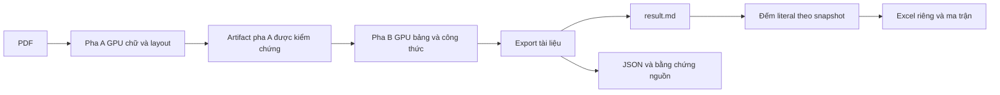
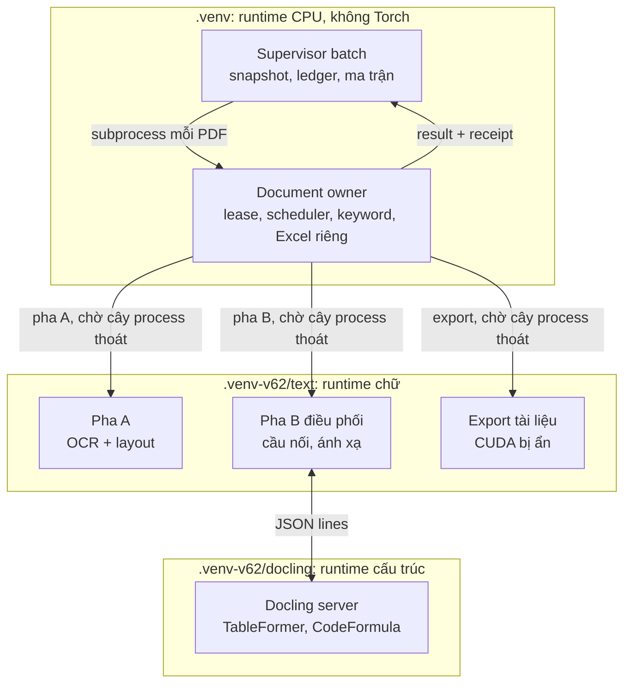

# Bộ prompt tái cấu trúc OCR_pdf theo module

Ngày soạn: 22/10/2026. Thư mục dự án tại thời điểm soạn: `C:\kk_2\OCR_pdf`.

Cập nhật cùng ngày: đối chiếu thiết kế với mã nguồn tại HEAD `e6a2190` cùng các thay đổi cục bộ chưa commit (đồ thị import tĩnh của 116 module trong `src/ocr` và 2 script được runtime dùng, runtime V6.3, ledger, test và notebook Kaggle); bổ sung các phần còn thiếu và ghi lại bốn quyết định chủ dự án đã chốt.

Mục tiêu là giúp quản lý, nâng cấp và kiểm thử từng phần của hệ thống một cách độc lập: giữ một repository và một distribution, chia package theo chức năng, cách ly hai runtime GPU và tái sử dụng kết quả hợp lệ theo từng bước xử lý. Kết quả cần có sớm nhất: đổi từ điển keyword hoặc Excel mà không phải OCR lại.

Đây là bộ hướng dẫn để thực hiện trong các lượt làm việc tiếp theo. Việc tạo và cập nhật tài liệu này chưa thực hiện thay đổi kiến trúc nào được mô tả bên dưới.

## Cách sử dụng

1. Dán **Prompt nền** vào đầu chat thực hiện công việc.
2. Chạy các giai đoạn theo thứ tự dưới đây. Mỗi giai đoạn là một phạm vi thay đổi có thể xem xét và kiểm chứng riêng; các prompt trong tài liệu được sắp đúng thứ tự này.

   ```text
   P00 → P00b → P01 → P02 → P03 → P04 → P11a → P05a → P05b → P06 → P07 → P08 → P09 → P10 → P11b → P12 → P13
   ```

   Theo quyết định D4, P11a chạy ngay sau P04; P11b hoàn thiện cache theo stage cho toàn pipeline sau khi đóng gói xong.
3. Với chat mới, dán lại Prompt nền và prompt của giai đoạn cần thực hiện. Yêu cầu agent đọc tài liệu này, `docs/architecture/MIGRATION_PLAN.md`, trạng thái và bằng chứng của các giai đoạn trước trong repository. Từ P01, cả hai tài liệu nằm trong `docs/architecture/` (được Git quản lý).
4. Chỉ chuyển giai đoạn khi các điều kiện tiên quyết được đáp ứng. Những kiểm tra chưa chạy phải có trạng thái cụ thể và lý do; không đổi chúng thành thành công.
5. Khi chỉ cần nâng cấp một phần sau khi đã tái cấu trúc, dùng mẫu **M01** hoặc **M02** ở cuối tài liệu.

Một giai đoạn có thể cần nhiều lượt làm việc. Không gom tất cả prompt thành một lần di chuyển mã lớn. Không yêu cầu agent tự commit, push, phát hành, thay đổi dữ liệu thật hoặc cài lại toàn bộ môi trường chỉ vì một prompt đề cập đến các việc đó trong kế hoạch.

Các đường dẫn hiện có trong tài liệu là điểm bắt đầu tra cứu, không thay thế việc đọc mã nguồn thực tế. Agent phải cập nhật bản đồ đường dẫn khi cấu trúc thay đổi.

## Quyết định đã chốt

Chủ dự án chốt các quyết định sau ngày 22/10/2026. Agent không tự thay đổi chúng. Nếu bằng chứng cho thấy một quyết định không khả thi, dừng phần việc liên quan và báo cáo kèm phương án.

| # | Chủ đề | Quyết định | Hệ quả |
| --- | --- | --- | --- |
| D1 | Đóng gói | Một distribution `ocr-pdf` với một `pyproject.toml` ở gốc; nhiều import package `ocr_*` trong `src/`. Dependency tối thiểu theo chức năng qua extras; lock riêng cho 3 runtime: CPU app, text GPU, Docling GPU. | Không tạo `pyproject.toml` con cho từng package. Tính độc lập được chứng minh bằng import-linter, kiểm tra import trong subprocess mới và job chỉ cài dependency tối thiểu. |
| D2 | Legacy | Đóng băng sau facade. Chỉ refactor sâu luồng V6.3; legacy giữ hành vi, chỉ sửa import tối thiểu và có smoke test tương thích. | Xem mục "Chính sách legacy". |
| D3 | Baseline | Giữ fallback Docling của V6.3 như chính sách có chủ đích. Sửa nhánh `GPUProcessor` đang nhận `result` sau lỗi worker trước P01: không chấp nhận thành công khi cây process còn sống hoặc chưa được xác minh đã thoát, hay khi exit code khác 0 chưa được phân loại. Result phải qua kiểm identity, receipt và artifact. | Giai đoạn P00b. |
| D4 | Ưu tiên | Đổi keyword hoặc Excel không phải OCR lại. | P11a chạy ngay sau P04; P11b sau P10. |

## Kiến trúc đích

Đây là pipeline module hoá có worker cách ly, phát hành dưới một distribution và một phiên bản chung. Schema, thuật toán, model, môi trường và closure mã của từng stage vẫn có nhận dạng riêng trong manifest. Ranh giới import được kiểm từ đầu, nên sau này có thể tách một package thành distribution riêng khi xuất hiện consumer độc lập mà không phải đổi API.

### Cây thư mục

```text
OCR_pdf/
├── pyproject.toml            # Distribution duy nhất `ocr-pdf`; extras theo chức năng
├── src/
│   ├── ocr_contracts/        # Model/schema, lỗi dùng chung, giao thức worker; chỉ phụ thuộc pydantic
│   ├── ocr_artifacts/        # Hash file, các biến thể canonical JSON digest, ghi nguyên tử, completion marker
│   ├── ocr_runtime/          # Đường dẫn/resource, cấu hình/profile, model registry, fingerprint, lock,
│   │                         # GPU lease, giám sát cây process, audit thiết bị, preflight
│   ├── ocr_text/             # Chuẩn hoá Unicode tiếng Việt, bảo vệ số, làm sạch chữ; thuần Python
│   ├── ocr_pdf_io/           # Đọc/render PDF, crop, chuyển hệ tọa độ
│   ├── ocr_recognition/      # Detector, VietOCR, đánh giá chất lượng chữ, routing chẩn đoán
│   ├── ocr_layout/           # Model DLA, adapter YOLO/RT-DETR, phân tích vùng trang
│   ├── ocr_structure/        # Bảng heuristic, Docling client, OCR bridge, ánh xạ/hợp nhất bảng-công thức
│   ├── ocr_document/         # Hợp nhất tài liệu, thứ tự đọc, furniture, section tree, kiểm tra tài chính,
│   │                         # Markdown/JSON và validator tài liệu
│   ├── ocr_keywords/         # Từ điển, snapshot, literal_v1, report và validator keyword
│   ├── ocr_reporting/        # Excel riêng, ma trận, kiểm workbook
│   ├── ocr_workers/          # Entry point và orchestrator pha A, pha B, export; Docling server
│   ├── ocr_pipeline/         # CLI V6.3, composition root, scheduler pha, document owner, ledger batch,
│   │                         # publication, analysis run
│   └── ocr/                  # Namespace cũ `src.ocr`: legacy đóng băng và alias tương thích, không thêm logic
├── config/                   # Nguồn duy nhất cho profile, từ điển, hardware
├── requirements/             # Lock theo runtime × nền tảng: cpu-app, text-gpu, docling-gpu
├── scripts/                  # Setup, model, benchmark, smoke; mã runtime không import từ đây
├── benchmark/                # Ground truth, evidence, mã đánh giá (giữ vị trí)
├── tests/                    # unit/<package>, contract, integration, golden, legacy_compat
├── kaggle/, docker/
└── docs/architecture/        # Quyết định và hướng dẫn kiến trúc được Git quản lý
```

Ghi chú:

- Thư mục trong `src/` là import package, không phải distribution. Mỗi package có README ngắn (trách nhiệm, public API, dependency được phép); test đặt trong `tests/unit/<package>/`. Trước khi chốt tên, kiểm tra xung đột với site-packages của cả ba runtime (P00).
- Giữ tên `scripts/`, không đổi thành `tools/`: README, CI, Dockerfile và notebook Kaggle đang gọi trực tiếp các đường dẫn này, đổi tên chỉ tăng thay đổi mà không tăng giá trị. Phần đang bị mã runtime import (`scripts/preflight_v62.py`, `scripts/docling_structure_worker.py`) chuyển vào package, file cũ trở thành wrapper mỏng.
- `ocr_artifacts` và `ocr_runtime` chỉ nhận trách nhiệm hạ tầng có ranh giới rõ ràng, không chứa tiện ích không phân loại được. `ocr_runtime` gồm những gì cả app lẫn worker cần để chạy và tự kiểm môi trường; điều phối thuộc `ocr_pipeline`.
- So với bản đầu của tài liệu, `ocr_runtime`, `ocr_text`, `ocr_layout`, `ocr_workers` và `ocr_pipeline` là bổ sung: mã hiện tại có các trách nhiệm này nhưng cây đích cũ không có chỗ cho chúng (xem "Điểm nối phát hiện khi đối chiếu mã").

### Bản đồ đường dẫn chính

Bảng dưới là đề xuất cho các module có ownership chưa hiển nhiên; đường dẫn tương đối với `src/ocr/`. P00 hoàn thiện bản đồ đầy đủ; mọi khác biệt so với bảng phải ghi lý do.

| Hiện tại | Đích | Ghi chú |
| --- | --- | --- |
| `domain/models/*`, `domain/routing/page_type.py`, lỗi dùng chung trong `domain/models/processing.py` | `ocr_contracts` | Hằng keyword trong `processing.py` chuyển cùng `ocr_keywords` (P03) |
| `runtime/atomic_io.py`, `gpu_scheduler.sha256`, `completion._sha256`, `keyword_contract.digest`, `config.config_hash` | `ocr_artifacts` | Giữ từng biến thể digest (P02) |
| `infrastructure/export/completion.py` | `ocr_artifacts` | Chỉ chuyển sau khi tách validator (P08) |
| `runtime/{paths,config,models,fingerprint,dependency_lock,process_tree,device,torch_placement,backend_probe,structured_logging}.py`, `GPULease`, `gpu_snapshot`, `lease_for_gpu`, `scripts/preflight_v62.inspect_environment` | `ocr_runtime` | `run_document`, `prepare_backend`, `GPUProcessor` thuộc `ocr_pipeline` |
| `infrastructure/postprocessing/{unicode_normalizer,numeric_guard,text_cleaner}.py` | `ocr_text` | Được pdf_io, recognition, layout, document dùng chung |
| `infrastructure/pdf/*` trừ `ocr_bridge.py` | `ocr_pdf_io` | |
| `infrastructure/ocr/*`, `infrastructure/quality/*`, `domain/routing/routing_policy.py`, `application/route_page.py` | `ocr_recognition` | V6.3 chỉ dùng routing để chẩn đoán |
| `infrastructure/layout/{dla_engine,page_content_analyzer,model_adapters,torch_layout}.py` | `ocr_layout` | |
| `infrastructure/layout/{document_layout_engine,diagram_builder,docling_structure}.py`, `infrastructure/pdf/ocr_bridge.py`, `infrastructure/table/hidden_text_layer.py`, `ProcessPageUseCase._enrich_structures` | `ocr_structure` | `hidden_text_layer` là thử nghiệm, không thuộc pipeline |
| `block_is_covered` và hàm hình học thuần khác trong `docling_structure.py` | Module hình học dùng chung (`ocr_contracts` nếu thuần Python) | Để `ocr_document` không phụ thuộc `ocr_structure` |
| `infrastructure/layout/region_tree.py`, `infrastructure/postprocessing/{reading_order,reading_order_graph,xy_cut,document_furniture,legacy_furniture,page_association}.py`, `infrastructure/structure/*`, `infrastructure/table/financial_checks.py`, `infrastructure/export/*` trừ keyword, `application/{export_document,resolve_document_layout,resolve_document_furniture}.py` | `ocr_document` | `PIPELINE_VERSION` là nguồn version động của `pyproject.toml` |
| `infrastructure/postprocessing/{keyword_counter,keyword_contract}.py`, phần JSON/receipt của `infrastructure/export/keyword_validator.py` | `ocr_keywords` | Model `KeywordReport` ở `ocr_contracts` |
| `infrastructure/export/{keyword_exporter,keyword_v63}.py`, phần kiểm workbook của `keyword_validator.py` | `ocr_reporting` | |
| `runtime/gpu_phase_worker.py`, `scripts/docling_structure_worker.py` | `ocr_workers` | Orchestrator V6.3 dựng ở P09 |
| `cli/unified.py`, `application/{process_batch,process_document,publish_keyword_matrix,recount_document}.py`, `infrastructure/state/batch_store.py`, `runtime/{v63_backend,v63_document_worker}.py`, `gpu_scheduler.run_document` | `ocr_pipeline` | Document owner là process CPU |
| `cli/{batch_runner,run_ocr,gpu_runner,collect}.py`, `application/{convert_document,count_keywords,reocr_region}.py`, `application/process_page.py` (vai trò orchestrator legacy), `runtime/{document_pool,run_manifest,hardware}.py`, `infrastructure/cache/artifact_cache.py`, `collect/` | Ở lại `src/ocr` | Legacy đóng băng, chỉ sửa import tối thiểu |

### Quy tắc phụ thuộc

| Package | Package nội bộ được import | Thư viện ngoài ở mức module | Ghi chú/cấm |
| --- | --- | --- | --- |
| `ocr_contracts` | — | pydantic | Cấm NumPy, PyMuPDF, OpenCV, Pillow, Torch, ONNX Runtime, VietOCR, Docling, Transformers, openpyxl |
| `ocr_artifacts` | contracts | — | |
| `ocr_text` | — | — | Chỉ stdlib |
| `ocr_runtime` | contracts, artifacts | PyYAML, psutil | Torch/ONNX Runtime chỉ được import trong hàm audit/probe. `__init__` không import submodule. Module Docling server dùng (`dependency_lock`, `torch_placement`) chỉ dùng stdlib ở mức module |
| `ocr_keywords` | contracts, artifacts | — | Không dùng `ocr_text`: `literal_v1` tự định nghĩa NFC + casefold |
| `ocr_reporting` | contracts, artifacts, keywords | openpyxl | |
| `ocr_pdf_io` | contracts, artifacts, runtime, text | PyMuPDF, NumPy, OpenCV, Pillow | |
| `ocr_recognition` | contracts, artifacts, runtime, text, pdf_io | như pdf_io + VietOCR, ONNX Runtime, Torch | Độc lập với `ocr_layout` |
| `ocr_layout` | contracts, artifacts, runtime, text, pdf_io | như pdf_io + ONNX Runtime; Torch/Transformers trong hàm | Độc lập với `ocr_recognition` |
| `ocr_structure` | contracts, artifacts, runtime, text, pdf_io | như pdf_io + psutil | Client không import Docling |
| `ocr_document` | contracts, artifacts, runtime, text, pdf_io | PyMuPDF (crop) | Không phụ thuộc recognition, layout, structure |
| `ocr_workers` | mọi package xử lý ở trên | theo runtime của worker | Cấm keywords, reporting, pipeline và ledger SQLite |
| `ocr_pipeline` | mọi package trừ `ocr_workers` (gọi worker qua subprocess) | PyMuPDF, PyYAML, psutil, openpyxl | Cấm Torch, VietOCR, ONNX Runtime, Docling ở bất kỳ module nào |
| `src.ocr` (legacy) | mọi package | như hiện tại | Package mới không import ngược `src.ocr`, trừ ngoại lệ tạm có hạn xoá |

Import-linter thực thi bảng này từ P02 và được mở rộng ở mỗi giai đoạn tạo package. Với thư viện ngoài, dùng hợp đồng `forbidden` cùng tuỳ chọn đưa external package vào đồ thị (kiểm tài liệu đúng phiên bản), và kiểm thêm `sys.modules` trong subprocess mới cho các package nhẹ. Package không liệt kê trong cột thứ hai là bị cấm. Mỗi cạnh mới cần ghi lý do trong `MIGRATION_PLAN.md`.

### Luồng dữ liệu

Luồng đích giữ thứ tự xử lý hiện tại:



### Process và runtime

Package không đồng nghĩa với process. Ví dụ `ocr_structure` có phần chạy trong runtime text (client, cầu nối OCR, ánh xạ) và phần chạy trong runtime Docling (server). Topology hiện tại:

| Process | Interpreter | Entry hiện tại | Việc | GPU |
| --- | --- | --- | --- | --- |
| Supervisor batch | `.venv` | `cli/unified.py` → `process_batch` | Snapshot, ledger SQLite, ma trận, publication | Không |
| Document owner, 1 PDF mỗi process | `.venv` | `runtime/v63_document_worker.py` | GPU lease, scheduler pha, kiểm nguồn GPU, đếm keyword, Excel riêng, marker hoàn tất | Không (giữ lease) |
| Pha A | `.venv-v62/text` | `gpu_phase_worker --phase text` | OCR toàn trang, layout, bảng heuristic, thứ tự đọc trang | CUDA |
| Pha B, process điều phối | `.venv-v62/text` | `gpu_phase_worker --phase structure` | Cầu nối OCR, ánh xạ bảng/công thức | Thấy CUDA; hiện còn import VietOCR qua `process_page` |
| Docling server | `.venv-v62/docling` | `scripts/docling_structure_worker.py --serve` | TableFormer, CodeFormula | CUDA |
| Export | `.venv-v62/text` | `gpu_phase_worker --phase export` | Hợp nhất tài liệu, Markdown/JSON, crop, validation | `CUDA_VISIBLE_DEVICES=""` |



Quy tắc:

- Refactor không chuyển một bước sang runtime khác. Mỗi runtime có lock riêng, nên đổi interpreter là đổi phiên bản PyMuPDF/NumPy/OpenCV và có thể làm thay đổi crop hoặc Markdown. Chuyển export sang `.venv` là thay đổi hành vi riêng, cần baseline riêng.
- Supervisor và document owner không import Torch, VietOCR, ONNX Runtime hay Docling; `run_document` đang kiểm `"torch" in sys.modules` và phải tiếp tục kiểm.
- P07 phải cắt việc process điều phối pha B import VietOCR.

### Nạp mã vào worker và fingerprint

- Hiện tại không runtime GPU nào cài mã dự án. `gpu_scheduler` đặt `PYTHONPATH=<repo>` và `cwd=<repo>` cho worker pha; Docling server thừa hưởng env này và import `src.ocr.runtime.dependency_lock` cùng `torch_placement`; document owner chạy `python -m` với `cwd=<repo>`.
- Trong P02–P09, giữ cơ chế nạp mã từ checkout và không cài package nội bộ vào `.venv-v62/*` (runtime đã khoá). Một hàm duy nhất trả về các thư mục mã (gốc repository cho `src.ocr`, `src/` cho `ocr_*`). PYTHONPATH của mọi worker và vùng file mà fingerprint băm đều lấy từ hàm này.
- Mỗi worker, sau khi import, kiểm `__file__` của các module `ocr_*` và `src.ocr` đã nạp đều nằm trong vùng đã băm; lệch thì dừng. Kiểm tra này chặn trường hợp bản cài cũ trong site-packages che checkout.
- P10 mới quyết định có cài wheel vào runtime worker hay không. Nếu cài, fingerprint lấy từ file đã cài và verifier lock ghi cả wheel nội bộ.

### Identity theo lớp

| Lớp | Thành phần | Hiện trạng | Đích |
| --- | --- | --- | --- |
| Extraction (`ocr_identity`, generation pha) | PDF hash, phạm vi trang, cấu hình thuật toán đã resolve, hash model/font, lock text và Docling, interpreter, `assets`, `output_mode`, schema, fingerprint mã extraction | Fingerprint phủ toàn bộ `src/ocr`, nên sửa mã keyword hoặc Excel cũng đổi `ocr_identity` và buộc OCR lại | Fingerprint chỉ phủ closure mã extraction: mọi mã trừ `ocr_keywords`, `ocr_reporting` và module ledger/publication/analysis, được import-linter chứng minh (P11a) |
| Analysis (`keyword_identity`) | Hash `result.md`, snapshot từ điển, policy và version, fingerprint `ocr_keywords` | Chỉ có hằng `POLICY_VERSION`; sửa mã đếm không đổi identity | Thêm fingerprint package keywords; giữ `literal_v1` |
| Publication | Batch/analysis run ID, revision, projection, schema workbook, fingerprint `ocr_reporting` | `batch_id` chứa toàn bộ backend, gồm fingerprint nguồn | Analysis run mới tham chiếu extraction đã kiểm; batch cũ bất biến |

Closure được tính bảo thủ: phủ thừa thì chỉ chạy lại, phủ thiếu thì nhận sai kết quả. Không bỏ thành phần ảnh hưởng output ra khỏi identity chỉ để tăng cache hit. Scheduler, backend, worker và phần dựng request thuộc closure extraction vì chúng ảnh hưởng output.

### Lớp tương thích

- Với module đã chuyển, đường dẫn cũ là alias `sys.modules` trỏ tới đúng module mới (cùng một object), không phải `from new import *`. Re-export tạo ra module khác, nên `mock.patch("src.ocr....X")` sẽ vá nhầm chỗ mà không báo lỗi. Test hiện có 97 lời gọi `monkeypatch.setattr` và nhiều `patch()` theo chuỗi đường dẫn, ví dụ `src.ocr.application.process_page.PDFRenderer`.
- Test mới vá theo đường dẫn mới, tại nơi tên được tra cứu. Có test khẳng định mỗi alias là cùng object với module đích.
- Shim không chứa logic. Danh sách shim, consumer còn dùng (test, notebook Kaggle, scripts, entry point trong `pyproject.toml`, `PIPELINE_VERSION` cho version động) và điều kiện xoá được ghi trong `MIGRATION_PLAN.md`.
- Khi `src/` nằm trong `sys.path`, `src/ocr` cũng import được dưới tên top-level `ocr`, tạo ra hai bản của cùng module. Cấm `import ocr` và `from ocr.` bằng import-linter hoặc test quét mã.

### Chính sách legacy

- Phạm vi đóng băng: `cli/{batch_runner,run_ocr,gpu_runner,collect}.py`, `application/convert_document.py`, `runtime/document_pool.py`, `collect/`, các nhánh chỉ legacy dùng trong `ProcessPageUseCase` (native-first, two-up, multi-region, orientation fallback, re-OCR vùng), `kaggle/ocr_pdf_kaggle.ipynb`, `scripts/run_count_only.py`.
- Facade giữ nguyên: `--backend legacy`, profile lịch sử và config không phải V6.3 tiếp tục được `unified.use_v63` chuyển sang legacy.
- Được phép sửa: import khi dependency chuyển chỗ (ưu tiên alias để không phải sửa gì) và lỗi do chính việc di chuyển gây ra. Không cải tiến thuật toán legacy.
- Logic dùng chung với V6.3 (nhận dạng, layout, bảng, thứ tự đọc, export) chỉ có một bản, nằm trong package. `ProcessPageUseCase` gọi các bước đã tách cho phần dùng chung; nhánh chỉ legacy dùng giữ nguyên trong lớp. Bước được tách phải là di chuyển nguyên văn.
- Một thay đổi có chủ đích ở module dùng chung có thể ảnh hưởng legacy. Smoke test legacy phải phát hiện chỗ gãy, và báo cáo giai đoạn phải nêu ảnh hưởng. Legacy không được bảo đảm giống từng byte.
- Smoke test legacy nằm trong `tests/legacy_compat/` (tạo ở P01): help của CLI legacy, `run_ocr.py --backend legacy --profile fast --device cpu --pages 1 --assets none` trên `examples/sample.pdf` khi model có sẵn, `scripts/run_count_only.py` trên output fixture, và import các module notebook legacy dùng. Thiếu model thì ghi NOT_RUN, không giả lập rồi ghi PASS.

## Những đặc điểm hiện tại phải đối chiếu trước khi sửa

- CLI mặc định nằm ở `src/ocr/cli/unified.py`, backend V6.3 `gpu_two_phase`, profile `unified_gpu_full_ocr`.
- `config/profiles-v63.yaml` yêu cầu CUDA, OCR mọi trang, `native_first: false`, `gpu_ocr_only_v1` và bridge `raster-plus-gpu-text-v1`.
- Pha A OCR/layout toàn tài liệu; chờ cây process kết thúc rồi mới chạy pha B Docling, sau đó đến export. Topology chi tiết ở mục "Process và runtime".
- Hai runtime GPU nằm dưới `.venv-v62/text` và `.venv-v62/docling`; V6.3 tái sử dụng tên và lock V6.2.
- `result.md` là nguồn đếm. `literal_v1` dùng NFC, `casefold`, escaped literal substring, không chồng lấn trong cùng keyword; các keyword khác nhau được đếm độc lập.
- Bộ từ điển `v1` có 88 vị trí hiển thị và 87 keyword duy nhất; `Internet di động` trùng ở vị trí keyword 43 và 45.
- Batch có snapshot, SQLite ledger, receipt, hash, completion marker và công bố ma trận theo revision.
- Một số nội dung trong `CLAUDE.md` mô tả nhánh legacy. Phải phân biệt hướng dẫn làm việc còn áp dụng với mô tả kiến trúc cũ; xác minh hành vi bằng CLI, profile và mã hiện tại.
- Tại thời điểm soạn, working tree có thay đổi cục bộ và tệp bị xoá sẵn. Không xem các thay đổi này là lỗi cần tự khôi phục. Thay đổi ở `config/profiles-v63.yaml`, `src/ocr/runtime/gpu_phase_worker.py` và `src/ocr/runtime/v63_backend.py` được xử lý theo D3 ở P00b.
- `.gitignore` hiện bỏ qua toàn bộ `docs/`. Đây là vấn đề cần giải quyết có chọn lọc khi đưa tài liệu kiến trúc vào Git.

## Điểm nối phát hiện khi đối chiếu mã

Kết quả đọc mã và phân tích import tĩnh (AST) ngày 22/10/2026: không có vòng import ở mức module, có hai vòng qua import trong hàm. Agent phải xác minh lại trên mã hiện hành trước khi sửa.

1. **`runtime/` chưa có chỗ trong cây đích cũ.** 18 module gồm cả hạ tầng dùng chung (paths, config, model registry, fingerprint, lock, giám sát process, lease, audit thiết bị) lẫn điều phối (scheduler, backend, worker). Các module lớp dưới import trực tiếp vào đây: `text_detector` → `runtime.backend_probe`, `runtime.models`; `vietnamese_seq2seq_engine` → `runtime.models`, `runtime.paths`; `docling_structure` → `runtime.paths`, `runtime.process_tree`; `manifest_exporter` → `runtime.fingerprint`, `runtime.models`; `document_furniture` → `runtime.config`; `dla_engine` → `runtime.device`. Không có `ocr_runtime` thì các phần này sẽ dồn vào `artifacts`/`contracts` hoặc tạo vòng import. *Xử lý: P02, P05a, P09.*
2. **Vùng băm fingerprint.** `runtime/fingerprint.py` chỉ băm `src/ocr/**/*.py` và `scripts/docling_structure_worker.py`. Nó không băm `scripts/preflight_v62.py`, dù `v63_backend` import file này. Nếu mã chuyển ra ngoài `src/ocr` mà vùng băm không mở rộng theo, sửa mã đã chuyển sẽ không làm đổi page cache key, `ocr_identity` hay generation, và kết quả cũ được nhận như kết quả của mã mới. *Xử lý: P02, trong cùng thay đổi với lần di chuyển đầu tiên.*
3. **Thư mục gốc tính theo vị trí file.** `Path(__file__).resolve().parents[N]` được gán cho `PROJECT_ROOT`/`ROOT` ở `runtime/paths.py` (N=3), `runtime/gpu_scheduler.py` (3) và `layout/docling_structure.py` (4). Chế độ checkout được nhận biết bằng `pyproject.toml` nằm cạnh ROOT. Chuyển file sang độ sâu khác làm ROOT trỏ sai thư mục mà không báo lỗi. *Xử lý: quy tắc từ P02, resolver chung ở P05a.*
4. **Vòng phụ thuộc qua import trong hàm.** `artifact_validator` → `keyword_validator` → `keyword_v63` (openpyxl) và `gpu_scheduler.sha256`; `completion.mark_completed` → `artifact_validator`; `gpu_scheduler.run_document` → `completion`. Ở đường legacy, `ExportDocumentUseCase` gọi `CountKeywordsUseCase`. Vì vậy validator tài liệu phụ thuộc keyword và Excel, và closure extraction của P11a không chứng minh được. *Xử lý: P03, P04, P08.*
5. **Nhiều biến thể digest.** Có ít nhất bốn kiểu serialize JSON trước khi băm. `keyword_contract.digest` dùng `ensure_ascii=False`, `separators=(",", ":")` và 64 hex, cho snapshot, `batch_id` và `ocr_identity`. Generation trong `run_document` dùng `sort_keys`, ASCII và separator mặc định. `config_hash` dùng `ensure_ascii=False`, `default=str` và 16 hex. `model_fingerprint`, cache key trang và `DoclingStructureExtractor.cache_fingerprint` dùng 16 hex; `resolve_document_layout` dùng 24 hex. Hash file SHA-256 có ít nhất sáu bản cài đặt. Hợp nhất bất kỳ hai biến thể nào cũng làm đổi identity và receipt cũ không còn kiểm được. *Xử lý: P02.*
6. **Mã runtime import từ `scripts/`.** `v63_backend.prepare_backend` import `scripts.preflight_v62`, trong khi `scripts/` không có trong wheel. *Xử lý: P05a, P10.*
7. **Pha B mượn phương thức của use case trang.** `gpu_phase_worker.run_structure` gọi `ProcessPageUseCase._enrich_structures` qua `SimpleNamespace`. Theo phân tích import tĩnh, việc import `process_page` kéo VietOCR và Torch vào process điều phối pha B. *Xử lý: P07.*
8. **Hàm hình học nằm trong Docling client.** `block_is_covered` nằm trong `docling_structure.py` và được `resolve_document_layout` dùng, nên tài liệu bị buộc phụ thuộc structure chỉ vì một hàm hình học. *Xử lý: P05b.*
9. **Export không chạy trên runtime CPU.** Export tài liệu chạy bằng interpreter text với CUDA bị ẩn; đếm keyword và Excel riêng chạy trong document owner (`.venv`). Bản đầu của tài liệu ghi "hợp nhất tài liệu trên CPU" và đặt document vào runtime CPU ở P10, dễ dẫn tới việc chuyển runtime ngầm. *Xử lý: P09, P10; chỉ chuyển khi có quyết định riêng.*
10. **Worker nạp mã qua `PYTHONPATH`.** Docling server import `src.ocr.runtime.*`. Cài package vào runtime đã khoá, hoặc quên thêm `src/` vào PYTHONPATH, sẽ làm worker chạy mã khác với mã được băm. *Xử lý: P02.*
11. **Test vá theo chuỗi đường dẫn.** Test tham chiếu 115 đường dẫn `src.ocr.*` khác nhau; notebook V6.3 import sáu module nội bộ. Re-export làm patch mất tác dụng trong khi test vẫn có thể qua. *Xử lý: chính sách alias từ P02.*
12. **Batch V6.3 hiện có sẽ không resume được.** `ocr_identity` và `batch_id` chứa toàn bộ fingerprint nguồn, nên ngay sau lần sửa mã đầu tiên `--resume` và `--recount` của các batch hiện có sẽ bị từ chối với `IdentityMismatch`. *Xử lý: khuyến nghị ở P00; đếm lại trên extraction cũ qua P11a.*
13. **Thay đổi cục bộ nới cổng.** `GPUProcessor` nhận `result` khi `supervised_run` báo lỗi, kể cả lỗi `GPU_PHASE_PROCESS_TREE_SURVIVED`. *Xử lý: P00b.*
14. **Đóng gói hiện tại.** `pyproject.toml` cài top-level package tên `src` và `benchmark`, và dependency gốc gồm Torch/VietOCR, nên không thể cài riêng keyword/reporting ở mức tối thiểu. *Xử lý: P10.*
15. **Tài liệu kiến trúc chưa vào Git.** `docs/` bị ignore toàn bộ. *Xử lý: P01.*

---

## Prompt nền dùng cho mọi giai đoạn

```text
Bạn đang làm việc trong dự án OCR_pdf. Hãy thực hiện giai đoạn được yêu cầu theo kiến trúc pipeline module hoá: một repository, một distribution ocr-pdf, nhiều import package ocr_* trong src/, hai runtime GPU cách ly và một runtime CPU cho điều phối.

Trước khi sửa:
1. Đọc AGENTS.md nếu có, hướng dẫn repository đang áp dụng, docs/architecture/PROMPTS_TAI_CAU_TRUC_MODULE_OCR_PDF.md (các mục Quyết định đã chốt, Kiến trúc đích, Điểm nối phát hiện khi đối chiếu mã), docs/architecture/MIGRATION_PLAN.md và trạng thái giai đoạn trước.
2. Kiểm tra git status, xác định thay đổi có sẵn của người dùng. Không reset, clean, checkout đè, tự khôi phục tệp bị xoá hoặc sửa các thay đổi ngoài phạm vi.
3. Đối chiếu mã hiện tại. Không mặc định cấu trúc, version, câu lệnh hoặc đường dẫn trong prompt vẫn còn đúng.
4. Thực hiện đầy đủ phần việc đã được yêu cầu, gồm mã, kiểm thử cần thiết, tài liệu và bằng chứng. Không kết thúc chỉ bằng kế hoạch khi prompt yêu cầu triển khai.

Các bất biến:
- Refactor không được tự đổi thuật toán, model, tham số OCR, chính sách nguồn chữ hoặc kết quả đếm.
- Giữ literal_v1, nguồn result.md, mapping canonical/display, semantics của số 0 và ô trống.
- Giữ các cổng kiểm chứng nguồn GPU, đủ trang, bridge, số liệu, receipt/hash, validation và publication revision.
- Không gắn confidence giả; không diễn giải PASS thành chứng nhận độ chính xác OCR.
- Không biến lỗi inference, lỗi môi trường hoặc lỗi xuất bản thành kết quả rỗng thành công.
- Worker chữ và Docling tiếp tục cách ly môi trường; supervisor và document owner không nạp Torch, VietOCR, ONNX Runtime hay Docling.
- Refactor không chuyển một bước xử lý sang runtime/interpreter khác. Export tài liệu đang chạy trong runtime text với CUDA bị ẩn.
- Mọi mã worker thực thi phải nằm trong vùng source fingerprint băm. PYTHONPATH của worker và vùng băm lấy từ cùng một hàm; di chuyển file không được tạo điểm mù.
- File mới hoặc file được chuyển không tính thư mục gốc bằng Path(__file__).parents[N]; dùng resolver chung.
- Đường dẫn import cũ được giữ bằng alias sys.modules trỏ tới đúng module mới, không bằng re-export. Shim không chứa logic.
- Package mới không import ngược namespace src.ocr, trừ ngoại lệ tạm có hạn xoá khai báo trong cấu hình import-linter. Không import src/ocr dưới tên top-level ocr.
- Legacy theo mục Chính sách legacy: chỉ sửa import tối thiểu và lỗi do việc di chuyển gây ra.
- Không tải lại model, nâng cấp dependency/model hoặc chạy toàn bộ dữ liệu thật trừ khi đó là phạm vi cụ thể của giai đoạn.
- Không di chuyển/xoá inputs, output, model, cache hay môi trường hiện hữu để làm đẹp cấu trúc thư mục. Không cài package vào runtime đã khoá .venv-v62/* trong lúc refactor.
- Không tự tạo commit, tag, worktree, push, phát hành hay triển khai dịch vụ.

Tương thích batch:
- Di chuyển mã làm đổi source fingerprint. Dùng output mới cho các phép chạy xác minh sau thay đổi.
- Không sửa hash/receipt/snapshot cũ để làm cho batch cũ có vẻ tương thích.
- Đọc/kiểm kết quả cũ và resume bằng runtime/mã nguồn phù hợp là hai khả năng khác nhau. Phải mô tả đúng giới hạn này. Từ P11a, đếm lại trên extraction cũ đã kiểm bằng analysis run, không bằng resume batch cũ.

Kiểm thử:
- Chọn kiểm thử theo phạm vi ảnh hưởng; dùng fixture nhỏ và các test hiện hữu trước.
- Import-linter và smoke test legacy hiện hành phải qua.
- Khi một tên được tra cứu ở module mới, cập nhật đường dẫn patch trong test theo nơi tra cứu; không để patch mất tác dụng mà test vẫn qua.
- Giữ đường dẫn interpreter của venv trên Linux mà không resolve symlink sang base interpreter.
- Trên Windows, nếu pytest gặp lỗi quyền thư mục tạm, xử lý theo hướng dẫn repository và cơ chế quyền hiện có; không thay ACL rộng để lách lỗi.
- Test mô phỏng không được ghi nhận là GPU inference thật. Kiểm thử không có ground truth không được dùng để công bố cải thiện độ chính xác.

Kết thúc giai đoạn:
- Báo cáo thay đổi, lý do, API mới/cũ, các kiểm tra đã chạy và kết quả thực tế.
- Ghi riêng NOT_RUN, BLOCKED hoặc FAIL kèm nguyên nhân; không che bằng skip hoặc nới tiêu chí.
- Cập nhật trong MIGRATION_PLAN.md: trạng thái giai đoạn, bản đồ đường dẫn, danh sách shim và ngoại lệ import, đường dẫn bằng chứng, việc còn lại.
- Chỉ hỏi khi có thông tin hoặc quyền thực sự thiếu. Quyết định triển khai thông thường được tự xử lý trong phạm vi đã giao.
```

---

## P00 Kiểm kê và lập kế hoạch chuyển đổi

Điều kiện: bắt đầu đợt tái cấu trúc; áp dụng Prompt nền.

```text
Hãy kiểm kê kiến trúc OCR_pdf và viết kế hoạch migration có thể thực hiện từng giai đoạn. Giai đoạn này chỉ đọc mã và tạo tài liệu kế hoạch, chưa di chuyển mã hay thay dependency.

Đọc ít nhất: pyproject.toml, setup.py, MANIFEST.in, pytest.ini, README, .gitignore, CI, các CLI (unified, run_ocr, batch_runner, gpu_runner, collect), profile V6.3/V6.2/legacy, model registry, lock, src/ocr/runtime/*, process_page, process_document, process_batch, keyword, export, notebook Kaggle và các test vá theo chuỗi đường dẫn.

Thực hiện:
1. Dựng đồ thị import tĩnh (AST) của src/ocr và các script được runtime import, phân biệt import mức module với import trong hàm. Lưu script và kết quả trong scratch/ hoặc docs/architecture. Đối chiếu với mục Điểm nối phát hiện khi đối chiếu mã: ghi điểm nào còn đúng, đã đổi hoặc mới phát hiện.
2. Phân biệt luồng mặc định V6.3, V6.2 và legacy; lập danh sách module chỉ legacy dùng, chỉ V6.3 dùng và dùng chung.
3. Liệt kê thành phần đã có interface/schema, nơi khởi tạo engine trực tiếp, vòng phụ thuộc, import nặng ở entry point CPU và các phép tính thư mục gốc theo số cấp thư mục.
4. Ghi rõ ownership của hash, các biến thể canonical JSON digest, atomic I/O, nguồn dữ liệu, validation, completion marker, ledger và publication.
5. Hoàn thiện bản đồ đường dẫn cũ → mới từ bảng trong tài liệu này. Chốt tên package sau khi kiểm xung đột với site-packages của .venv, .venv-v62/text và .venv-v62/docling (chỉ đọc danh sách package đã cài, không cài thêm). Không chia module chỉ theo độ dài file.
6. Xác định danh sách module thuộc closure extraction và closure analysis/publication cho P04 và P11a.
7. Viết bản nháp cấu hình import-linter theo bảng Quy tắc phụ thuộc, kèm các ngoại lệ tạm cần có trong quá trình chuyển và giai đoạn xoá từng ngoại lệ.
8. Lập danh sách consumer của đường dẫn cũ: test (gồm chuỗi trong patch/monkeypatch), notebook Kaggle, scripts, entry point và version động trong pyproject.toml, Dockerfile, CI, README.
9. Kiểm tra dữ liệu mẫu, test và môi trường thực có thể sử dụng. Không quét nội dung mọi PDF hoặc hash toàn kho model chỉ để lập inventory.
10. Phân tích ảnh hưởng của di chuyển mã lên source fingerprint, resource path, wheel, notebook Kaggle, Windows/Linux và batch cũ. Liệt kê các batch V6.3 hiện có (thư mục có batch_state.sqlite) cùng trạng thái hoàn tất đọc từ ledger hoặc batch_report.json; không băm lại toàn bộ output.
11. Đề xuất danh sách thay đổi nhỏ, thứ tự, tiêu chí chấp nhận và cách quay lại mã của từng thay đổi mà không can thiệp dữ liệu người dùng.

Tạo MIGRATION_PLAN.md ở gốc repository vì docs đang bị ignore, kèm migration status table theo đúng thứ tự giai đoạn của tài liệu này: P00, P00b, P01, P02, P03, P04, P11a, P05a, P05b, P06, P07, P08, P09, P10, P11b, P12, P13. Nêu trạng thái ban đầu, kết quả mong đợi và kiểm tra cần chạy của mỗi giai đoạn.

Trong báo cáo, nhắc chủ dự án: sau lần di chuyển mã đầu tiên, --resume và --recount của batch V6.3 hiện có sẽ bị từ chối vì source fingerprint đổi. Nếu còn batch dở cần hoàn tất bằng mã hiện tại, nên chạy xong trước P02, hoặc chủ dự án tự tạo worktree/tag cục bộ tại commit baseline để dùng riêng cho việc đó.

Đầu ra phải phân biệt rõ mã đang có với thiết kế đề xuất. Không tuyên bố chất lượng hoặc mức độ độc lập của module chỉ từ tên thư mục.
```

## P00b Sửa cổng chấp nhận kết quả worker

Điều kiện: P00 hoàn thành; áp dụng Prompt nền. Đây là thay đổi hành vi có chủ đích, nhỏ và tách riêng, theo quyết định D3.

```text
Hãy sửa cổng chấp nhận kết quả của document worker V6.3 và ghi chính sách fallback Docling thành văn bản, trước khi lập baseline.

Phạm vi: src/ocr/runtime/v63_backend.py (GPUProcessor), src/ocr/runtime/gpu_phase_worker.py (run_structure), config/profiles-v63.yaml, cùng test và tài liệu liên quan. Ba file này đang có thay đổi cục bộ của chủ dự án: đọc diff trước, giữ phần fallback Docling, không khôi phục về HEAD.

Chính sách:
1. V6.3 giữ docling.on_error: fallback. Trang Docling thất bại có docling_structure.status=FAILED_FALLBACK, giữ chữ/bảng heuristic và có region NEEDS_REVIEW. Validator tạo cảnh báo, nên tài liệu đạt NEEDS_REVIEW chứ không đạt PASS. Diff hiện tại cũng chấp nhận trạng thái success kèm errors khi on_error=fallback; validator cũng cảnh báo trường hợp này. Giữ hành vi đó như một phần của chính sách và ghi rõ trong tài liệu cùng test. Lỗi ngoài Docling (bridge, ánh xạ, I/O, thiếu receipt) vẫn làm pha B thất bại.
2. GPUProcessor chỉ coi một lượt là thành công khi đồng thời:
   - cây process của document worker đã được xác minh thoát hết;
   - exit code bằng 0, hoặc thuộc danh sách exit code khác 0 được phân loại tường minh, có lý do, bằng chứng log và test (mặc định danh sách rỗng);
   - response được ghi trong chính lượt thử này, parse được và đúng schema;
   - result qua kiểm identity (ocr_identity, thư mục output theo snapshot), receipt (report_sha256, completion_sha256) và artifact (verify_completed, validate_report, nguồn GPU), bằng các kiểm tra hiện có trong process_batch.accept hoặc tương đương.
3. GPU_PHASE_PROCESS_TREE_SURVIVED, timeout và lỗi không đóng được cây process là lỗi hạ tầng, kể cả khi response có result. Chúng không được chuyển thành SUCCEEDED, cũng không thành FAILED_DOCUMENT với số đếm rỗng.
4. Exit code khác 0 chưa được phân loại mà response vẫn có result: xử lý như lỗi hạ tầng. Batch dừng, revision đã công bố được giữ, và báo cáo ghi exit code cùng đoạn log để chủ dự án quyết định có phân loại hay không. Không để một lỗi lặp lại biến thành hàng loạt FAILED_DOCUMENT.
5. Mọi nhánh nhận result đều đi qua cùng một hàm kiểm chứng.

Kiểm thử bằng worker giả chạy qua subprocess thật, không dùng GPU:
- ghi result rồi thoát mã 1 → không nhận;
- ghi result, thoát mã 0, để lại process con: supervised_run dọn được và xác minh đã thoát → nhận; không xác minh được (ProcessTreeSurvived) → lỗi hạ tầng, ledger không có SUCCEEDED mới;
- response còn lại từ lượt thử trước → không nhận;
- result có hash report hoặc marker sai, hay thư mục output khác snapshot → không nhận;
- exit code đã được phân loại (nếu có) → chỉ nhận khi mọi kiểm tra còn lại đều qua;
- Docling FAILED_FALLBACK, và success kèm errors → tài liệu SUCCEEDED với validation NEEDS_REVIEW, được tính vào "Cần review" của ma trận, không PASS;
- lỗi ngoài Docling ở pha B → pha B thất bại.
Chạy lại tests/unit/test_v63_pipeline.py, test worker lifetime và test lỗi worker Kaggle.

Cập nhật README hoặc tài liệu V6.3 về chính sách fallback, và cập nhật MIGRATION_PLAN.md. Hoàn thành khi các test trên qua và không còn nhánh nào nhận result mà bỏ qua hàm kiểm chứng.
```

## P01 Thiết lập baseline và bằng chứng hồi quy

Điều kiện: P00 và P00b hoàn thành; áp dụng Prompt nền.

```text
Hãy tạo baseline cần thiết trước khi di chuyển mã. Phạm vi là fixture, kiểm thử hồi quy có ý nghĩa, smoke test legacy, tài liệu và trạng thái migration; không thay thuật toán xử lý.

Baseline là mã sau P00b: HEAD cùng các thay đổi cục bộ được giữ theo D3. Ghi nhận dạng baseline bằng commit (nếu chủ dự án đã commit) hoặc hash của git diff, kèm danh sách file.

Thực hiện:
1. Tái sử dụng test/fixture hiện có. Bắt đầu từ tests/unit/test_keyword_counter.py, tests/unit/test_v63_pipeline.py, tests/integration/test_keyword_counter_e2e.py và các test output/runtime liên quan; đọc điều kiện của từng test trước khi chạy.
2. Chọn bộ mẫu nhỏ bao phủ Unicode tiếng Việt, bảng/công thức, trang xoay hoặc nhiều cột khi đã có fixture, lỗi tài liệu và lỗi xuất bản. Tránh thêm dữ liệu riêng tư hoặc PDF dung lượng lớn vào Git.
3. Ghi baseline về Markdown, keyword canonical/display, nội dung số, tọa độ/nguồn chữ và các tham chiếu quan trọng. Phân loại trường biến thiên hợp lệ như timestamp/thời gian chạy; không bỏ qua hash hoặc provenance để làm test dễ qua.
4. Ghi giá trị baseline của từng hàm digest/identity trên input cố định: snapshot từ điển, batch_id, ocr_identity, generation, config_hash, model_fingerprint, cache key trang, cache fingerprint Docling, digest trong resolve_document_layout. P02 dùng các giá trị này để chứng minh không hàm nào đổi cách serialize.
5. Tạo tests/legacy_compat theo mục Chính sách legacy. Thiếu model thì ghi NOT_RUN.
6. Ghi danh sách kiểm tra CPU, GPU thật, model-dependent và ground-truth-dependent. Chạy phần có thể thực hiện; ghi chính xác phần chưa chạy.
7. Lưu bản tóm tắt CLI công khai và các cổng validation/publication cần giữ. Với batch cũ, kiểm tra khả năng đọc và phát hiện identity mismatch đúng hành vi.
8. Đưa docs/architecture vào phạm vi Git một cách có chọn lọc. Nếu cần đổi .gitignore, chỉ mở đúng thư mục tài liệu kỹ thuật; không đưa toàn bộ docs/output/model vào Git. Chuyển kế hoạch gốc vào vị trí này hoặc giữ một tệp chỉ dẫn rõ ràng.

Tạo baseline manifest và bằng chứng trong thư mục benchmark/evidence hoặc vị trí được kế hoạch chốt, với phân loại nguồn: fixture, mock, inference thật hoặc human ground truth.

Hoàn thành khi baseline có thể chạy lại, các test cần thiết qua, giới hạn được ghi rõ. Không dùng test giả lập 500 tài liệu để khẳng định đã chạy tải 500 PDF thật.
```

## P02 Tách contracts, artifacts và dựng cơ chế di chuyển

Điều kiện: P01 có baseline; áp dụng Prompt nền.

```text
Hãy tách hai package nền tảng ocr_contracts và ocr_artifacts trong src/, đồng thời dựng các cơ chế mà mọi lần di chuyển sau đều cần: vùng băm fingerprint, PYTHONPATH của worker, alias tương thích và import-linter. Theo D1, không tạo pyproject.toml riêng cho package.

Cơ chế di chuyển, làm trong cùng thay đổi với lần di chuyển đầu tiên:
1. Fingerprint: mở rộng vùng băm của source_fingerprint() để phủ mọi mã worker có thể nạp: src/ (gồm src/ocr và src/ocr_*), Docling worker và module trong scripts/ mà runtime import (scripts/preflight_v62.py). Thêm test: sửa một file trong package mới làm fingerprint đổi, và mọi file .py worker nạp đều nằm trong vùng băm.
2. PYTHONPATH: một hàm duy nhất trả về các thư mục mã (gốc repository cho src.ocr và src/ cho ocr_*). gpu_scheduler, Docling client và document owner dùng hàm này; vùng băm fingerprint lấy cùng danh sách. Worker kiểm __file__ của module ocr_* và src.ocr đã nạp nằm trong các thư mục đó. Kiểm bằng subprocess mới chạy từ CWD khác. Cập nhật pytest.ini cho cả hai đường import.
3. Alias: đường dẫn cũ là alias sys.modules trỏ tới đúng module mới. Thêm test khẳng định alias là cùng object, và mock.patch theo đường dẫn cũ tác động đúng module mới. Cấm import src/ocr dưới tên top-level ocr.
4. Import-linter: cài trong môi trường phát triển (.venv), không cài vào .venv-v62/*. Khai báo hợp đồng cho các package đã tạo và quy tắc "package mới không import src.ocr" cùng ngoại lệ tạm có hạn xoá. Chứng minh cấu hình bắt được một vi phạm cài thử có kiểm soát, rồi gỡ vi phạm đó.

ocr_contracts:
- Tái sử dụng model/schema hiện có (domain/models, PageType, lỗi dùng chung trong processing.py); chỉ tách phần thực sự dùng chung. Hằng keyword trong processing.py chuyển ở P03.
- Chuẩn hoá dữ liệu trang/tài liệu, bbox/hệ tọa độ, provenance, trạng thái, lỗi dùng chung và kiểu kết quả xử lý.
- Giữ tên field, alias, giá trị mặc định, serialization, ID và semantics của dữ liệu hiện tại. Không đổi wire schema chỉ vì thay vị trí class.
- Không import Torch, VietOCR, Docling, Transformers, ONNX Runtime, OpenCV, NumPy hoặc PyMuPDF. Giao thức liên process dùng tham chiếu ảnh/artifact, không dùng object model GPU hay numpy.ndarray.

ocr_artifacts:
- Tách hash file SHA-256 (hiện có ít nhất sáu bản cài đặt), các hàm canonical JSON digest và atomic I/O thật sự dùng chung.
- Mỗi biến thể serialize hiện có (khác nhau ở ensure_ascii, separators, default=str và độ dài cắt 16/24/64 hex) trở thành một hàm có tên riêng; nơi gọi giữ đúng biến thể đang dùng. Không hợp nhất thành một digest, không tạo digest mới rồi áp lên receipt cũ. So với giá trị baseline P01 của từng hàm.
- Chưa chuyển completion.py, vì mark_completed đang gọi validator tài liệu. Việc này làm ở P08, sau khi tách validator.
- Không phụ thuộc keyword, reporting, engine hoặc pipeline. Validation đặc thù tài liệu/keyword vẫn thuộc module có trách nhiệm tương ứng.

Kiểm chứng:
1. Round-trip các fixture JSON cũ, gồm confidence null, nguồn chữ và bbox.
2. Chạy các test schema/atomic I/O/hash liên quan và test giá trị digest/identity baseline.
3. Trong subprocess mới với PYTHONPATH chỉ gồm src/ và một venv tạm trong scratch/ chỉ có pydantic, kiểm import public API, chạy test của hai package và kiểm sys.modules không có thư viện nặng.
4. Chạy test V6.3 pipeline, worker lifetime, venv path và smoke legacy.

Cập nhật public API, quy tắc phụ thuộc, danh sách shim và migration status. Không nâng schema version nếu hình dạng/hành vi wire không thay đổi.
```

## P03 Tách bộ từ điển và thuật toán đếm

Điều kiện: P02 hoàn thành; áp dụng Prompt nền.

```text
Hãy tách ocr_keywords thành package CPU độc lập. Di chuyển logic từ keyword_counter.py, phần từ điển/snapshot/report trong keyword_contract.py, phần JSON/receipt của keyword_validator.py, hằng keyword trong processing.py và các model liên quan theo ownership đã chốt.

Yêu cầu hành vi:
- Nguồn đếm là nguyên văn result.md, gồm nội dung và cú pháp đang có trong file.
- NFC + casefold; re.escape và literal substring; không thêm word boundary, fuzzy, tokenizer, bỏ dấu, nối dòng hay chuẩn hoá khoảng trắng. Không dùng ocr_text cho phần chuẩn hoá của literal_v1.
- Cùng keyword không chồng lấn; keyword khác nhau đếm độc lập.
- Giữ thứ tự display, mapping canonical, ID keyword, snapshot hash và hai tổng.
- Bộ v1 giữ 88 display/87 canonical cùng mục trùng. Bộ tuỳ chỉnh dùng version phù hợp, không nới kiểm v1.

Thiết kế public API cho đọc từ điển, tạo/kiểm snapshot, đếm văn bản, tạo/kiểm report và kiểm nhóm artifact keyword dạng JSON/receipt. API đếm thuần không đọc Excel, khởi động worker, yêu cầu PDF gốc hoặc sửa ledger.

Cắt phụ thuộc ngược:
1. Mã runtime và pipeline lấy digest từ ocr_artifacts, không từ keyword_contract.
2. artifact_validator (validator tài liệu) không import keyword_validator nữa. Validator nhóm keyword thuộc ocr_keywords; nơi hoàn tất tài liệu V6.3 (finalize_keywords và mark_completed) nhận validator tổng hợp do caller truyền vào. Giữ nguyên cổng: output khai báo keyword_contract không thể được đánh dấu hoàn tất khi nhóm keyword thiếu file, sai hash hoặc sai mapping. Phần kiểm workbook tạm gọi qua đường dẫn hiện có cho đến P04.
3. Ở đường legacy, việc ExportDocumentUseCase gọi CountKeywordsUseCase chuyển thành hook do caller truyền vào; facade legacy truyền hook đếm cũ để giữ hành vi.

Phân biệt API đếm thuần với recount batch V6.3: CLI recount cũ tiếp tục qua snapshot, identity và publication gate hiện có. Không biến việc tách package thành cách bỏ các kiểm tra này.

Kiểm thử phải bao phủ hoa/thường, NFC/NFD, dấu tiếng Việt, ký tự regex, khoảng trắng/xuống dòng, chuỗi con, không chồng lấn, keyword trùng, report bị thay đổi và việc mất từng file trong nhóm keyword. Tái sử dụng test hiện có; thêm trường hợp thiếu có giá trị kiểm chứng.

Hoàn thành khi package import và chạy test được trong venv tạm chỉ có dependency trực tiếp (không model, GPU, openpyxl hay PyMuPDF), kết quả baseline không đổi, import-linter chứng minh ocr_keywords chỉ phụ thuộc contracts/artifacts, và CLI V6.3 chưa bị thay semantics.
```

## P04 Tách Excel và ma trận báo cáo

Điều kiện: P03 hoàn thành; áp dụng Prompt nền.

```text
Hãy tách ocr_reporting từ keyword_exporter.py, keyword_v63.py và phần đọc/kiểm workbook tương ứng. Reporting nhận dữ liệu report/record theo contracts và ocr_keywords; không chạy OCR hoặc tính lại số đếm.

Thực hiện:
1. Cung cấp API riêng cho Excel từng tài liệu, ma trận batch và kiểm workbook.
2. Giữ tên sheet/cột, thứ tự keyword, số 0/ô trống, tổng canonical/display và dữ liệu trạng thái theo hợp đồng hiện có.
3. Giữ cách ghi keyword/tên PDF thành literal text, kể cả chuỗi bắt đầu bằng dấu bằng; giữ tổng bằng giá trị số theo hành vi hiện tại.
4. Tách việc tạo và kiểm file Excel khỏi việc điều phối ledger. Quyết định prepare/publish/acknowledge revision vẫn do pipeline điều phối.
5. Giữ ghi tạm, thay thế nguyên tử và đọc lại kiểm chứng; lỗi xuất bản phải truyền thành lỗi tương ứng, không thành FAILED_DOCUMENT với số đếm rỗng.
6. Nếu cần đường dẫn cũ, giữ alias, không sao chép logic format.
7. Phần kiểm workbook riêng (verify_document) trở thành validator của ocr_reporting; validator tổng hợp từ P03 gọi nó qua API mới.
8. Thêm hợp đồng import-linter: các module thuộc closure extraction (danh sách trong MIGRATION_PLAN.md) không import ocr_keywords, ocr_reporting hay module ledger/publication. Đây là điều kiện tiên quyết của P11a.

Kiểm thử trên report/record fixture: workbook riêng và ma trận; 88/87; tài liệu thành công không khớp; tài liệu lỗi/chưa xử lý; file lỗi hoặc bị sửa; lỗi ghi; dữ liệu dễ bị hiểu là formula. Đối chiếu giá trị và cấu trúc workbook, không so byte XLSX nếu metadata ZIP biến thiên.

Chạy reporting độc lập trong venv tạm chỉ có dependency trực tiếp (pydantic, openpyxl). Không kéo Torch, VietOCR, Docling hoặc model để chạy test Excel.

Cập nhật use case hiện có để sử dụng API mới, rồi chạy lại kiểm thử keyword và publication liên quan. Chỉ coi hoàn thành khi publication gate vẫn được giữ và hợp đồng ở mục 8 qua.
```

## P11a Tách identity extraction và chạy analysis trên extraction đã kiểm

Điều kiện: P04 hoàn thành và hợp đồng import-linter "extraction không import keywords/reporting/publication" qua; áp dụng Prompt nền. Đây là thay đổi hành vi có chủ đích theo D4, tách khỏi các refactor.

```text
Hãy triển khai P11a: tách identity extraction khỏi analysis/publication và thêm analysis run dùng extraction đã kiểm chứng, để đổi từ điển keyword hoặc Excel không gọi OCR. Trước khi sửa, đọc fingerprint, ocr_identity, ocr_receipt, batch snapshot, recount, ledger, validate_gpu_source và validator hiện tại.

Thiết kế bắt buộc:
1. Fingerprint theo closure, tính bảo thủ:
   - extraction: toàn bộ mã trong vùng băm trừ ocr_keywords, ocr_reporting và các module ledger/publication/analysis có tên trong danh sách tường minh. Scheduler, backend, worker và phần dựng request/config thuộc extraction.
   - analysis: ocr_keywords cùng phần contracts/artifacts mà nó dùng.
   - publication: ocr_reporting cùng các module ledger/publication.
   Một file mà stage thực sự dùng nằm ngoài closure là lỗi; phủ thừa thì chấp nhận được.
2. Lần chạy mới dùng fingerprint extraction cho ocr_identity và generation. keyword_identity thêm fingerprint analysis, giữ literal_v1, POLICY_VERSION và snapshot. Publication identity thêm fingerprint reporting và schema workbook.
3. Tách process_document thành phần chấp nhận extraction (validate_gpu_source, ocr_receipt) và phần finalize keyword, để mỗi phần thuộc đúng closure.
4. Thêm lệnh/API analysis run. Đầu vào: một hoặc nhiều nguồn extraction (thư mục batch V6.3 hoặc thư mục tài liệu), từ điển/policy và một output mới. Với từng tài liệu, kiểm marker hoàn tất, ocr_receipt.json, manifest, đủ trang, bằng chứng GPU từng trang, cầu nối pha B và hash result.md. Chỉ đọc nguồn, không sửa hay ghi thêm file vào nguồn.
5. Output của analysis run gồm snapshot, ledger, report keyword từng tài liệu, Excel riêng, ma trận và manifest nhập. Manifest nhập ghi nguồn (đường dẫn, batch_id, ocr_identity cũ, pipeline version, hash result.md/manifest/receipt) cùng fingerprint analysis/publication hiện tại. Không ghi rằng mã mới đã thực hiện inference.
6. Khi chỉ mã reporting đổi (analysis identity không đổi): tái dùng report keyword đã kiểm, chỉ dựng lại workbook trong một publication mới; không đếm lại, không OCR.
7. Giữ prepare → publish → đọc lại → acknowledge theo từng tài liệu. Tài liệu nguồn không đạt kiểm tra thành FAILED_DOCUMENT kèm lý do, không có số đếm, không bị bỏ qua âm thầm.
8. Không sửa snapshot, ledger, receipt hay hash của batch V6.3 cũ. Sau khi mã đổi, --resume và --recount trên batch cũ vẫn báo IdentityMismatch như trước; README hướng dẫn dùng analysis run thay thế.

Kiểm thử bằng call counter tại ranh giới scheduler/worker:
- đổi từ điển → 0 lần gọi scheduler/OCR;
- đổi mã reporting → 0 OCR, 0 lần đếm lại;
- đổi mã keywords → đếm lại, 0 OCR;
- đổi mã extraction → ocr_identity đổi;
- nguồn bị sửa result.md, manifest hoặc receipt; thiếu trang; có synthetic probe; có text native → bị từ chối;
- thư mục nguồn có hash giống hệt trước và sau khi chạy;
- crash giữa publish → phục hồi như batch hiện tại.

Nếu có batch V6.3 thật, chạy analysis run trên nguồn đó ở chế độ chỉ đọc với output mới và cùng từ điển, rồi đối chiếu: số đếm phải trùng khớp ma trận đã công bố. Không có batch thật thì ghi NOT_RUN.

Hoàn thành khi đổi từ điển hoặc Excel không gọi OCR, đổi mã extraction làm mất hiệu lực extraction, và không có đường vòng nào bỏ qua cổng gpu_ocr_only_v1.
```

## P05a Tách runtime dùng chung và chuẩn hoá chữ

Điều kiện: P11a hoàn thành; áp dụng Prompt nền.

```text
Hãy tách ocr_runtime và ocr_text theo bản đồ P00.

ocr_runtime:
- Gồm: paths/resource với một resolver thư mục gốc duy nhất, config/profile và validation, model registry/hash, fingerprint (đã mở rộng ở P02 và P11a), dependency_lock, process_tree/supervised_run, GPULease/gpu_snapshot/lease_for_gpu, device/torch_placement/backend_probe, structured_logging, preflight (inspect_environment từ scripts/preflight_v62.py; script cũ thành wrapper).
- Không gồm điều phối: run_document, prepare_backend, GPUProcessor và entry point worker chuyển ở P09. run_manifest, hardware và document_pool ở lại legacy.
- Ở mức module chỉ import stdlib, PyYAML, psutil. Torch/ONNX Runtime chỉ import trong hàm. __init__ không import submodule. Module Docling server dùng (dependency_lock, torch_placement) chỉ dùng stdlib ở mức module và phải import được trong .venv-v62/docling: kiểm bằng subprocess thật nếu venv có sẵn, nếu không thì ghi NOT_RUN và kiểm bằng phân tích import.
- Thay mọi Path(__file__).resolve().parents[N] trong mã runtime bằng resolver. Chế độ checkout xác định bằng marker rõ ràng hoặc biến môi trường, không chỉ dựa vào sự có mặt của pyproject.toml. Test resolver từ CWD khác, từ checkout và từ resource đóng gói.
- Giữ semantics: thứ tự ưu tiên config, lỗi khi thiếu profile, các biến OCR_*, lease dựa trên khoá của kernel, Windows Job Object kill-on-close, process group trên Linux, log tail có giới hạn.

ocr_text:
- Gồm unicode_normalizer, numeric_guard và text_cleaner; thuần Python.
- Giữ hành vi từng ký tự. Test NFC/NFD, dấu tiếng Việt, số âm, phần trăm, ngày, mã và đơn vị liền kề.

Kiểm chứng: test runtime hiện có (v6_runtime, v62_gpu_scheduler, v6_worker_lifetime, venv_interpreter_paths, v62_backend_probe, v6_structured_logging), import supervisor không nạp Torch, fingerprint vẫn phủ đủ, PYTHONPATH worker không đổi tập mã, smoke legacy qua.
```

## P05b Tách đọc PDF và xử lý hình học

Điều kiện: P05a hoàn thành; áp dụng Prompt nền.

```text
Hãy tách ocr_pdf_io cho đọc/kiểm PDF, render ảnh, crop và chuyển hệ tọa độ. Phạm vi gồm infrastructure/pdf trừ ocr_bridge.py (thuộc ocr_structure, chuyển ở P07).

Thực hiện:
1. Công khai các API cần thiết cho thông tin tài liệu/trang, render, crop và biến đổi bbox/polygon. Giữ số trang, DPI, góc xoay, alpha/chuyển màu và coordinate space hiện tại.
2. Cách ly PyMuPDF và xử lý ảnh phụ trợ trong package này. Không đưa kiểu engine PDF vào contracts chung nếu không cần thiết; dùng kiểu dữ liệu hoặc reference trung lập qua worker.
3. Chuyển block_is_covered và các hàm hình học thuần khác ra khỏi docling_structure.py về module hình học dùng chung (ocr_contracts nếu thuần Python), để ocr_document không phải phụ thuộc ocr_structure.
4. Quản lý vòng đời document/page/image rõ ràng. Không truyền đối tượng tài liệu đang mở qua process, cũng không mặc định có thể dùng chung an toàn giữa các thread.
5. Giữ hành vi đối với PDF mã hoá, trang xoay, bbox ngoài biên, ảnh có mask và dữ liệu rỗng theo hợp đồng hiện có.
6. Khai báo resource nếu cần; không phụ thuộc người dùng luôn đứng ở repository root.

Kiểm chứng bằng fixture nhỏ cho kích thước ảnh, transform thuận/nghịch, crop và tọa độ trang xoay; đối chiếu test geometry, scan_image, region_cropper hiện có. Khi có PDF cần thiết, chạy smoke trong output mới; không dùng pipeline GPU toàn batch để kiểm một hàm hình học.

Hoàn thành khi mọi nơi gọi dùng public API của ocr_pdf_io, package không nạp model OCR và baseline hình học không thay đổi.
```

## P06 Tách nhận dạng chữ, layout và chia nhỏ pipeline trang

Điều kiện: P05b hoàn thành; áp dụng Prompt nền.

```text
Hãy tách ocr_recognition và ocr_layout, rồi chia nhỏ trách nhiệm trong ProcessPageUseCase. Đây là refactor hành vi hiện tại; không thay model hoặc tối ưu thuật toán trong cùng giai đoạn.

Thực hiện:
1. ocr_recognition gồm detector ONNX, VietOCR adapter, fallback engine/candidate scorer, đánh giá chất lượng chữ OCR/native và routing chẩn đoán. ocr_layout gồm DLA, adapter YOLO/RT-DETR, torch layout và phân tích vùng trang. Hai package độc lập với nhau.
2. Tách các bước có thể kiểm thử mà V6.3 thực thi: lấy ảnh qua pdf_io; nhận dạng; chuyển tọa độ; đánh giá chất lượng/bảo vệ số/hallucination; layout; tạo evidence.
3. ProcessPageUseCase tiếp tục phục vụ cả V6.3 và legacy trong giai đoạn này. Phần dùng chung gọi bước đã tách (chỉ một bản logic); nhánh chỉ legacy dùng giữ nguyên. Bước được tách là di chuyển nguyên văn; test hiện có của process_page và smoke legacy phải qua, chỉ đường dẫn patch được cập nhật theo nơi tra cứu mới. Nếu không thể tách mà vẫn giữ hành vi legacy, dừng và báo cáo.
4. Tái sử dụng BaseOCREngine hoặc chuyển thành interface tương đương có kiểu kết quả rõ ràng. Worker/factory khởi tạo implementation và truyền vào bước; phần nghiệp vụ không tự chọn class cụ thể ở nhiều nơi.
5. Giữ nguyên preprocessing detector, full-page scope, ngưỡng, crop, batch, xử lý OOM, NFC, numeric guard, rejected evidence và nguồn confidence.
6. V6.3 vẫn OCR mọi trang; các tín hiệu native chỉ phục vụ chẩn đoán theo code hiện tại. Giữ đúng nhánh legacy/native-first và các tùy chọn riêng của nó.
7. Giữ placement audit, số lần inference thật và trạng thái trang không có detection. Không tạo lệnh nhận dạng giả chỉ để hoàn thiện receipt.

Kiểm thử:
- Unit bằng fixture/model double ở ranh giới engine; xác nhận double không thể được ghi là document GPU inference thật.
- Test hồi quy routing, numeric guard, Unicode, geometry, OOM/error và các flag đang tắt ở V6.3.
- So page JSON pha A với baseline P01 trên cùng input.
- Nếu GPU/runtime/model sẵn có, chạy smoke nhỏ thật với output mới và so baseline. Nếu thiếu, ghi NOT_RUN rõ ràng; không sửa policy sang CPU để vượt qua kiểm tra.

Hoàn thành khi các bước nhận dạng/layout có API và test riêng, source provenance không đổi, supervisor vẫn không nạp model và ProcessPageUseCase giảm trách nhiệm một cách đo được bằng bản đồ chức năng trước/sau.
```

## P07 Tách cấu trúc bảng công thức và OCR bridge

Điều kiện: P06 hoàn thành; áp dụng Prompt nền.

```text
Hãy tách ocr_structure, gồm bảng heuristic (document_layout_engine, diagram_builder), Docling client, OCR bridge, ánh xạ bảng/công thức và hợp nhất evidence liên quan. Giữ implementation/model hiện tại trong runtime Docling riêng.

Thực hiện:
1. Định nghĩa StructureBackend và kiểu request/result công khai. Mã ngoài adapter không phụ thuộc object nội bộ Docling hoặc đường cache Hugging Face.
2. Chuyển ProcessPageUseCase._enrich_structures thành hàm của ocr_structure với đầu vào tường minh (backend, trang/cầu nối, blocks, tables, regions, metadata). Pha B không còn gọi qua SimpleNamespace và không import process_page; thêm test khẳng định vietocr và các module recognition không có trong sys.modules sau khi nạp module điều phối pha B.
3. Dựng bridge từ ảnh raster và chữ OCR pha A; giữ policy raster-plus-gpu-text-v1, font có kiểm glyph và hệ tọa độ đã xác minh. Không sao chép text layer native vào đường V6.3.
4. Giữ Docling OCR tắt, table_mode, cell matching, formula token budget, lựa chọn trang và model revision theo profile/registry hiện tại.
5. Giữ nguồn text/table/formula rõ ràng. CodeFormula có thể sinh LaTeX từ ảnh; không gắn mọi ký tự đầu ra thành chữ do VietOCR trực tiếp sinh.
6. Bảo toàn logic thay bảng chồng lấp, bổ sung ô rỗng, tránh lặp chữ và giữ evidence khi cấu trúc không chứng minh đã giữ đủ nội dung.
7. Giữ timeout, worker log, đóng process, FAILED_FALLBACK/NEEDS_REVIEW theo chính sách P00b và confidence null khi chưa có số đo. Không đổi heuristic thành nhãn model.

Kiểm chứng:
- Contract tests dùng kết quả Docling fixture; kiểm bbox, cell, formula, provenance, nguồn chữ và reference.
- Test bridge có tiếng Việt và trang xoay; kiểm không có native text bị copy.
- Test lỗi/timeout, fallback và cleanup. Những kiểm tra placement thực cần inference thật.
- Smoke model thật khi môi trường đáp ứng; kiểm HTML bảng, TeX và nội dung Markdown tương ứng.

Hoàn thành khi có thể thay implementation qua adapter mà phần điều phối vẫn kiểm được schema và source policy. Không tích hợp thêm Marker/MinerU ở giai đoạn này.
```

## P08 Tách hợp nhất tài liệu và các renderer

Điều kiện: P07 hoàn thành; áp dụng Prompt nền.

```text
Hãy tách ocr_document cho hợp nhất kết quả trang thành tài liệu, thứ tự đọc, furniture, section tree, kiểm tra tài chính và các biểu diễn đầu ra. Giữ thuật toán hiện tại và nguồn đếm result.md.

Thực hiện:
1. Tái sử dụng ExtractedDocument và các schema extraction/structure/document; định nghĩa rõ mô hình nội bộ cùng quy tắc chuyển sang từng artifact. Không tạo thêm một bản sao nội dung không có mapping nguồn.
2. Tách các processor cho reconcile evidence, bố cục toàn tài liệu, header/footer, section và liên kết bảng/ảnh/công thức. Mỗi processor công khai dữ liệu cần và dữ liệu tạo ra.
3. Giữ region_tree_graph_v1, document_context_v3, topological order/cycle review và stable ID theo hành vi hiện tại.
4. Tách MarkdownRenderer, JSON exporter và artifact validation theo trách nhiệm; rendering không khởi tạo OCR/Docling.
5. Chuyển completion.py về ocr_artifacts: mark_completed nhận kết quả hoặc validator tổng hợp do caller truyền, không tự import validator tài liệu. Giữ nguyên cổng: không đánh dấu hoàn tất output không qua validator đã khai báo.
6. Giữ PIPELINE_VERSION là nguồn version động của pyproject.toml (cập nhật đường dẫn attr trong cùng thay đổi hoặc giữ alias).
7. Giữ khác biệt có chủ đích giữa result.md và document.md. Keyword tiếp tục đếm result.md, không chuyển sang JSON hoặc document.md.
8. Giữ số liệu tài chính theo chế độ gắn cờ; không tự sửa giá trị, xoá evidence hoặc ghép bảng khi refactor.

Kiểm chứng:
- Chạy fixture nhiều cột, furniture lặp, bảng/công thức và xung đột thứ tự đọc hiện có.
- Kiểm ID và reference đầy đủ, evidence không bị mất khi bỏ text đã được bảng thể hiện.
- So JSON Schema sinh từ contract_schema trước và sau khi chuyển.
- Đối chiếu Markdown và keyword counts baseline. Nếu có biến thiên được cho phép, chỉ rõ nguyên nhân; thay đổi thuật toán phải tách sang giai đoạn khác.
- Kiểm render/validation với assets png/jpeg/none và output compact/legacy theo phạm vi hỗ trợ hiện tại.

Hoàn thành khi có thể xử lý fixture trang đã trích xuất thành tài liệu mà không nạp model GPU, import-linter chứng minh ocr_document không phụ thuộc recognition/layout/structure/keywords/reporting, và renderer mới có thể được thêm qua interface mà không sửa logic OCR.
```

## P09 Chuẩn hoá worker và pipeline điều phối

Điều kiện: P08 hoàn thành; áp dụng Prompt nền.

```text
Hãy chuẩn hoá ocr_pipeline (runtime CPU) và ocr_workers (runtime text và Docling). Giữ hành vi CLI công khai cùng thứ tự pha A → kết thúc cây process → pha B → kết thúc cây process → export → kết thúc cây process → keyword/Excel → ma trận.

Thực hiện:
1. ocr_pipeline gồm CLI V6.3, composition root, chuẩn bị backend (prepare_backend, verify_runtime), scheduler pha (run_document) với GPU lease, document owner, process_batch, ledger, publication và analysis run. Không module nào import Torch, VietOCR, ONNX Runtime hoặc Docling.
2. ocr_workers gồm entry point pha A, pha B, export và Docling server (từ scripts/docling_structure_worker.py; script cũ thành wrapper, resource đóng gói và cache_fingerprint của Docling cập nhật đường dẫn). Orchestrator pha A/B/export của V6.3 được lắp từ các bước đã tách ở P06–P08; V6.3 không còn dùng ProcessPageUseCase, lớp này ở lại làm orchestrator legacy. Export vẫn chạy bằng interpreter runtime text với CUDA bị ẩn. Đường V6.2 legacy (cli/gpu_runner.py gọi run_document với finalize_document=True) hiện đếm keyword ngay trong pha export; giữ đường này qua entry hoặc hook legacy, không để ocr_workers import keywords.
3. Lắp ráp engine/backend ở entry point hoặc factory. Pipeline phụ thuộc contracts và API module, không phụ thuộc trực tiếp lớp model cụ thể.
4. Định nghĩa giao thức request/response có phiên bản trong ocr_contracts: request ID, attempt, stage, nguồn PDF/artifact, page scope, output đích, cấu hình, source policy và nhận dạng runtime. Dùng JSON và đường dẫn/artifact reference; không truyền Python pickle hoặc object GPU.
5. Response mô tả trạng thái, artifact/receipt được tạo, metrics, lỗi phân loại và bằng chứng thực thi. Không đưa chuỗi lệnh shell vào request để worker thực thi. Hàm kiểm chứng kết quả của P00b áp dụng cho mọi response.
6. Giữ model stdout khỏi kênh dữ liệu nếu dùng JSON lines; log đi kênh/file riêng. Kiểm malformed response, response cũ, sai request ID và artifact bị sửa.
7. Giữ GPU lease, timeout, giới hạn retry và dọn toàn cây process. Chỉ chạy pha B khi pha A kết thúc đúng; lease không được mất trong khoảng chuyển pha.
8. Giữ phân biệt DocumentProcessingError, PublicationError và IdentityMismatch hoặc kiểu tương đương. Hàng thất bại không giữ số đếm cũ khi chạy thay thế lỗi.
9. Giữ prepare → publish Excel → đọc lại → acknowledge revision trước PDF tiếp theo. Worker không tự ghi trực tiếp trạng thái công bố vào SQLite.
10. Giữ entry point CLI và import cũ qua alias. Đường interpreter Linux phải giữ symlink venv; không dùng resolve() làm mất site-packages của worker.

Kiểm thử protocol/process bằng subprocess nhỏ; test timeout/crash/retry, fake receipt, process con còn sống, revision recovery và lock contention. Chạy lại test lifetime, venv path, V6.3 pipeline và smoke legacy liên quan. So output tài liệu V6.3 với baseline P01.

Hoàn thành khi giao thức và ownership rõ ràng, supervisor import được mà không nạp model GPU, và bằng chứng cũ vẫn được kiểm hoặc bị từ chối đúng lý do.
```

## P10 Hoàn thiện đóng gói và môi trường thư viện

Điều kiện: P09 hoàn thành; áp dụng Prompt nền.

```text
Hãy hoàn thiện đóng gói một distribution và quản lý dependency theo D1. Dùng công cụ dự án hiện có; tra tài liệu chính thức trước khi dùng tính năng quản lý dependency mới.

Thiết kế:
- pyproject.toml ở gốc là nguồn metadata duy nhất. Dependency gốc tối thiểu, chỉ gồm những gì contracts/artifacts/keywords cần. Extras theo chức năng, ví dụ reporting (openpyxl); app (PyMuPDF, PyYAML, psutil, openpyxl cho supervisor và document owner); legacy (Torch, VietOCR, OpenCV, RapidOCR, ONNX Runtime CPU và phần còn lại legacy cần); test; research; dev (import-linter). Chốt tên và nội dung extras theo kiểm tra thực tế.
- Ba runtime dùng lock riêng theo nền tảng trong requirements/: CPU app, text GPU, Docling GPU. Không ép chúng vào một lock chung hoặc một uv workspace dùng chung lock.
- Công cụ soạn Word/PDF/slide thuộc môi trường phát triển hoặc extra riêng, không đưa vào dependency OCR sản xuất.

Thực hiện:
1. Wheel chứa các package ocr_* và resource cần thiết (profile, từ điển, font bridge, hardware, Docling server). Không thêm top-level package tên chung. Nếu wheel còn giữ namespace src.ocr cho legacy, ghi rõ đây là ngoại lệ chuyển tiếp và điều kiện bỏ.
2. Bỏ Torch/VietOCR khỏi dependency gốc làm pip install -e . không còn đủ cho legacy. Cập nhật README, CI, Dockerfile và notebook Kaggle legacy sang extra tương ứng trong cùng thay đổi.
3. Quyết định cách nạp mã vào runtime worker: giữ PYTHONPATH từ checkout, hoặc cài wheel có version xác định. Nếu cài, verifier lock ghi cả wheel nội bộ, fingerprint lấy từ file đã cài, và không sync runtime đang được batch sử dụng; môi trường kiểm mới đặt ở đường riêng.
4. Kiểm wheel cài từ thư mục ngoài checkout. V6.3 hiện chỉ chạy được từ checkout (preflight nằm trong scripts/, .venv-v62 và models/ tính theo gốc repository); chạy V6.3 từ wheel là khả năng mới, được nghiệm thu riêng, không coi là sửa hồi quy.
5. Giữ model và dependency version hiện tại. Nếu bắt buộc thay bản do không giải được dependency, tách thay đổi, ghi lý do và chạy kiểm tra ảnh hưởng.
6. Chỉ tái tạo lock khi input dependency thay đổi; giữ hash, nền tảng và CUDA source đúng.
7. Cập nhật resource resolver và kiểm từ CWD khác repository.

Kiểm chứng bằng ma trận cài/import/build: keyword-only, reporting-only, CPU app, text worker và Docling worker. Các slot GPU chỉ được xác nhận khi đã chạy thật; pip check/preflight không thay thế inference.

Giữ đường dẫn môi trường cũ được hỗ trợ trong chuyển tiếp; không tự xoá hoặc đổi tên venv đã có. Cập nhật setup, README và trạng thái migration.
```

## P11b Cache theo stage toàn pipeline

Điều kiện: P10 hoàn thành; áp dụng Prompt nền. Đây là thay đổi hành vi có chủ đích, xây trên P11a.

```text
Hãy hoàn thiện cơ chế nhận dạng/cache theo stage cho toàn pipeline, trên nền identity theo lớp và analysis run của P11a. Trước khi sửa, đọc fingerprint theo closure, ocr_identity, receipt, batch snapshot, analysis run, recount, ledger và validator hiện tại.

Thiết kế bắt buộc:
1. Tạo execution plan theo dependency graph của artifact: nguồn PDF → pha A → pha B → export tài liệu → keyword report → Excel/publication.
2. Pha A, pha B và export có stage key riêng, gồm hash đầu vào/upstream artifact, schema/protocol, fingerprint closure package của chính stage (theo hợp đồng import-linter), cấu hình hiệu lực của stage, model hash, lock/runtime cần thiết và source policy. Không chỉ băm file triển khai chính hoặc dùng mtime.
3. Xuất manifest/receipt có phiên bản và danh sách output. Chỉ tái dùng khi output còn đúng hash, validator qua, nguồn/policy phù hợp và lần chạy trước kết thúc hợp lệ.
4. Giữ output được chấp nhận bất biến. Từ điển hoặc policy đếm mới tạo analysis run mới tham chiếu extraction cũ; không sửa snapshot/receipt/batch đã công bố.
5. Phân biệt extraction identity với analysis identity và publication revision. Cache dùng lại không có nghĩa ledger đã acknowledge kết quả mới.
6. Cache hỏng, sai nguồn hoặc thiếu artifact phải bị từ chối và khôi phục theo chính sách. Không tái sử dụng receipt đang ghi dở hoặc thuộc request khác.

Tương thích:
- Batch V6.3 cũ vẫn được nhận diện theo schema cũ; giữ cách đọc/kiểm và thông báo sai identity.
- Không viết lại hash cũ để resume bằng mã mới. Nếu cần tiếp tục execution cũ, chỉ ra yêu cầu mã/runtime đã khoá.
- Extraction cũ chỉ được nhập ở chế độ chỉ đọc theo cách P11a đã định nghĩa; không gắn thành inference do mã mới thực hiện.
- CLI recount cũ giữ snapshot cũ.

Kiểm thử execution plan và fault recovery: đổi Excel; đổi keyword; đổi Markdown; đổi Docling; đổi VietOCR; đổi mã chỉ ảnh hưởng pha B (pha A phải được tái dùng); đổi schema; đổi dependency dùng chung; lỗi upstream; output bị sửa; crash khi publish. Dùng call counter để chứng minh stage nào chạy, không chỉ kiểm file tồn tại.

Hoàn thành khi sửa Excel không gọi OCR, sửa keyword chỉ đếm/xuất lại trên nguồn hợp lệ, thay OCR làm mất hiệu lực mọi downstream liên quan, thay mã chỉ của một pha không chạy lại pha upstream, và không có đường vòng bỏ cổng gpu_ocr_only_v1 của chế độ đang yêu cầu policy đó.
```

## P12 Cấu hình đường dẫn và quản lý dữ liệu lớn

Điều kiện: P11b hoàn thành; áp dụng Prompt nền.

```text
Hãy chuẩn hoá cấu hình và ranh giới giữa mã nguồn, dữ liệu, model, output và cache. Phạm vi triển khai gồm resolver/config validation/manifest và tài liệu; không di chuyển dữ liệu thật hoặc tự thiết lập kho cloud.

Thực hiện:
1. Chốt một nguồn cấu hình chuẩn cho mỗi loại thông tin: pipeline/stage, runtime/hardware, model registry, keyword policy, analysis run và storage paths. Không sao chép các profile thành nhiều bản cùng được sửa tay.
2. Quy định thứ tự ưu tiên CLI/config/env/default bằng tài liệu và test. Đường dẫn tương đối phải có base xác định; hỗ trợ CWD khác, tên Unicode, khoảng trắng, Windows/Linux.
3. Giữ tương thích --backend, --config và profile cũ. Việc CLI hiện dùng tên file profiles-v63 để chọn nhánh phải được kiểm thử khi đổi cấu trúc config; thiết kế mới nên có schema/version/backend rõ ràng thay vì phụ thuộc ngầm vào tên file.
4. Tách cấu hình thuật toán khỏi deployment paths để kiểm soát phần nào ảnh hưởng stage key. Không bỏ thuộc tính ảnh hưởng output ra khỏi identity chỉ để cache hit nhiều hơn. Đường dẫn tuyệt đối của interpreter và checkout hiện nằm trong identity; nếu thay bằng nhận dạng nội dung, đó là thay đổi identity có chủ đích, cần test và ghi chú tương thích.
5. Giữ model registry/revision/hash, font bridge và nguồn từ điển có nhận dạng rõ ràng. Dependency version và model version là hai lớp quản lý khác nhau.
6. Định nghĩa nhóm dữ liệu: mẫu nhỏ được version bằng Git; nguồn PDF/model lớn ở kho được cấu hình; output cần lưu; cache có thể tái tạo; dữ liệu ground truth có provenance.
7. Viết quy trình sao lưu/khôi phục cho kết quả cần lưu và SQLite ledger. .gitignore hoặc cache không phải cơ chế sao lưu. Chỉ mô tả chính sách dọn, chưa xoá dữ liệu thật.
8. Nếu nhu cầu version dataset/model được xác nhận trong kế hoạch, tạo hướng dẫn hoặc cấu hình DVC tối thiểu cho tập mẫu được cho phép. Không thêm toàn bộ inputs/model/output vào DVC, không upload dữ liệu, không đưa credential vào Git.

Kiểm thử các path resolver, config precedence, resource missing, model mismatch và CLI routing. Bổ sung lệnh chẩn đoán chỉ đọc nếu có giá trị: hiển thị runtime/path đã chọn, capability và lỗi thiếu; không tự sửa môi trường.

Hoàn thành khi dự án có thể trỏ đến kho dữ liệu ngoài checkout qua cấu hình, nhưng các lệnh và đường dẫn cũ vẫn có hành vi tương thích đã được mô tả. Việc tái sử dụng output cũ vẫn phải qua kiểm identity/provenance của P11a/P11b.
```

## P13 CI ranh giới module và nghiệm thu chuyển đổi

Điều kiện: P12 hoàn thành; áp dụng Prompt nền.

```text
Hãy hoàn thiện kiểm tra tự động, tài liệu phát triển và báo cáo nghiệm thu kiến trúc module. Phạm vi là CI/test/packaging/docs cùng những sửa lỗi cần thiết để đáp ứng hợp đồng đã chốt; không nâng model hoặc triển khai microservices.

Thực hiện:
1. Hoàn thiện kiểm tra import boundary đã có từ P02: xoá hết ngoại lệ tạm, hoặc ghi lý do cho từng ngoại lệ còn giữ. Chặn contracts/artifacts phụ thuộc pipeline/worker/engine, keywords phụ thuộc reporting/OCR, recognition và layout phụ thuộc lẫn nhau, và import chéo implementation riêng. Kiểm tra phải bắt được một vi phạm mẫu có kiểm soát.
2. Chia CI thành các job rõ ràng: package nhẹ (contracts, artifacts, text, keywords, reporting) chỉ với dependency trực tiếp; CPU document/pipeline; wheel/resource từ ngoài checkout; contract/subprocess; legacy smoke; integration; model/GPU. Các job keyword/reporting không cài Torch và không tải model.
3. Không đồng nhất thiếu GPU với test pass. Job GPU có runner phù hợp hoặc ghi rõ cơ chế kích hoạt và trạng thái chưa xác minh. Giữ kiểm Windows/Linux, đặc biệt venv symlink và process cleanup.
4. Chạy các bộ kiểm tra cần thiết theo kế hoạch migration. Đối chiếu baseline Markdown, số đếm, số liệu, tọa độ/nguồn, artifact validity và publication recovery.
5. Kiểm setup script, package resource và notebook Kaggle bị ảnh hưởng bởi đường dẫn mới. Không chỉ sửa CLI local rồi để môi trường Kaggle/wheel dùng đường dẫn cũ đã mất.
6. Viết hướng dẫn phát triển từng module: cài tối thiểu, chạy test, fixture mẫu, thêm adapter/processor, đổi schema, cập nhật lock, benchmark, closure fingerprint và xử lý cache.
7. Tạo bảng API/import cũ → mới; công bố alias còn giữ và điều kiện loại bỏ. Giữ alias cho những consumer chưa được chuyển, không tạo shim có logic riêng.
8. Viết hướng dẫn cho batch hiện hữu: đọc kết quả, kiểm receipt, giới hạn resume với mã/runtime đã khoá và cách tạo analysis run kế thừa.

Tạo báo cáo nghiệm thu có:
- Danh sách package và dependency thực tế, không chỉ cây thư mục dự kiến.
- Các trường hợp phát triển độc lập đã chứng minh được bằng lệnh/test.
- Kết quả từng nhóm kiểm tra, đường dẫn bằng chứng, NOT_RUN/FAIL còn lại.
- Trạng thái riêng cho hoàn thiện mã, xác minh CPU, inference GPU thật và chất lượng trên ground truth.
- Các thay đổi hành vi có chủ đích (P00b, P11a, P11b và các thay đổi khác) cùng compatibility policy.

Chỉ đánh dấu giai đoạn hoàn thành khi các yêu cầu bắt buộc đã được đáp ứng. Không phát hành/push/deploy. Nếu còn thiếu runner hoặc dữ liệu nghiệm thu, báo đúng phần chưa hoàn tất và hoàn thành các phần độc lập còn làm được.
```

---

## M01 Mẫu nâng cấp một module sau khi chuyển đổi

Thay các nội dung trong dấu `<...>` bằng yêu cầu cụ thể trước khi dùng. Áp dụng Prompt nền; đọc lại bản đồ module hiện tại.

```text
Hãy cải tiến package <tên package ocr_*> để đạt mục tiêu <hành vi mong muốn và ví dụ trước/sau>.

Đầu vào được cung cấp: <fixture/dataset/config liên quan>.
Giới hạn thay đổi: <API/semantics phải giữ và phạm vi được phép đổi>.

Thực hiện:
1. Đọc README/API/tests của package và các consumer phụ thuộc. Xác định thay đổi thuộc thuật toán, schema, cấu hình, dependency hay chỉ trình bày, và runtime nào chạy phần mã này.
2. Tạo ví dụ tái hiện hoặc baseline có thể đo được. Chọn tiêu chí theo mục tiêu: đúng hành vi, chất lượng trên ground truth, thời gian, bộ nhớ hoặc độ ổn định. Không tạo mục tiêu độ chính xác khi chưa có nhãn.
3. Triển khai trong ranh giới public API và quy tắc phụ thuộc; những thay đổi hợp đồng chung phải được cập nhật consumer và có policy tương thích rõ ràng.
4. Giữ package khác ngoài phạm vi trừ khi một thay đổi phụ thuộc thực sự cần thiết; nêu lý do cụ thể. Cạnh import mới phải được thêm vào cấu hình import-linter kèm lý do.
5. Cập nhật algorithm/schema/dependency identity đúng loại. Chứng minh stage nào cần chạy lại và stage nào được tái sử dụng theo closure fingerprint và cache contract.
6. Chạy unit/contract, sau đó integration hoặc GPU test khi loại thay đổi yêu cầu. So kết quả với baseline và ghi trường hợp hồi quy. Nếu package được legacy dùng chung, chạy smoke legacy.
7. Cập nhật README, changelog/decision và bằng chứng. Không tự công bố model mới là tốt hơn dựa trên một vài trang dễ hoặc confidence.

Đầu ra: thay đổi đã triển khai, kết quả kiểm chứng, phạm vi ảnh hưởng, hướng dẫn dùng và việc còn lại. Không tự commit/push/phát hành.
```

Ví dụ mục tiêu phù hợp:

- `ocr_reporting`: thêm một sheet tổng hợp nhưng giữ nguyên giá trị và thứ tự cột ma trận chính.
- `ocr_document`: sửa một trường hợp sai thứ tự đọc đã có fixture; kiểm tác động đến Markdown và số đếm.
- `ocr_recognition`: thử một model tiếng Việt mới trên cùng ảnh và ground truth, đo cả lỗi token số và tài nguyên.
- `ocr_layout`: chọn ứng viên YOLO/RT-DETR trên GT layout, giữ adapter cũ làm mặc định cho đến khi có quyết định.
- `ocr_keywords`: thêm policy mới có tên/version mới, giữ nguyên `literal_v1` để tái lập kết quả cũ.

## M02 Mẫu tích hợp backend hoặc adapter mới

Thay các nội dung trong dấu `<...>` trước khi dùng. Áp dụng Prompt nền.

```text
Hãy tích hợp <tên engine/backend và phiên bản cần dùng> vào OCR_pdf dưới một adapter mới, theo interface và capability thực tế.

Mục tiêu: <thay một bước nhận dạng/cấu trúc hoặc thử pipeline toàn tài liệu>.
Dataset kiểm chứng: <tập mẫu và ground truth nếu có>.

Thực hiện:
1. Đọc tài liệu/mã nguồn chính thức của đúng phiên bản. Phân biệt engine PDF cấp thấp, recognizer, structure extractor và converter toàn tài liệu.
2. Chọn interface đúng cấp độ. Không ép một converter toàn tài liệu thành recognizer bằng cách tạo bằng chứng giả cho các bước nó không thực hiện.
3. Khai báo capability: định dạng đầu vào, thiết bị, OCR scope, nguồn chữ native/OCR/VLM, bảng/công thức, bbox, thứ tự đọc, confidence và khả năng giữ evidence.
4. Chuẩn hoá kết quả vào contracts, giữ nguồn gốc và thông tin chưa có. Không tạo bbox/confidence hoặc giả nhãn VietOCR/Docling để làm validator qua.
5. Xác định runtime chạy adapter. Nếu dependency xung đột với runtime hiện có, tạo runtime mới: lock riêng, entry point trong ocr_workers, PYTHONPATH/fingerprint và preflight tương ứng. Cập nhật model registry của backend mới. Không thay backend mặc định khi chưa có quyết định dựa trên kết quả kiểm chứng.
6. Chế độ gpu_ocr_only_v1 chỉ chấp nhận backend đáp ứng đúng hợp đồng và bằng chứng. Backend có nguồn khác phải có policy/config hợp lệ riêng, không nới validator cũ cho tất cả backend.
7. So sánh với baseline trên cùng nguồn/trang, quy tắc xuất Markdown và policy đếm. Phân biệt chất lượng trích xuất với tác động của cú pháp/format đến số đếm.
8. Chạy test adapter, schema, lỗi/timeout và test thật phù hợp. Ghi latency/VRAM bằng phép đo thực nếu chúng là tiêu chí; không suy từ tên model hoặc benchmark của nguồn khác.

Đầu ra: adapter có cấu hình tường minh, capability, test, bằng chứng so sánh và hướng dẫn sử dụng. Chưa tự thay mặc định hay xoá engine cũ.
```

---

## Bảng kiểm chung khi xem kết quả của agent

| Nội dung | Bằng chứng nên có |
| --- | --- |
| Module độc lập | Import/test trong venv tạm chỉ có dependency trực tiếp; import-linter qua; không chỉ chạy trong venv đầy thư viện |
| Ranh giới mã | API công khai và hợp đồng import; ownership rõ cho code dùng chung; ngoại lệ tạm có hạn xoá |
| Fingerprint đúng mã thực thi | Test sửa một file trong package làm đổi fingerprint; worker từ chối module nằm ngoài vùng băm |
| Tương thích import | Alias là cùng object với module mới; patch theo đường dẫn mới; không có shim chứa logic |
| Tương thích dữ liệu | Fixture cũ được đọc/kiểm đúng hoặc từ chối có lý do; không sửa hash cũ; digest baseline không đổi |
| Không đổi hành vi khi refactor | Đối chiếu baseline về Markdown, số đếm, nguồn chữ, số và hình học |
| Legacy | Smoke test legacy qua, hoặc NOT_RUN có lý do |
| Đúng môi trường | Lock được kiểm đúng runtime; không bước nào đổi runtime ngầm; source package nội bộ không nằm ngoài fingerprint |
| Đúng xử lý lỗi | Test timeout/crash/file hỏng/cây process còn sống; không ghi thành công giả hoặc số 0 giả |
| Dùng lại kết quả theo stage | Call counter chứng minh stage nào chạy; cache hit có receipt/validator hợp lệ; đổi keyword/Excel không gọi OCR |
| Công bố kết quả | Excel và SQLite cùng revision đã kiểm, phục hồi được lỗi ghi giữa chừng |
| Khả năng chạy ngoài checkout | Wheel/resource được kiểm từ CWD khác; notebook/setup liên quan được cập nhật |
| Chất lượng được mô tả đúng | Tách test phần mềm, inference thật và nghiệm thu trên human ground truth |

## Gợi ý thao tác xác minh ban đầu

Đây là các lệnh tham chiếu cho cấu trúc hiện tại, không phải bằng chứng rằng mọi lệnh đã chạy trong lần soạn prompt. Agent phải đọc test và cập nhật đường dẫn khi module được chuyển.

```powershell
# Kiểm thay đổi đang có
git status --short

# Xem CLI hiện tại
.\.venv\Scripts\python.exe run_batch.py --help
.\.venv\Scripts\python.exe run_ocr.py --help

# Nhóm kiểm thử hiện hữu cho keyword và V6.3
.\.venv\Scripts\python.exe -m pytest `
  tests/unit/test_keyword_counter.py `
  tests/unit/test_v63_pipeline.py `
  -q --basetemp scratch/module_migration_tests
```

Chỉ chạy nhóm test cần thiết cho giai đoạn. Kiểm phần mềm không cần tự kích hoạt OCR toàn bộ thư mục `inputs/`. Khi có sự cố quyền tmp trên Windows, áp dụng hướng dẫn repository và quyền công cụ thay vì sửa quyền cả cây thư mục.

## Nguồn kiến trúc để tra cứu khi thực hiện

- [Docling architecture](https://docling-project.github.io/docling/concepts/architecture/) — phân biệt converter, backend, pipeline và bước xuất kết quả.
- [DoclingDocument](https://docling-project.github.io/docling/concepts/docling_document/) — mô hình tài liệu trung gian, hierarchy, bbox và provenance.
- [Marker internals](https://github.com/datalab-to/marker#internals) — provider, builder, processor, renderer, schema và converter.
- [uv workspaces](https://docs.astral.sh/uv/concepts/projects/workspaces/#when-not-to-use-workspaces) — workspace dùng lock chung; trường hợp cần dependency/môi trường tách biệt.
- [Import Linter](https://github.com/seddonym/import-linter) — kiểm soát quan hệ import giữa các module Python.

Các nguồn này cung cấp mẫu tổ chức. Bất biến và kết quả baseline của OCR_pdf quyết định cách áp dụng. Khi thực hiện thao tác phụ thuộc phiên bản công cụ, agent phải xác minh tài liệu chính thức và môi trường thực tế trước.
