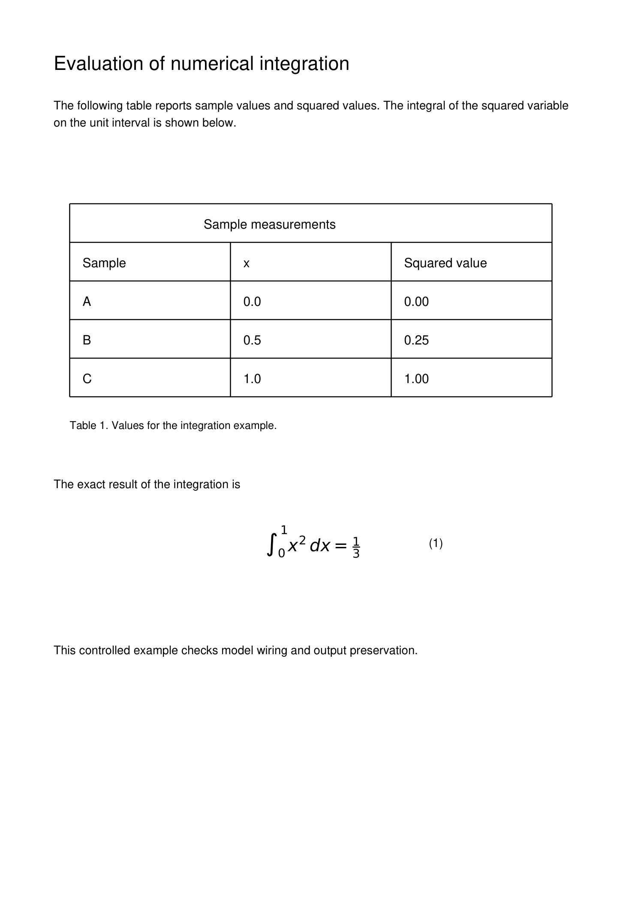

# Trang 2

> **Header**: Evaluation of numerical integration

The following table reports sample values and squared values. The integral of the squared variable on the unit interval is shown below.

**Table 1. Values for the integration example.**

| Sample measurements |      |               |
| :------------------ | ---: | ------------: |
| Sample              |    X | Squared value |
| A                   |  0.0 |          0.00 |
| B                   |  0.5 |          0.25 |
|                     |  1.0 |          1.00 |

Table 1 Values for the integration example

The exact result of the integration is

$$
\int _ { 0 } ^ { 1 } x ^ { 2 } \, d x = \frac { 1 } { 3 }
$$

(1)

This controlled example checks model wiring and output preservation

